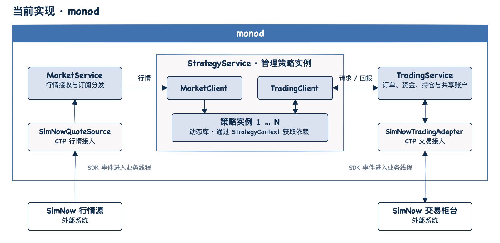
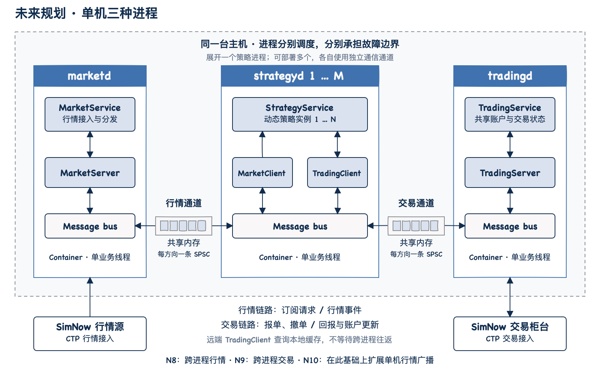

# YQuant

YQuant 是使用 C++ 编写的多策略、低延迟量化交易系统。首版以 SimNow 做市策略跑通交易闭环为目标，支持多个策略共用同一个交易账户。

当前已实现单进程 `monod`，按配置加载策略动态库，接收 SimNow 行情并完成交易及账户记账。

## 系统架构

### 当前：monod 单进程

行情、策略和交易服务运行在同一个 `monod` 进程中。



- 行情服务统一接收行情，按订阅分发给策略。
- 策略服务承载多个策略实例，根据行情和交易回报生成交易指令。一个进程可运行多个策略服务，共用行情和交易服务。
- 交易服务对接柜台，统一维护共享账户的订单、资金和持仓，并将回报交给对应策略。

所有业务逻辑在单个线程上执行，策略接口见[策略设计](docs/design/strategy.md)。

### 规划：单机三种进程

后续在同一台机器上部署行情进程 `marketd`、策略进程 `strategyd` 和交易进程 `tradingd`。其中 `strategyd` 可以运行多个进程实例，共用行情和交易服务；每个策略进程又可以承载多个策略实例。各进程以独立业务线程获得并行处理能力和进程隔离。



| 进程类型 | 职责 |
| --- | --- |
| `marketd` | 接入行情，按订阅向策略进程分发。 |
| `strategyd` | 可部署多个进程，各自加载策略实例，共用行情和交易服务。 |
| `tradingd` | 接入交易柜台，统一处理交易并维护共享账户状态。 |

跨进程调用经 client、message bus 和 server 适配。每个策略进程与行情、交易进程分别建立通信通道，每个方向使用独立的共享内存 SPSC 队列。远端交易 client 的同步查询读取本地缓存，缓存随收到的状态更新。

同机跨进程行情和交易由 N8、N9 实现；N10 在此基础上增加单机行情广播，减少向多个策略进程分发时的重复写入。跨机器部署继续通过 `relayd` 扩展。组件边界与通信设计见[系统架构](docs/design/architecture.md)，开发顺序见[首版计划](docs/plans/v1.md)。

## 首版目标

在 SimNow 环境中运行多个简单做市策略，允许策略共用同一个交易账户，验证从接收行情、生成报价、提交委托到处理成交和撤单的完整交易闭环。

做市策略用于验证系统功能，保持简单，不设盈利目标。策略根据行情生成双边报价，在报价变化时撤单并重新报价，处理委托和成交回报；具体报价规则在策略设计中细化。

### 功能范围

| 能力 | 首版范围 |
| --- | --- |
| 行情接入 | 接入 SimNow 行情，向策略提供所需行情。 |
| 多策略运行 | 支持多个策略实例同时运行，各策略独立生成交易指令，并允许共用同一个交易账户。 |
| 交易执行 | 支持报单、撤单和回报处理，维护订单及成交状态，将订单和成交回报准确分发给所属策略。 |
| 账户状态 | 启动时同步账户资金和持仓，运行中由交易事件更新本地数据，提供带可用性的查询；共享账户统一检查与预占资金。运行中对账及持久化恢复由独立里程碑 N13 交付。 |

首版支持同进程、同机跨进程和跨机器部署，提供跨机点对点通信与单机广播，不包含跨机广播。部署拓扑通过静态配置文件提供。

首版不包含回测、研究和运行管理。风险控制中的停止报价与集中撤回挂单，以及运行管理中的配置分发、日志和运行状态管理，均不纳入首版功能范围。

### 验收标准

- 多个做市策略实例能够同时接收行情并独立生成交易指令。
- 多个策略能够通过同一个 SimNow 交易账户完成报单和撤单。
- 订单和成交回报能够正确归属并分发给对应策略。
- 策略能够查询账户资金及持仓，数据与对应的柜台快照一致；能区分数据尚不可用与有效的零资金、空持仓，接收后续更新且不同账户的数据相互独立。
- 报单前统一检查并预占账户资金，资金不足时拒绝发送；发送失败、拒单、撤单和成交后本地资金及持仓变化正确，不重复扣减或释放。
- 通过 N13 验证订单、资金、持仓的运行中对账、差异处理和持久化保存，进程重启后恢复并经柜台核实继续交易。
- 在同进程、同机跨进程和跨机器部署下，做市策略能够根据行情变化更新报价，完成行情驱动的交易闭环。
- 单机广播能够向本机多个策略分发行情。

## 目标平台

| 用途 | 操作系统 | CPU 架构 |
| --- | --- | --- |
| 运行与验收环境 | Linux | x86_64 |
| 开发环境 | macOS | arm64、x86_64 |

Linux 执行正式构建、功能及并发验收；macOS 支持本机构建、功能测试和调试。现有验收的平台状态分别记录在开发计划中。

## 构建与运行

需要支持 C++20 的编译器、CMake 3.20 或更高版本，以及匹配平台的 CTP 行情和交易动态库。先按 [SDK 安装说明](docs/design/simnow-market.md#构建依赖)准备 `vendor/ctp/`，或通过 `-DYQUANT_CTP_SDK_ROOT=/path/to/sdk` 指定目录。

```sh
cmake -S . -B build -DBUILD_TESTING=ON
cmake --build build
ctest --test-dir build --output-on-failure
```

构建目录生成 `monod.conf`、`monod.multi.conf` 和策略配置。调整库路径、账户和合约映射，并准备[交易登录环境变量](docs/design/trading.md#交易前置登录)后运行：

```sh
./build/monod --config /absolute/path/monod.conf
```

测试使用 GoogleTest 和 CTest；固定行情、模拟柜台及接入探测位于独立测试程序中。生产构建、离线依赖、各类场景和真实接入命令见[构建与运行说明](docs/development.md)。

## 项目文档

- [系统架构](docs/design/architecture.md)
- [策略接口与动态加载](docs/design/strategy.md)
- [交易接口与账户记账](docs/design/trading.md)
- [SimNow 行情接入](docs/design/simnow-market.md)
- [首版执行计划](docs/plans/v1.md)
- [架构图制作与维护](docs/architecture-diagrams.md)
- [项目 TODO](TODO.md)
