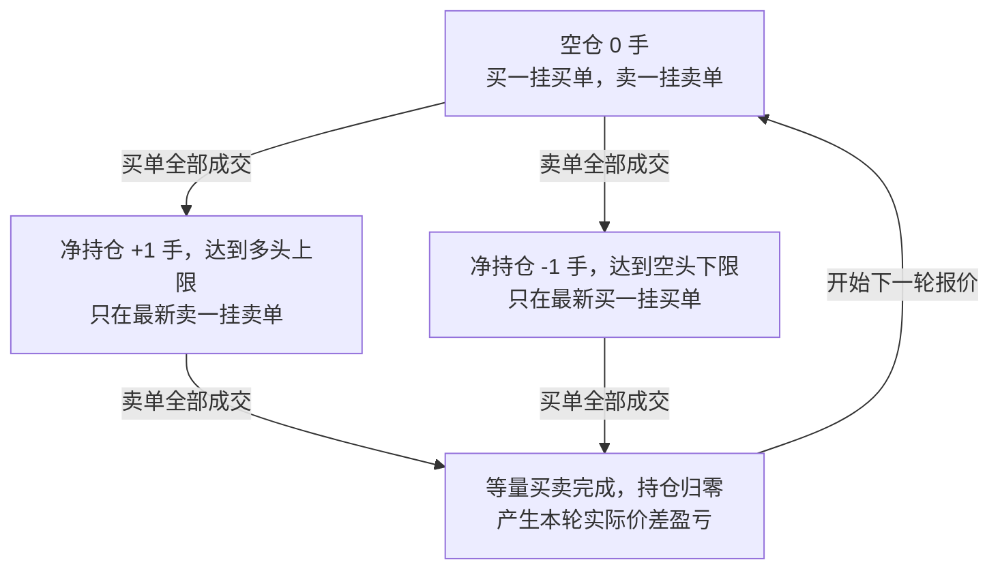
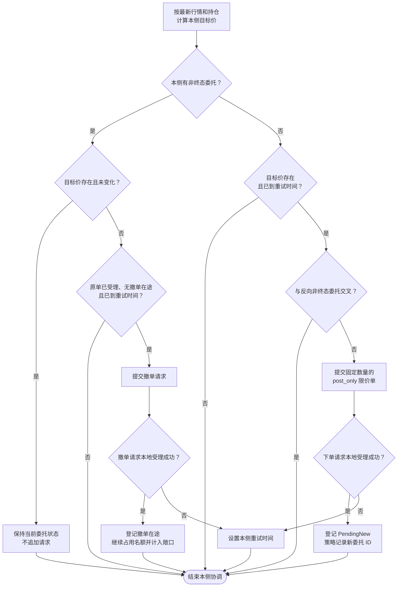
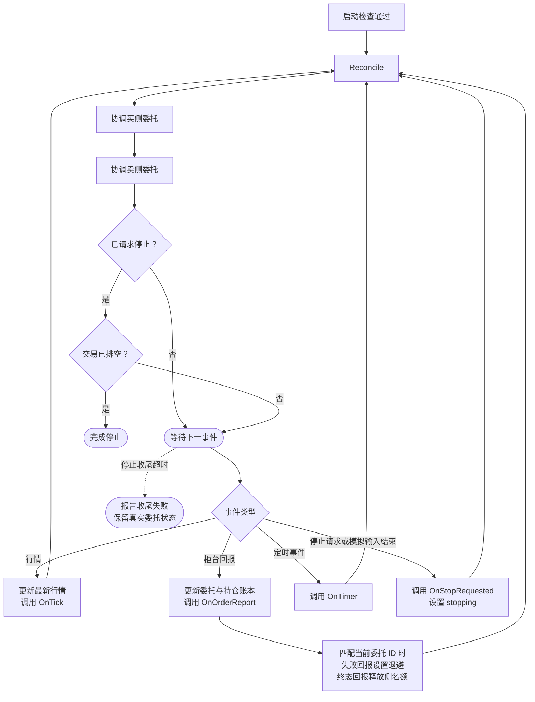

# 一档双边做市策略

一档双边做市策略用于驱动 `yquant-strategyd` 的策略接口与模拟交易闭环。策略在单个交易场所交易一个允许双向持仓的标的，持续在买一价挂买单、卖一价挂卖单。

## 盈利逻辑

策略的收益来源是买卖价差：在买一价承接主动卖单，在卖一价承接主动买单，争取通过较低价格买入、较高价格卖出获得收益。两侧交易之间需要持有多头或空头仓位，承担这段时间内的价格风险。[做市与持仓风险模型](https://arxiv.org/abs/1105.3115)

例如，某模拟标的按元每单位计价，每次买卖 1 单位，初始持仓为零。盘口为买一 `100.0 元`、卖一 `100.2 元` 时，策略同时挂出这两个价格；若买单先以 `100.0 元` 成交，随后卖单以 `100.2 元` 成交，持仓回到零，每单位毛收益为 `0.2 元`。这一轮等量买卖的每单位净收益为：

```text
每单位净收益 = 卖出成交价 - 买入成交价 - 每单位双边手续费
```

两侧成交发生在不同时间，卖出时的价格可能已经变化。例如，买单在 `100.0 元` 成交后，行情下跌，最新卖一变为 `99.7 元`；若策略撤掉旧卖单，跟随最新报价重新挂单并在 `99.7 元` 成交，每单位就亏损 `0.3 元`，还需支付双边手续费。

成交机会也可能偏向对策略不利的时刻：价格即将下跌时，主动卖单可能增多，使策略的买单更容易成交；价格即将上涨时，策略的卖单可能更容易成交。这种成交与后续不利价格变化相关的现象称为逆向选择。[Tradeworx 对做市与逆向选择的说明](https://www.sec.gov/comments/s7-02-10/s70210-129.pdf#page=10)

整体盈利依赖于多次交易捕获的价差足以覆盖手续费和不利价格变化造成的损失。持仓上限用于约束已成交持仓与未成交委托形成的潜在敞口；收益是否为正，需要结合实际成交条件检验。

## 交易规则

策略逐事件执行：每次行情、委托回报或定时事件到来后，让实际委托向当前目标报价靠拢。等待受理或撤单期间继续更新行情，补单时重新计算目标。

1. 配置一个标的、每张新单的固定数量和净持仓上下限。
2. 获得有效报价后，在买一价挂买单、卖一价挂卖单，每侧最多一张委托。待受理和待撤单委托也占用该侧名额。
3. 目标价格不变时保留原单；价格变化时先撤旧单，收到终态回报后按最新行情重新挂单。
4. 部分成交后保留原单剩余量，不自动补足到新单的固定数量。成交后重新检查持仓和两侧委托。
5. 计算潜在持仓时，计入待受理、已挂出和正在撤销的同侧委托剩余量。买卖两侧分别检查，剩余量不能相互抵消。
6. 行情无效或过期时撤销报价；停止时不再开新单，撤销剩余委托并处理完回报。

### 交易策略流程

以初始空仓、每张新单为 1 手、持仓范围为 `[-1, 1]` 为例，正常交易循环如下。买入后通过卖出回到空仓，卖出后通过买回回到空仓，实际收益取决于两次成交的价格和手续费。



图中的成交箭头表示整张委托成交；部分成交时保留剩余委托，并按持仓与剩余量检查风险。等待成交期间，报价跟随最新买一、卖一调整，保持当前允许的交易方向。停止时撤销剩余委托并处理在途回报，收尾时可以保留持仓。

## 数据与运行时接口

### 行情与委托数据

价格使用整数 tick，数量使用整数 lot，价格和数量的实际单位由标的信息定义。市场事件时间与本地接收时间保留各自的时钟语义，过期检查只使用与 `Now()` 相同的单调时钟。

```text
QuoteTick:
    instrument_id
    sequence                 # 同一行情流中的递增序号
    event_time_ns            # 市场事件时间
    receive_time_ns          # 本地单调时钟时间；模拟中使用虚拟时钟
    bid_price, bid_qty
    ask_price, ask_qty
    tradable                 # 是否允许交易

OrderSnapshot:
    order_id
    instrument_id
    side                     # Buy / Sell
    limit_price
    original_qty
    cumulative_filled_qty
    leaves_qty               # 仍可能成交的数量；终态为 0
    state                    # PendingNew / Working / Filled / Canceled / Rejected
    cancel_pending           # 撤单请求在途，原委托仍可能成交
    report_sequence          # 同一委托规范化回报的递增序号

OrderReport:
    order: OrderSnapshot     # 本次回报应用后的完整快照
    new_rejected             # 本次回报为柜台拒单
    cancel_rejected          # 本次回报为撤单拒绝，原委托可能仍有效
    reason

RiskSnapshot:
    position                 # 净持仓，买入为正，卖出为负
    buy_leaves               # 所有非终态买单的剩余量
    sell_leaves              # 所有非终态卖单的剩余量
```

部分成交的委托仍处于 `Working` 状态，通过累计成交量和剩余量表达进度。撤单请求是否在途由 `cancel_pending` 单独表达；撤单请求发出后，原委托仍可能部分成交或全部成交。

`Filled`、`Canceled` 和 `Rejected` 为委托终态。`Rejected` 表示柜台拒绝新委托；撤单失败通过 `cancel_rejected` 表达，不将原委托改为终态。

### 上下文接口

运行时维护行情、委托和持仓账本。首版由一个策略独占该标的的交易与持仓状态，风险快照覆盖该策略的全部委托。

```text
Context:
    Now() -> 单调时间
    GetLatestQuote(instrument_id) -> QuoteTick 或空
    GetOrder(order_id) -> OrderSnapshot
    GetRisk(instrument_id) -> RiskSnapshot
    NextOrderId() -> 唯一且不复用的委托 ID

    TrySubmit(order_id, instrument_id, side, price, qty, post_only)
        -> 本地受理结果

    TryCancel(order_id)
        -> 本地受理结果

    TradingDrained() -> 无活动委托、未决交易请求及待处理委托回报
    CompleteStop()
```

`GetLatestQuote()`、`GetOrder()` 和 `GetRisk()` 返回固定大小的快照值，不向策略暴露运行时缓冲区的长期借用。运行时保留策略正在引用的委托记录，使 `GetOrder()` 在该引用有效期间可用。

`post_only` 表示只允许被动挂单：委托到达柜台时如果会立即吃单，柜台拒绝该单，策略经过退避后重新读取行情再尝试。

### 事件与账本约束

- 所有策略回调串行执行；运行时先更新行情和账本，再调用策略。同一行情流中的旧数据不覆盖最新快照。
- 下单成功后立即登记 `PendingNew`，将请求数量计入潜在敞口；撤单成功后立即登记 `cancel_pending`，继续保留原委托剩余量。
- 下单和撤单接口只返回本地受理结果，不在当前调用栈中触发策略回调。本地受理失败没有副作用。
- 柜台回报是规范化后的完整委托快照，包含该委托的累计成交量。运行时检查回报序号、去重并更新账本，终态不会被迟到回报恢复成活动状态。
- 运行时在推进委托和持仓状态前保证相应回报可完整保存，不能先修改状态再因容量不足丢失回报。

持仓按累计成交量的增量更新，避免部分成交与撤单回报重复计数：

```text
filled_delta = 新累计成交量 - 旧累计成交量
position += 买卖方向符号 × filled_delta    # Buy 为 +1，Sell 为 -1
```

运行时校验累计成交量单调不减且不超过原始数量，再更新账本。终态回报包含该委托的最终累计成交量。

## 策略状态与回调

策略只保存两个固定委托槽及重试时间，委托和持仓明细由运行时维护。

```text
Config:
    instrument_id
    quote_qty                # 每张新单的固定数量，必须为正
    min_position             # 例如 -1
    max_position             # 例如 +1
    quote_timeout_ns         # 行情超过此时间未更新，撤销报价；必须为正
    retry_delay_ns           # 请求失败后的重试间隔；必须为正

StrategyState:
    stopping = false
    order_id[Buy, Sell] = 空
    retry_not_before[Buy, Sell] = 0
```

回调负责触发决策，具体行为集中在 `Reconcile()`。

```text
OnStart():
    if config.quote_qty <= 0 or config.min_position > config.max_position:
        return 参数错误

    if config.quote_timeout_ns <= 0 or config.retry_delay_ns <= 0:
        return 参数错误

    # 从无活动委托和未决交易请求的账户状态启动。
    if not Context.TradingDrained():
        return 状态错误

    if 初始持仓不在 [min_position, max_position] 内:
        return 状态错误

    Reconcile()
    return 成功


OnTick(tick):
    if tick.instrument_id == config.instrument_id:
        Reconcile()


OnOrderReport(report):
    side = report.order.side

    # 旧单的迟到回报不能改变新单的策略状态。
    if order_id[side] == report.order.order_id:
        if report.new_rejected or report.cancel_rejected:
            retry_not_before[side] = Now() + config.retry_delay_ns

        if report.order.state in {Filled, Canceled, Rejected}:
            order_id[side] = 空

    # 持仓已经由运行时更新。
    # 成交、撤单完成后，都可能需要立即重新报价。
    Reconcile()


OnTimer():
    # 驱动失败重试，也能发现没有新 Tick 的行情中断。
    Reconcile()


OnStopRequested():
    stopping = true
    Reconcile()


Reconcile():
    ReconcileSide(Buy)
    ReconcileSide(Sell)

    if stopping and Context.TradingDrained():
        Context.CompleteStop()
```

行情回调、委托回报回调和定时回调遵守同一个重试时间，失败回调不会立即循环提交请求。正常成交或撤单完成后，可以立即执行一次协调。

## 目标报价与委托协调

### 目标报价

计算目标报价时，把所有在途委托算进潜在持仓。已有委托的剩余量已经包含在风险快照中；只有准备提交新单时，才额外加入固定新单数量。

```text
DesiredPrice(side, current_order):
    if stopping:
        return 空

    quote = Context.GetLatestQuote(config.instrument_id)

    if quote 为空 or not quote.tradable:
        return 空

    if quote.bid_price >= quote.ask_price:
        return 空

    if quote.bid_qty <= 0 or quote.ask_qty <= 0:
        return 空

    if Now() - quote.receive_time_ns >= config.quote_timeout_ns:
        return 空

    risk = Context.GetRisk(config.instrument_id)

    # 已有委托的剩余量已经包含在 risk 中。
    # 部分成交后保留剩余量，不自动补足到 quote_qty。
    additional_qty = 0 if current_order 存在 else config.quote_qty

    if side == Buy:
        if risk.position + risk.buy_leaves + additional_qty
                > config.max_position:
            return 空
        return quote.bid_price

    if side == Sell:
        if risk.position - risk.sell_leaves - additional_qty
                < config.min_position:
            return 空
        return quote.ask_price
```

### 单侧委托协调

每侧最多保留一张委托，待受理和待撤单也占用这个名额。等待旧单终结期间只维护最新行情，不缓存撤单时的补单价格；旧单终结后重新调用 `DesiredPrice()`。



```text
ReconcileSide(side):
    current = 空
    if order_id[side] 存在:
        current = Context.GetOrder(order_id[side])

    target_price = DesiredPrice(side, current)

    if current 存在:
        need_cancel = (
            target_price 为空
            or current.limit_price != target_price
        )

        if not need_cancel:
            return                          # 保留原单和排队位置

        if current.state == PendingNew:
            return                          # 等待受理结果后再撤

        if current.cancel_pending:
            return                          # 等待撤单结果，仍计入敞口

        if Now() < retry_not_before[side]:
            return

        result = Context.TryCancel(current.order_id)
        if result 失败:
            retry_not_before[side] = Now() + config.retry_delay_ns

        return                              # 旧单终结之前不补单

    if target_price 为空:
        return

    if Now() < retry_not_before[side]:
        return

    # 反向旧单可能还在等待受理或撤销，不能与它交叉。
    opposite = 空
    opposite_side = Sell if side == Buy else Buy
    if order_id[opposite_side] 存在:
        candidate = Context.GetOrder(order_id[opposite_side])
        if candidate.state not in {Filled, Canceled, Rejected}:
            opposite = candidate

    if opposite 存在:
        if side == Buy and target_price >= opposite.limit_price:
            return
        if side == Sell and target_price <= opposite.limit_price:
            return

    new_id = Context.NextOrderId()

    result = Context.TrySubmit(
        order_id      = new_id,
        instrument_id = config.instrument_id,
        side          = side,
        price         = target_price,
        qty           = config.quote_qty,
        post_only     = true
    )

    if result 成功:
        order_id[side] = new_id
    else:
        retry_not_before[side] = Now() + config.retry_delay_ns
```

反向委托交叉检查覆盖待受理、已挂出和待撤单状态。例如，旧卖单仍在等待撤销时，新买单不能以高于或等于旧卖单的价格提交。

本次协调结束后，由后续事件再次触发检查。若目标价格恢复为旧单价格，已经发出的撤单仍继续执行。

## 主循环与停止收尾

主循环持续处理行情、柜台回报和定时事件。行情先写入最新报价存储，再触发 `OnTick()`；委托回报先更新委托和持仓账本，再触发 `OnOrderReport()`。定时事件调用 `OnTimer()`，驱动失败重试和行情过期检查。

### 事件驱动流程

启动检查通过后先执行一次委托协调，随后按事件推进。买侧和卖侧依次处理，停止请求通过清空两侧目标报价驱动撤单。



交易排空包含无活动委托、无未决交易请求和无待处理委托回报。停止期间继续处理行情、成交及撤单回报，停止完成后退出事件循环。

### 停止收尾

模拟输入结束时触发 `OnStopRequested()`，继续推进撤单与回报，直到 `TradingDrained()`。停止超时报告收尾失败，并保留未完成委托的真实状态。

委托进入终态后，策略可以释放该侧名额。运行时仍需保留委托记录，直到相关在途请求和回报全部处理完，才能复用存储；迟到的旧单回报通过委托 ID 与新单隔离。

运行时按配置上限预分配委托记录、请求和回报存储。命令按值保存，回调参数只在当前回调期间有效；策略保存所需的 ID 或快照值，不持有指向可复用事件缓冲区的引用。
