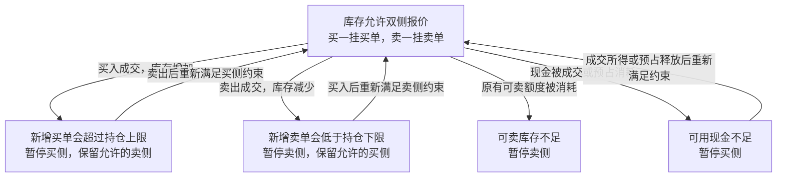

# 有底仓的一档双边报价策略

策略使用初始现金和可卖底仓，在有效买一价挂买单、卖一价挂卖单，通过总持仓上下限约束两侧未成交委托的潜在敞口。

## 交易与收益模型

策略交易单个标的，使用现有人民币现金账户和持仓账本。初始持仓来自模拟柜台，初始总持仓须在策略配置的上下限内。买入成交只增加总持仓，本轮买入股份不可卖；卖出消耗已有可卖库存。

一对等量买卖的毛现金差额来自成交价差。例如买入 100 股的成交价为 10.00 元，卖出 100 股的成交价为 10.01 元，两单的毛现金差额为 1 元。两次成交之间存在价格风险，成交机会也可能偏向对策略不利的时刻。[做市与持仓风险模型](https://arxiv.org/abs/1105.3115)

等量买卖后，总持仓可以回到起点，但卖出消耗的可卖额度不会由本轮买入恢复。可卖库存耗尽时停止卖侧报价；资金或总持仓上限也可能使买侧暂停。账户结算、计量和预占规则见[持仓与资金账本](trading.md#持仓与资金账本)。

当前使用普通限价单，委托到达柜台时可能主动成交。此版本不提供 `post_only`、完整撮合、手续费与收益核算。模拟回报用于检验策略和账本行为，成交条件与盈利验证需要后续的成交模型。

## 配置与初始化

示例动态库为 `bbo_market_making_strategy`，配置使用派生的强类型配置对象：

```json
{
  "strategy_id": "bbo-market-making-example",
  "parameters": {
    "venue": "SSE",
    "symbol": "600000",
    "quote_qty": 100,
    "min_position": 800,
    "max_position": 1200,
    "quote_timeout_ms": 500,
    "retry_delay_ms": 10
  }
}
```

所有参数必填，未知字段拒绝。场所和代码遵循[行情标识约定](market-data.md#公共类型与标识)。数量单位为股，价格沿用标的的整数精度。

| 字段 | 约束与用途 |
| --- | --- |
| `quote_qty` | 正 `int64_t`，每张新委托的固定数量 |
| `min_position`、`max_position` | 非负 `int64_t`，最小值不大于最大值，区间宽度至少容纳一张新委托 |
| `quote_timeout_ms` | `1..60000` 的整数，最后报价的有效期 |
| `retry_delay_ms` | `1..60000` 的整数，下单或撤单失败后的退避时间 |

`OnStart()` 解析标的、登记订阅并查询初始账户。账户必须已经建立，总持仓位于配置区间内。初始化只准备状态，第一条有效行情才开始报价。

## 报价规则

1. 每侧最多一张非终态委托，待受理与撤单在途也占用该侧名额。
2. 报价须具备有效买卖侧、可交易标志、正价量、`bid_price < ask_price`，且本地接收时间未过期。
3. 买单目标为最新买一价，卖单目标为最新卖一价。价格未变化时保留原单和排队位置。
4. 价格变化或目标失效时，撤销旧单；等待旧单终结后，使用最新行情重新计算，不能缓存撤单时的补单价。
5. 部分成交后保留剩余量，不自动补足到 `quote_qty`。
6. 新单与反向非终态委托不得交叉，检查包含待受理及待撤单委托。
7. 柜台拒单、拒撤或本地资源不足进入本侧退避，行情更新不能提前触发同一侧重试。

普通限价请求、委托状态及撤单竞争的语义见[交易接口](trading.md#策略接口)。

### 库存与资金约束

策略保存买卖各一个 `ClientOrderId`，通过现有查询取得快照。潜在敞口分别计算，不用买卖剩余量互相抵消：

```text
买侧最坏持仓 = total_qty + buy_leaves + 新增买单数量
卖侧最坏持仓 = total_qty - sell_leaves - 新增卖单数量

买侧最坏持仓 <= max_position
卖侧最坏持仓 >= min_position
```

所有非终态委托的剩余量均计入，包括 `PendingNew` 和撤单在途。检查已有委托时，新增数量为零；准备新单时，新增数量为 `quote_qty`。实现先检查边界再计算，避免整数溢出。

新买单还要求可用现金足够，新卖单要求可卖数量足够；资源不足时不缩小委托数量。已有委托的预占由宿主管理，不因其预占后账户可用量减少而错误撤单。



各侧约束同时检查。总持仓回到允许区间后，仍须满足该侧的可用资源要求。

## 状态与事件协调

策略状态固定为两个委托槽、两个重试期限及统计计数，不维护第二份持仓或资金账本。

```text
OnTick / OnOrderUpdate / OnTimer:
    读取最新行情、持仓、现金及两侧委托
    处理匹配委托的终态与失败退避
    若宿主已关闭交易入口，结束
    协调买侧
    协调卖侧
    安排最早一次必要的定时唤醒

协调一侧:
    计算此侧当前允许的目标价格
    若已有非终态委托:
        价格仍合适则保留
        否则，等待受理/在途撤单/退避结束后提交撤单
        结束；旧单终结之前不补单
    若没有目标，或尚未结束退避，结束
    若与反向非终态委托交叉，结束
    提交固定数量新单；成功后保存宿主返回的 ID
```

宿主在回调前已提交成交、持仓与现金变化。`OnOrderUpdate()` 触发协调，`OnFill()` 只记录成交统计，不再按累计成交量更新持仓或重复触发同一笔协调。迟到的旧单回报不能清除新单的委托槽，也不能修改新单的退避状态。

### 定时唤醒与退避

使用[策略一次性定时器](strategy-timer.md)，每次协调后选择最早的未来期限：

```text
min(当前报价过期期限, 买侧重试期限, 卖侧重试期限)
```

报价过期时撤销两侧挂单；即使没有后续行情或交易事件，也由定时事件触发。已经过期的报价不反复设置立即触发的期限。委托仍在等待受理或撤单结果时，依靠后续交易回报继续协调；拒撤后重新安排退避。

时间换算及期限加法均检查溢出。本地参数或状态错误按业务回调错误收尾；可用资源不足和柜台拒单、拒撤按业务结果处理。连续行情不会绕过失败退避。

### 停止

宿主停止新请求、清除策略定时器，自动撤销尚未终结的委托并处理在途回报。停止中的策略回调可以更新自身委托槽和统计，但不提交请求。排空后 `OnStop()` 查询最终账户并输出汇总，不另行实现停止事件循环。

## 运行与验收

```sh
./build/debug/bin/yquant-strategyd \
  --strategy ./build/debug/strategies/bbo_market_making_strategy.so \
  --config ./build/debug/strategies/bbo_market_making_strategy.json \
  --market-data-config ./build/debug/strategies/mock_market_data.json \
  --trading-config ./build/debug/strategies/bbo_mock_trading.json
```

柜台样例初始现金为 30,000 元，总持仓 1,000 股、可卖 800 股，默认 `working` 模式。进程通过停止信号收尾。启动、首次提交和停止时输出低频标记及摘要，不逐条行情打印。

当前委托和成交记录保留到进程退出，容量规则见[交易容量](trading.md#容量与实现位置)。本版本验证有限轮次报价，记录回收及跨会话库存恢复另行设计。

场景集成测试通过真实策略动态库和 `StrategyRunner::Run()` 驱动，覆盖：

- 双侧初始挂单、重复报价保留原单、价格连续变化后按最新报价补单。
- 待受理、部分成交和撤单竞争；反向旧单尚未终结时不提交交叉委托。
- 持仓上下限、现金不足、可卖库存不足及本轮买入不可卖。
- 没有新行情时按期撤单；拒单、拒撤和本地失败按退避重试。
- 停止时清除定时器、撤销挂单并正确结算预占。
- 真实进程加载、启动握手、信号退出及最终账户汇总。
