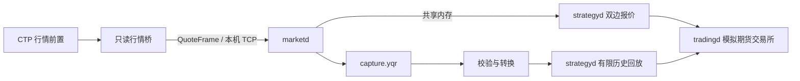

# CTP 行情接入与同源回放

期货双边报价策略使用 CTP 的买卖一价量，交易继续由
`SimulatedFuturesExchange` 模拟。行情桥只创建行情 API，不创建交易 API。
数据渠道及权限见[国内期货数据渠道](../research/domestic-futures-data-sources.md)。
将策略报撤单交给外部模拟柜台的入口见 [SimNow 模拟柜台接入](simnow-trading.md)。

## 数据流



SDK 隔离在 Python 采集进程中，C++ 策略和行情分发程序沿用现有接口。
桥只订阅显式配置的单个期货合约，不选择主力或拼接连续合约；标的身份、价格精度、
最小价位和手数来自共享标的字典。期货账本、报价规则和成交模型见
[国内期货模拟交易](domestic-futures.md)。

## 行情与失效语义

- CTP 的 `BidPrice1/BidVolume1`、`AskPrice1/AskVolume1` 映射为买卖一价量，
  数量单位为手；价格按字典精度转换为整数并检查最小价位。
- 无效价格或零数量表示缺侧，缺侧的价量归零。锁盘、交叉或缺侧报价仍可录制，
  但不允许策略据此报价。
- 事件时间由可靠的 `ActionDay`、`UpdateTime` 和 `UpdateMillisec` 以北京时间
  转换为 UTC 纳秒；不使用交易日猜测夜盘的自然日期。无法确定时清除事件时间有效位。
- 行情 API 的深度回调不提供完整交易状态。可报价标记结合双侧盘口和时间新鲜度生成，
  不代表交易所已经受理下单；登录时返回的旧快照不能作为新鲜实时行情。
- 桥仅监听本机，单个 `marketd` 消费有界队列中的固定长度帧。
  登录失败、订阅失败、断线、数据丢失或背压超限终止会话；新会话重新启动整个运行目录。
- 每个会话限一个交易日；首快照锁定合法的 `TradingDay`，缺失、非法或发生变化时终止，
  避免在不支持逐日结算的模拟账本上跨日继续交易。夜盘自然日期仍以 `ActionDay` 处理。
- 策略先撤单排空，编排随后发出显式停止请求，行情分发关闭输入并封存录制，
  桥识别预期断连后释放 SDK。全部进程正常退出且录制通过校验后，运行清单才标记成功。

## 接入准备

CTP 行情前置可以要求账户，也可以接受空登录请求。
默认模式使用期货公司或 [SimNow 账户](https://www.simnow.com.cn/)；
前置允许空登录时，显式使用 `--anonymous`，桥发送空登录字段并忽略本机账户凭据。
空登录用法见[维护者行情示例](https://github.com/openctp/openctp/blob/master/ctpapi-python/demo/md_demo.py)。
前置拒绝登录时会结束会话，不自动切换鉴权方式。

SimNow 的前置地址和服务时段以其
[环境说明](https://www.simnow.com.cn/product.action)及维护者的
[当前配置](https://github.com/Jedore/ctp.examples/blob/main/openctp-ctp/config.py)核对；
选择与生产交易时段一致的环境验证真实市场行情，API 测试环境单独使用。

构建 C++ 程序后，为采集桥创建 Python 环境：

```sh
cmake --preset debug
cmake --build --preset debug
python3 -m venv /tmp/yquant-ctp-env
/tmp/yquant-ctp-env/bin/python -m pip install -r scripts/requirements-ctp.txt
```

账户模式通过环境变量读取 `YQUANT_CTP_BROKER_ID`、`YQUANT_CTP_USER_ID` 和
`YQUANT_CTP_PASSWORD`。在本机设置，不写入配置、运行清单或版本库。
`front` 使用账户提供方公布的行情前置，不能填写交易前置。

| 字典 | 合约 | 价格计量 | 模拟参数 |
| --- | --- | --- | --- |
| `examples/ctp/instruments.json` | `DCE/a2701` | 10 吨/手，最小价位 1 元/吨，价格精度 0、乘数 10 | 保证金率 10%，开平各 2 元/手 |
| `examples/ctp/treasury_instruments.json` | `CFFEX/TF2612` | 百元净价报价，面值 100 万元，最小价位 0.005 元；价格精度 3、整数步长 5、乘数 10000，每跳 50 元/手 | 保证金率 2%，开平各 2 元/手 |

合约单位与最小价位依据
[大商所合约规格](https://www.htfc.com/wz_upload/png_upload/20240207/17072856162152a5658.pdf)和
[中金所国债期货合约条款](https://www.e-cffex.com.cn/u/cms/www/202007/231658479i3m.pdf)。
保证金率与手续费是本地模拟参数。
运行前应将字典和命令中的合约代码改为行情源当前提供的实际合约；脚本不会自动换月。

## 实时运行与采集

以下示例使用 SimNow 第一套公开行情前置，以空登录方式订阅国债期货。
实时运行保留双边策略，并在独立网关中模拟交易：

```sh
/tmp/yquant-ctp-env/bin/python scripts/run_ctp_strategy.py live \
  --anonymous --front tcp://182.254.243.31:30011 \
  --catalog examples/ctp/treasury_instruments.json --venue CFFEX --symbol TF2612 \
  --duration-seconds 60 --run-dir /tmp/yquant-ctp-live
```

只采集行情时，将 `live` 改为 `record`，并使用新的运行目录。
每个运行目录独占创建，保存标的字典、运行配置、分开的标准输出和诊断日志、
`manifest.json` 及 `capture.yqr`。清单记录 `anonymous` 或 `credentials` 登录模式。
账户模式省略 `--anonymous` 并设置对应环境变量；`--build-dir` 可指定其他 CMake 构建目录。
启动必须收到新鲜的有效双侧行情；登录成功但没有有效行情时按超时失败。
`live` 还须实际驱动策略提交双边报价，才开始计算运行时长。

`--duration-seconds 600` 连续采集 10 分钟，`3600` 采集 1 小时；
实际帧数取决于前置推送频率及行情更新。扩大历史样本时可使用 `record` 模式，
结束后校验封存文件并查看清单中的 `recorded_events` 和
`recording_metadata.tradable_rows`。

## 历史回放

成功采集后，不再需要账户或 SDK：

```sh
python3 scripts/run_ctp_strategy.py replay \
  --capture-dir /tmp/yquant-ctp-live \
  --run-dir /tmp/yquant-ctp-replay --speed 1
```

脚本验证录制封存标志、每帧校验和、来源、标的、序号连续性和合约价量约束，
将录制转成有限 CSV 后运行原策略。保留采集间隔、事件时间、买卖一价量和标志；
回放源按原顺序重新分配序号。清单保存录制和 CSV 的 SHA256。
最后一帧后由宿主进入撤单排空并正常退出。

一次回放最多 100000 帧且 CSV 不超过 16 MiB；超过时缩短采集区间。
默认速度为 1，策略超时和模拟交易延迟按真实时间运行。
`--speed 2..1000` 适合快速检查功能，行情加速不会同步缩放策略定时器与柜台延迟。

## 验收

离线测试检查 CTP 字段转换、回调失败、缓冲上界、录制损坏和回放数据保持。
进程测试用受控行情驱动实际 C++ 分发、录制及策略进程，检验接口衔接与正常收尾。
构建完成后运行：

```sh
ctest --test-dir build/debug -R '^Futures.CtpScripts$' --output-on-failure
```

真实接入验收在前置服务时段使用其允许的登录方式，确认登录、订阅、新鲜双侧报价和成功封存，
再使用本次录制完成一次原速策略回放。

CTP 快照满足样例的报价输入需求；当前撮合模型不包含真实排队位置，
其成交及损益用于检验模拟交易行为。
