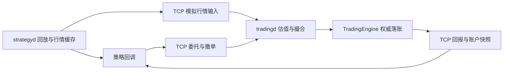

# 国内期货模拟交易

`yquant-strategyd` 使用期货合约规格、开平仓委托和保证金账本运行双边报价策略；历史报价由回放源发布，成交由 `tradingd` 中的模拟交易所生成。

## 组件与执行顺序

`strategyd` 串行驱动行情与策略回调；`tradingd` 串行驱动撮合和权威账本。两进程通过 TCP 交换请求、账户快照和回报。策略使用现有 `market_data()`、`trading()` 和 `timer()` 服务；策略动态库和宿主共同使用最新插件 ABI。



报价先更新策略的最新行情，再作为模拟输入排入发往网关的队列。网关按接收顺序更新盘口与估值、处理委托；撮合只计划回报，持仓在交易引擎提交回报后改变。策略查询到的账户是最近收到的网关快照，本地 PendingNew 尚无已确认预占。委托和成交回调的顺序、去重、失败及停止规则沿用[交易执行设计](trading.md)。

## 合约与计量

标的定义和稳定身份见[行情类型](market-data.md#公共类型与标识)。`InstrumentType::kFutures` 的规格在[共享标的字典](market-data.md#共享标的字典)中显式提供，宿主行情配置仅引用场所和代码：

| 字段 | 语义 |
| --- | --- |
| `price_decimals` | 整数价格的精度，价格单位为 `10^-price_decimals` 元 |
| `price_tick` | 最小价格步长，以编码后的整数价格计量 |
| `quantity_step` | 最小数量步长，单位为手 |
| `contract_multiplier` | 每手合约乘数 |
| `margin_rate_ppm` | 模拟保证金率，百万分比，范围 `1..1000000` |
| `open_fee_per_lot` | 每手开仓手续费，微元 |
| `close_today_fee_per_lot` | 每手平今手续费，微元 |
| `close_yesterday_fee_per_lot` | 每手平昨手续费，微元 |

数量均为整数手；价格与数量必须是各自步长的整数倍。金额统一使用 `int64_t` 微元，`1 元 = 1000000 微元`，计算溢出返回显式错误并保持原状态。

```text
合约名义金额 = 整数价格 × 手数 × contract_multiplier
               × 10^(6 - price_decimals)
保证金 = ceil(合约名义金额 × margin_rate_ppm / 1000000)
```

默认样例为大商所黄大豆 1 号历史合约 `DCE/a1805`，价格精度为 0、乘数为 10、价格步长为 1：`3662` 表示 3662 元/吨，一手价格变动 1 对应 10 元。合约单位与价位依据大商所[黄大豆合约资料](https://www.htqhedu.com/upload/1491810037404.pdf)。样例保证金率设为 10%，开仓、平今、平昨手续费各设为 2 元/手，均是模拟参数。

## 委托与持仓

### 开平仓意图

`OrderRequest`、`OrderSnapshot` 和 `Fill` 共同携带 `PositionEffect`。股票请求使用 `kNone`，期货请求必须明确以下一种意图：

| 方向与意图 | 作用 |
| --- | --- |
| `Buy + kOpen` | 新增今多仓 |
| `Sell + kOpen` | 新增今空仓 |
| `Sell + kCloseToday` / `kCloseYesterday` | 平今多仓 / 昨多仓 |
| `Buy + kCloseToday` / `kCloseYesterday` | 平今空仓 / 昨空仓 |

买卖方向不隐式推断开平仓，平仓也不自动跨今昨桶补足。成交的意图必须与原委托一致。现阶段提供普通限价单，不提供原生 `post_only` 指令。

### 四个持仓桶

`FuturesPositionSnapshot` 按 `long_today`、`long_yesterday`、`short_today`、`short_yesterday` 分开记录。每个桶包含总手数 `quantity`、未决平仓单冻结手数 `frozen_qty` 和剩余开仓成本 `open_notional`。`net_qty()` 返回总多仓减总空仓。

净仓为零仍可能同时持有多仓和空仓。因此风险约束分别使用净持仓和总持仓；总持仓为四桶数量之和，不以多空抵消。

内部按开仓成交保留固定容量 FIFO 成本记录。平仓只消耗指定方向和交易日桶的最早开仓记录；分批平仓保留剩余成本，不使用浮点平均价。

### 策略查询

```cpp
bool TryGetFuturesAccount(model::FuturesAccountSnapshot& out) const noexcept;
bool TryGetFuturesPosition(
    model::InstrumentId id, model::FuturesPositionSnapshot& out) const noexcept;
```

查询复制自包含快照，失败保持输出不变。股票账户使用原有 `TryGetCash`、`TryGetPosition`；期货账户使用以上接口。已知且未持仓的期货标的可查询到零持仓。

## 保证金与损益

`FuturesAccountSnapshot` 的金额均为微元：

```text
balance = 初始余额 + realized_pnl - commission
equity = balance + unrealized_pnl
available = equity - margin - reserved
```

- 开仓按委托限价预占保证金与剩余手续费，成交后转为持仓保证金并实际扣费，不扣整笔合约本金。
- 平仓冻结指定桶的手数并预占手续费，成交时按 FIFO 计算已实现损益、扣费并释放对应仓位与保证金。
- 拒单、确定撤单或未发送委托的本地取消释放剩余预占；发送结果不明或排空超时继续保留未确认预占。
- 多仓按买一、空仓按卖一计算浮动盈亏，总持仓按买卖一较高价计算保证金，不做多空保证金抵扣。缺少双侧正价时保留上次估值。
- 价格不利变动可以使权益和可用资金为负。此时拒绝资金不足的新开仓，允许库存足够的平仓，已确认成交继续落账。

例如，乘数 10、保证金率 10%、开平各 2 元/手时，以 3662 买开一手预占 3664 元；以 3663 卖平后已实现损益为 10 元，累计手续费 4 元，余额增加 6 元。

这套账本在单个交易日内使用固定保证金率和按手收费。逐日盯市结算、交易日切换、按成交额收费、涨跌停、交易时段限制、强平、交割、真实柜台对账和重启恢复留待相应接入阶段设计。

## 模拟交易所

网关柜台配置选择 `adapter: "simulated_futures"`，由 `SimulatedFuturesExchange` 实现 `TradingAdapter`。它保留独立的外部盘口，策略自己的挂单不写回该盘口。

新单在一个 `report_interval_ms` 后收到受理；若报单时买单限价不低于卖一、卖单限价不高于买一，则按对侧报价安排主动成交。其余订单留在簿内，后续报价跨过限价时按原挂单限价成交。

同一报价的买一、卖一数量各形成一份可成交量，同侧多个订单按报单顺序共享，部分成交保留余量。新报价替换上一帧的外部流动性；该模型不推测排队位置、隐藏流动性或历史盘口中自有订单的影响。

撤单在发送后的一个回报间隔生效。生效前仍可成交，全部成交后返回带原撤单请求 ID 的撤单拒绝；到达撤单生效时点的报价不再撮合该单。同一到期时间按事件登记顺序处理，受理先于该单成交。规范化序号逐单连续，成交标识在本次会话内唯一。

存储在准备阶段分配，订单上限 1024、成交上限 8192。运行期间不扩容；容量耗尽返回显式错误，宿主遇到适配器错误时进入既有错误收尾流程。

## 行情回放

`ReplayMarketDataSource` 在启动时读取一个标的的 CSV，严格校验并将报价载入连续存储；`Poll` 不读文件、不分配内存。文件最多 16 MiB、100000 帧，格式为：

```csv
elapsed_ns,event_time_ns,bid_price,bid_qty,ask_price,ask_qty,flags
0,0,3662,70,3664,53,7
749000000,0,3662,71,3664,53,7
```

`elapsed_ns` 是相对回放起点的时间，必须非递减，相同时按文件顺序发布。事件时间及标志沿用 `QuoteTick` 契约。来源、标的、序号由回放源填写，接收时间取当前主线程单调时钟。

行情配置使用 `adapter: "replay"`、`replay_path`、`replay_speed` 和 `replay_tail_ms`，不包含 mock 报价种子。`replay_path` 相对进程工作目录解析；速度为 `1..1000` 的整数，默认 1；尾部等待为 `0..60000` 毫秒，默认 1000，不随速度缩放。最后一帧发出后等待尾部期限，宿主随后自动进入撤单排空并退出。未订阅行情的策略不接收帧，仍在相同的结束期限退出。

默认样本包含 2017-12-27 09:38:06.422000 至 10:09:25.324000 的 744 条 `a1805` 报价，保留原始买卖一价量，用采集时间差控制回放，不进行插值。原始文件名为 `a1803_few.csv`，内容的合约字段全部为 `a1805`。样本中的交易所时间字段不用于生成事件时间，回放 `event_time_ns=0` 且不设置事件时间有效标志。

来源固定为 [net1qian-flink-ctp-demo 的历史 CSV](https://github.com/qingtiandalaoye/net1qian-flink-ctp-demo/blob/13b3bc3f907e4962a4d3ea0e9f95b9015e23c176/src/main/resources/a1803_few.csv)。仓库保留原始文件、上游 MIT 许可、规范化 CSV 和包含提交号、字段映射及 SHA256 的清单，位于 `examples/data/`。

```sh
# 从仓库中的原始样本重新转换；可离线执行。
python3 scripts/prepare_futures_sample.py
# 校验原始样本、转换文件及清单。
python3 scripts/prepare_futures_sample.py --check
# 从固定上游提交重新下载并转换。
python3 scripts/prepare_futures_sample.py --download
```

## 期货双边报价策略

`futures_bbo_strategy` 从零持仓启动，每侧报价一手，净仓限制为 `[-1, 1]`、总仓限制为 2。买侧优先平空、卖侧优先平多，先平今再平昨，没有反向仓时才开仓。持仓变化后重新选择开平意图，即使价格相同也可能撤换委托。

净仓检查独立计算所有买单或所有卖单成交后的最坏结果。总仓检查使用当前总仓加全部未成交开仓单的余量，不提前抵扣平仓单。两张开仓单先后成交形成锁仓时，策略按平仓意图解锁；不能仅凭净仓为零判断已平仓。

策略通过主线程定时事件撤销过期报价并重试，撤旧单必须等终态后才补单，同时检查旧的对侧订单以避免自成交。停止时宿主撤销全部活动委托，保留已经形成的持仓；策略汇总四桶、净仓、总仓、保证金、预占及损益。

## 运行与配置

```sh
cmake --preset debug
cmake --build --preset debug
./scripts/run_futures_strategy.sh
```

脚本以 100 倍速度回放上述约 31 分钟的样本，约 20 秒自动收尾；本次配置与输出保存在启动时打印的临时目录中。也可按 `Ctrl+C` 提前停止。最终 `futures_bbo: stopped` 行中的 `reserved`、冻结总量 `frozen_qty` 和活动委托数 `slots` 应为零，实际成交形成的仓位仍在汇总中。

脚本分别启动交易网关和策略，保存网关、客户端及柜台配置。策略的 `--trading-config` 使用 `adapter: "tcp"` 的客户端配置；以下柜台配置由 `tradingd` 加载：

```json
{
  "adapter": "simulated_futures",
  "report_interval_ms": 1,
  "shutdown_timeout_ms": 5000,
  "initial_cash": 100000000000,
  "initial_futures_positions": []
}
```

初始资金为 10 万元。非空 `initial_futures_positions` 每项包含 `venue`、`symbol`、`reference_price` 和四个持仓桶；每桶为 `{"quantity": 1, "open_price": 3662}`。空桶必须填写两个零，非空桶必须填写两个正整数，四桶不可省略。初始参考价用于首次行情前的估值；标的、步长、成本和资金约束在启动阶段统一校验。

## 验证场景

账本测试覆盖开仓保证金、平今平昨、分批 FIFO 成本、手续费和损益、负权益减仓、锁仓、撤单释放、回报去重及溢出原子性。撮合测试覆盖主动和被动成交、共享流动性、部分成交及撤单竞争。策略单元测试注入 mock TradingService，检查双向开仓和未确认平仓请求；账本及撮合测试验证锁仓、FIFO 和风险约束。进程测试启动真实 tradingd，运行历史回放并验证开平仓及自动收尾。
