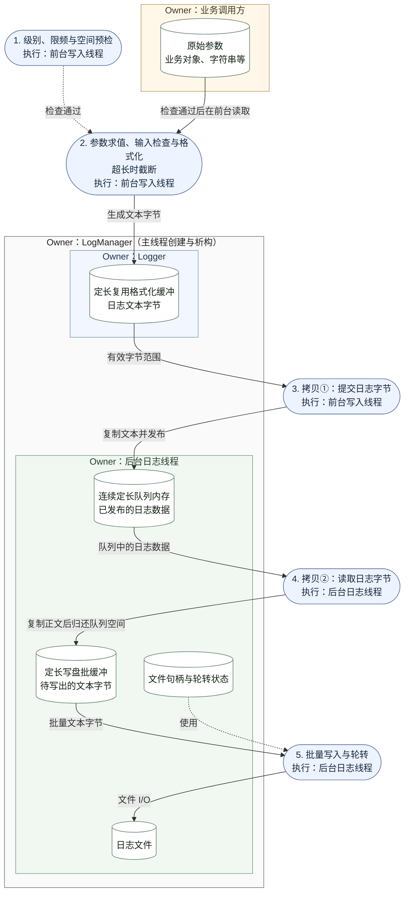

# YQuant 日志选型与设计

更新日期：2026-10-21。

`LogManager` 统一管理日志系统的生命周期，由主线程创建和析构。日志在调用线程完成格式化，通过 `SpscQueue` 逐帧交给进程内后台线程或独立的 `yquant-logd` 进程写入和轮转。日志与队列组件均位于 `yquant_base` 静态库中。

目标平台见项目 [README](../../README.md#目标平台)。项目及 fmt 采用无异常构建，管理错误显式返回状态；工程组织及公共状态类型见[工程组织与验证方案](engineering.md)。

## 需求与取舍

| 要求 | 设计约束 |
| --- | --- |
| 支持不同日志级别 | 提供 `TRACE`、`DEBUG`、`INFO`、`WARNING`、`ERROR`、`CRITICAL`，允许按 Logger 设置运行时最低级别 |
| 编译期删除低级别日志 | 低于构建阈值的宏展开为空操作，删除调用及其参数表达式，不生成对应的字符串操作、格式化和入队代码 |
| 不阻塞日志调用线程 | 每个 Logger 使用独立的预分配队列，不等待其他生产者、队列空间或文件 I/O；空间不足时丢弃诊断日志并计数，不扩容或同步回退；关键事件使用独立可靠记录通道 |
| 格式化参数不跨执行上下文 | 最终日志文本在调用线程完成格式化；队列只复制文本字节，后台不访问原始参数或 formatter |
| 统一管理生命周期 | 主线程创建并初始化 `LogManager`，由它创建 Logger、管理所选后端，并在析构时完成日志收尾 |

## 组件选型

| 组件 | 选择 | 职责 |
| --- | --- | --- |
| 格式化 | fmt | 在调用线程生成日志文本，写入定长复用缓冲区 |
| 跨线程或跨进程传输 | `SpscQueue` | 维护帧边界，一次写入或读取一帧字节载荷 |
| 项目日志层 | `yquant_base` 中的日志模块 | 分级、编译期裁剪、缓冲复用、丢失统计与后台文件写入 |

队列的帧格式、内存布局、初始化和读写算法见[SPSC 队列设计](spsc-queue.md)。日志层只提交和接收正文，不编码或解析队列帧头。

fmt 提供 `format_to_n`，将输出限制在指定容量内，并返回未截断的输出总长度，使用方据此保留超长文本前缀。[fmt API](https://fmt.dev/latest/api/)

### 现成日志库对照

| 日志库或模式 | 已核查行为 | 选型判断 |
| --- | --- | --- |
| Quill 原生异步模式 | 将参数编码入队，在后台格式化 | 不符合格式化参数不跨线程的约束 |
| spdlog async | 前台格式化正文，异步队列使用互斥锁 | 免等空位配置仍可能等待队列锁 |
| fmtlog `FMTLOG_ONCE` | 提供前台格式化正文的入口，后台仍生成日志头 | 可作参考，日志头生成位置及目标平台仍需适配 |

依据：[Quill 线程模型](https://quillcpp.readthedocs.io/en/latest/overview.html)、[spdlog 前台格式化](https://github.com/gabime/spdlog/blob/v1.x/include/spdlog/logger.h)、[spdlog 队列](https://github.com/gabime/spdlog/blob/v1.x/include/spdlog/details/mpmc_blocking_q.h)、[fmtlog 前台入口](https://github.com/MengRao/fmtlog/blob/main/fmtlog.h)、[fmtlog 后台处理](https://github.com/MengRao/fmtlog/blob/main/fmtlog-inl.h)。

## LogManager 与生命周期

`LogManager` 是日志子系统的管理入口，由主线程创建和初始化，并在应用退出作用域时析构。它持有所有 Logger 实例，业务层通过它创建 Logger。默认 `kThread` 后端持有后台日志线程；`kLogd` 后端只持有共享队列生产端。下述线程初始化与退出步骤适用于 `kThread`，进程模式见[跨进程日志](#跨进程日志)。

| 对象 | Owner | 职责 |
| --- | --- | --- |
| `LogManager` | 主线程的应用作用域 | 初始化日志系统、创建 Logger、执行阻塞退出收尾 |
| `Logger` | `LogManager` | 持有定长格式化缓冲和调用状态，向业务层提供日志写入接口 |
| 后台日志线程 | `LogManager` | 管理队列存储、批缓冲和文件资源，消费日志并完成退出写入 |

`LogManager` 不可复制或移动。Logger 以稳定借用指针提供给业务层，由 `LogManager` 统一销毁；借用的有效期不超过管理对象的运行期。

| 管理接口 | 行为 |
| --- | --- |
| `Initialize(config) -> Status noexcept` | 主线程调用，线程模式启动后台并等待就绪，进程模式建立管理状态；失败时回滚本次资源 |
| `CreateLogger(config) -> CreateLoggerResult noexcept` | 返回状态及 `Logger*`；成功时指针非空，所选后端的队列已就绪；失败时指针为空 |
| `Shutdown() -> ShutdownResult noexcept` | 主线程调用，阻塞完成收尾并返回结果；重复调用返回同一结果，不重复释放资源 |
| `~LogManager() noexcept` | 执行与 `Shutdown()` 相同的收尾；显式关闭已完成时直接结束 |

管理接口允许分配内存和阻塞，普通日志写入保持前述非阻塞约束。`CreateLoggerResult` 包含 `Status status` 和 `Logger* logger`，成功指针为借用，调用者不负责销毁；业务层检查状态后使用 Logger。初始化或创建失败不发布未就绪对象，未初始化或初始化失败后的管理对象也可以安全析构。

管理对象构造仅建立空状态。初始化按 `max_loggers` 预分配 Logger 注册表和错误槽；创建 Logger 时通过无异常分配取得固定缓冲及队列资源，失败返回 `kResourceExhausted`，并回收本次已取得的资源。线程创建使用 `pthread_create`，失败保存返回的错误码，不使用 `std::thread` 的异常路径。

### 配置

| 配置 | 字段与默认值 |
| --- | --- |
| `LogConfig` | 默认 `backend = kThread`，最多 16 个 Logger，每通道 64 KiB 批缓冲，空闲轮询间隔 1 ms；`shutdown_timeout_ns = 5000000000` 为进程模式收尾等待上限；可指定独立的退出错误回调及上下文 |
| `LoggerConfig` | `name` 为模块名，`file_path` 为目标文件；默认 1 MiB 队列、运行时最低 `INFO`；`min_interval_ns = 0` 关闭限频，`max_file_bytes = 0` 关闭轮转；进程模式使用 `queue_path` 指定共享队列 |

模块名最多 64 字节，不含空字符或换行。写盘端的文件父目录须已存在，目标须为普通文件；同一管理对象内，一个文件只能由一个 Logger 持有，路径别名、符号链接及硬链接指向同一文件时拒绝重复创建。

### 初始化与 Logger 创建

1. 主线程构造 `LogManager`，调用 `Initialize()` 启动后台日志线程并等待就绪。成功初始化后进入运行状态，同一对象不重复初始化。
2. 主线程通过 `CreateLogger()` 创建 Logger 及其定长格式化缓冲，并向后台提交资源准备请求。
3. 后台日志线程申请该 Logger 的队列存储，完成初始化与消费端注册；准备完成后，`CreateLogger()` 才返回成功结果和稳定借用指针。

主线程中的使用示意：

```cpp
LogManager log_manager;
auto init_status = log_manager.Initialize(log_config);
if (!init_status.ok()) {
  return ReportStartupError(init_status);
}
LoggerConfig logger_config;
logger_config.name = "strategy";
logger_config.file_path = "logs/strategy.log";
auto logger_result = log_manager.CreateLogger(logger_config);
if (!logger_result.status.ok()) {
  return ReportStartupError(logger_result.status);
}
RunApplication(*logger_result.logger);  // 返回前结束日志生产线程及业务对象
auto shutdown_result = log_manager.Shutdown();
return ReportShutdownResult(shutdown_result);
```

### 退出与析构

应用先停止新业务工作，汇合日志生产线程，并在日志系统仍可用时销毁会记录日志的业务对象。全部 Logger 调用结束后，主线程调用 `Shutdown()` 或离开 `LogManager` 的作用域。

1. `LogManager` 进入收尾状态，停止创建 Logger，停用生产端视图，并通知后台排空现有日志。此后业务层结束使用所有 Logger 引用。
2. 后台日志线程读完可正常消费的队列，将批缓冲及尚未完成的文件写入处理完毕，不因队列积压而提前退出。已损坏或发生不可恢复错误的通道停止排空并保留失败状态，其余健康通道继续收尾。
3. 后台完成文件刷新与持久化同步，关闭文件；在两端均停止访问队列后结束消费端视图并回收队列存储，随后退出。
4. 主线程等待后台线程结束，汇总最终计数和退出结果，再销毁 Logger 及其格式化缓冲。以上步骤完成后，析构才返回。

退出收尾覆盖成功入队的最终日志文本。文件后端先完成全部写入，再执行平台持久化同步；例如 Linux 使用 `fsync`，文件新建或轮转涉及的目录项也纳入同步范围。[Linux 文件同步语义](https://man7.org/linux/man-pages/man2/fsync.2.html)

全部已入队日志完成写入和同步，且未锁存不可恢复错误时，才报告收尾成功。`ShutdownResult` 返回固定大小摘要，包含最终 `Status`、首个失败的阶段和通道、错误数量及最终日志计数；各通道的错误详情保存在初始化时预分配的槽位中。运行期及收尾期不可恢复的队列、文件写入、同步或关闭错误均锁存，完成健康通道收尾与资源清理后返回失败。

显式 `Shutdown()` 允许主线程取得结果。析构执行相同收尾，失败时通过独立的无异常错误出口报告；该出口不再写回当前日志系统。收尾及保存错误结果不申请内存。

关闭完成后，`channel_error(index)` 可读取对应通道的首个错误、阶段和错误数量；错误槽保留到管理对象析构。

## 跨进程日志

### 通道与启动

每个 Logger 对应一条共享内存 SPSC 队列。业务进程在调用线程格式化最终文本并入队；logd 复用线程后端的逐帧读取、批量写盘、轮转和持久化同步实现。业务进程不启动日志工作线程，也不打开日志文件。一个 logd 可以消费多个业务进程的多条队列。

消费端使用 `LogManager::Initialize()` 的默认线程后端，再通过 `CreateLogSink(LoggerConfig) -> Status` 注册共享队列和目标文件。注册不向调用方发布生产端 Logger。命令行入口及参数见 [README 日志进程](../../README.md#日志进程)。消费端先创建并完全初始化私有临时映射文件，在文件资源准备成功后通过 `link` 原子发布配置中的队列路径；失败回收本次资源，已有队列路径不被替换。

队列文件必须位于同机本地文件系统，生产环境可放在 `/dev/shm`。文件以 `0600` 创建，两端以同一用户运行，采用相同的日志协议与 SPSC 布局版本。映射由日志共享状态头和原有 SPSC 存储组成，不跨进程传递指针。状态头包含固定 magic、容量、生产端认领标记、结束标记、错误和写入进度，原子字段均为无锁 64 位整数。

生产端配置：

```cpp
LogConfig config;
config.backend = LogBackend::kLogd;
LogManager manager;
auto status = manager.Initialize(config);
if (!status.ok()) return ReportStartupError(status);
LoggerConfig channel;
channel.name = "strategy";
channel.queue_path = "/tmp/strategy-log.queue";
auto created = manager.CreateLogger(channel);
if (!created.status.ok()) return ReportStartupError(created.status);
YQ_LOG_INFO(*created.logger, "strategy started");
auto result = manager.Shutdown();
return ReportShutdownResult(result);
```

`CreateLogger()` 要求消费端已发布队列，两端 `queue_capacity` 一致；文件不存在、长度或协议不匹配时返回失败。生产端不设置 `file_path`、`max_file_bytes`，这两个字段由消费端配置。队列通过原子认领拒绝第二个生产者，认领在该队列会话内永久保留。创建和映射仅发生在管理接口，日志调用沿用固定缓冲、非阻塞入队及满队列丢弃计数规则。

### 退出、故障与会话回收

业务进程先停止并汇合全部日志生产线程，再调用 `Shutdown()`。管理对象卸下生产端视图，发布所有通道的结束标记，再等待消费端确认。logd 先以 acquire 观察结束标记，再排空队列，完成文件及目录同步、关闭文件后发布确认；健康通道持续处理，失败通道锁存错误并完成资源收尾。

生产端的总等待时间受 `shutdown_timeout_ns` 限制，默认 5 秒。收到确认且没有消费端错误时返回成功；超时返回 `kIoError / ETIMEDOUT`，阶段为 `kSync`。超时释放本进程映射，logd 仍可继续消费已经提交的数据。生产端不删除队列文件。

logd 的文件和队列错误通过共享状态反馈。生产端的 `backend_status()` 读取首个错误及最近成功写入的单调时钟时间，后续日志调用遇到共享错误时停止入队并计入 `queue_errors_total`；`Shutdown()` 同时汇总该错误。logd 正常运行时没有消费进度也不会阻塞生产者，积压达到容量后按原有规则丢弃。

应先关闭所有生产端，再向 logd 发送 `SIGTERM` 或 `SIGINT`。logd 提前停止已连接且未结束的通道时返回 `EPIPE`，生产端不能把此次收尾视为完整交付。logd 被强制终止时无法发布确认，生产端收尾超时。生产端崩溃时无法发布结束标记，由运维停止 logd，消费可读的已提交帧并报告未完整结束的通道。

每个队列文件只供一次生产者会话使用，结束后保留认领标记，拒绝重新连接。logd 正常退出会删除自己发布的队列路径；异常退出会留下文件，确认两端均已退出后删除，再重新启动 logd。运行期间不得截断、替换或删除队列文件，也不支持自动重连或接管旧会话。

## 处理流程

图以线程模式中单个 Logger 的一条日志成功入队并写出为主线。边界框表示存储的 Owner，圆柱节点表示存储，圆角节点表示处理动作并标注执行线程；实线为数据流，虚线为条件控制或资源使用。



拷贝①并发布完成后，Logger 的格式化缓冲即可复用；拷贝②完成后，相应队列空间可复用。后台批缓冲中的字节保留到对应文件写入完成。原始参数只在本次前台调用期间使用，不转移所有权。

线程模式的 `LogManager` 持有 Logger 实例和后台日志线程。后台日志线程负责队列内存的申请，并在各端停止访问后回收；`SpscQueue` 视图仅借用该内存。后台还管理批缓冲、文件句柄及日志文件的创建、关闭与轮转。

被编译期裁剪的调用不进入运行时流程；前置检查不通过时不求值参数。调用者保证同一 Logger 的串行使用。后台保留同一 Logger 的消息顺序；不同 Logger 的文件位置不作为业务因果顺序依据，需要重建业务顺序的日志携带显式业务序号。

## 日志接口与编译期裁剪

项目级别按 `TRACE < DEBUG < INFO < WARNING < ERROR < CRITICAL` 排列。编译期阈值决定保留哪些调用，运行时阈值进一步过滤已编译保留的调用。

开发构建保留 `DEBUG` 及以上，发布构建保留 `INFO` 及以上；需要 `TRACE` 时显式调整配置。项目头文件定义数值型级别宏，`YQ_LOG_COMPILED_LEVEL` 控制各 `YQ_LOG_*` 的预处理分支，禁用分支为 `((void)0)`，不引用 logger、格式字符串或参数。

发布构建配置：

```cmake
target_compile_definitions(yquant_base PUBLIC
    YQ_LOG_COMPILED_LEVEL=YQ_LOG_LEVEL_INFO
)
```

定义传播到所有调用日志的编译单元。业务调用示例：

```cpp
YQ_LOG_DEBUG(logger, "order_book={}", BuildOrderBookSnapshot(book).view());
YQ_LOG_INFO(logger, "order_id={} state={}", order_id, state);
```

示例中的快照使用定长结果，`view()` 返回有长度的字符串视图。阈值为 `INFO` 时第一条调用完全删除，`BuildOrderBookSnapshot(book)` 不求值。仅用于日志的昂贵计算放在宏参数内，宏之前的独立语句仍会执行。

编译保留的调用先完成运行时级别、限频、Logger 重入及最小载荷空间检查，再求值参数、检查输入规模、格式化并调用 `TryWrite`。`CheckWrite(1)` 只检查最小帧所需的总字节，成功后仍调用真实写入处理连续空间与 padding；最终按实际载荷长度写入，不按最大日志长度提前拒绝短消息。

业务层通过 `LogManager::CreateLogger()` 的成功结果取得 Logger 的稳定借用指针，并在 `LogManager` 开始收尾前结束使用。同一 Logger 同时只有一个调用线程使用，由调用者保证串行访问；不同 Logger 可以并行记录。线程间顺序移交 Logger 时，由调用者同步前后生产端状态。写入缓冲区不加锁，logger 表达式只求值一次。

## 日志载荷与格式化缓冲

### 缓冲区所有权

Logger 持有固定容量的格式化缓冲区，容量为 `kMaxLogBytes`，初始化时建立并预热。缓冲区全部用于日志正文，不预留队列帧头。单次调用只重置有效长度并覆盖当前输出，不申请、释放或扩容缓冲区。

Logger 的非原子占用标记防止自身重入，在参数求值前设置，在写入完成或任意失败返回时清除。同一 Logger 的嵌套调用丢弃并计数，不同 Logger 嵌套使用各自缓冲区。该标记不承担调用线程之间的并发协调。

参数只在本次调用中使用，不保存供后台访问的对象地址。公共字段使用实际调用线程标识，模块标识在 Logger 初始化时确定。调用者的参数表达式遵守无异常及热路径内存约束。

### 文本格式化与截断

载荷为完成格式化的最终日志文本，以换行符结尾，字节长度不超过 `kMaxLogBytes`。`fmt::format_to_n` 限制写入范围，超长时保留前缀，在 UTF-8 字符边界回退，为 ` [truncated]` 与换行留出位置，再按实际长度写入。初始化时保证缓冲容量足以容纳标记和换行。

`kMaxLogBytes = 1024`。行头包含 Unix 纳秒时间、级别、当前调用线程 ID、模块名及源码位置；正文中的换行、回车、反斜杠及控制字节转义，保证一条记录只占一个物理行。截断同时保持 UTF-8 字符和转义序列完整。

日志入口使用 `consteval LogFormat<Args...>`，同时检查参数类型和项目格式语法。初版只开放 `{}`、`{{`、`}}`；允许基本整数、`bool`、`char`、默认格式的 `float`、`double`、有长度字符串视图及字符串字面量。运行期格式字符串、宽度和精度规格、locale 及任意自定义 formatter 在编译期拒绝；业务类型先转换成允许的标量或定长文本，裸字符串指针先转换成有长度视图。

单个输入字符串最多 `kMaxLogInputBytes = 65536` 字节，格式字面量最多 1024 字节，参数最多 16 个。输入长度检查失败在调用 fmt 前丢弃并计数，该上限独立于输出记录容量。`format_to_n` 仍计算未截断总长度，因此输出容量不能代替输入规模限制。格式字面量长度、参数数量和允许输入长度的总上界也须避免长度计算溢出。[格式化接口](https://fmt.dev/latest/api/)

fmt 与调用方统一使用 `FMT_USE_EXCEPTIONS=0` 和无异常编译选项。fmt 内部格式错误会终止进程，属于程序契约违例；不描述为可恢复的格式化失败。正常调用通过编译期约束和输入预检避免进入该路径。[fmt 无异常错误路径](https://github.com/fmtlib/fmt/blob/12.1.0/include/fmt/format.h#L155-L160)

### 帧队列调用

每条日志的正文作为一次 `SpscQueue::TryWrite` 的字节载荷，队列负责长度头及整帧发布。调用成功后复用 Logger 缓冲；空间不足立即丢弃并计数，其他队列错误使通道进入错误状态。

后台通过一次 `TryRead` 接收一条完整日志，得到实际正文长度，不在日志层拆分或合并队列帧。文件只写正文，队列帧头不进入日志文件。

## 队列存储与后台读取

### 外部队列存储

线程模式下，`LogManager::CreateLogger()` 协调后台为该 Logger 准备独立的连续定长队列区域。后台日志线程申请内存、执行独占初始化并建立两端视图，完成后才允许调用方使用 Logger。两端停止访问后由后台释放内存；SpscQueue 仅借用该区域。

Logger 格式化缓冲与队列存储是独立区域，日志路径的 `TryWrite` 复制载荷后不保留 Logger 缓冲的引用。初始化时验证 `queue.max_payload_size() >= kMaxLogBytes`。

容量估算同时计入有效帧积压与尾部 padding。帧始终连续，尾段不足时整体回绕；即使总空闲字节能容纳正文，跳尾开销也可能使预留返回 `kFull`。

一个未消费窗口至多包含一段 padding，其长度小于触发回绕的预留帧长。日志使用精确长度的复制便利接口，可按最大日志帧预留回绕余量，再向上取二的幂：

`数据区容量 >= 峰值帧字节率 × 积压秒数 × 余量系数 + 最大日志帧字节数 - 1`

例如，假设每秒 10 万条、平均正文 160 字节、最大正文 1 KiB、帧头 4 字节、吸收 100 毫秒停顿、余量为 2，有效帧预算为 3.28 MB，再加最多 1027 字节回绕余量，可选择 4 MiB 数据区。另计控制区、Logger 格式化缓冲和后台批缓冲。

### 逐帧读取与写出

后台是每条队列的唯一消费者，使用预分配批缓冲，其总容量至少为 `kMaxLogBytes`：

1. 把批缓冲的剩余区域作为 `TryRead` 的输出区。
2. 成功时按返回的载荷长度推进批缓冲使用量；队列已完整消费该帧。
3. `kBufferTooSmall` 时保留队列帧，先写出批缓冲已有数据，再以腾空的固定缓冲重试，不动态扩容。
4. `kEmpty` 时继续处理其他队列；`kCorrupt` 时停用该通道并上报。所需长度超过批缓冲总容量属于配置或通道错误。

文件部分写入时保留未写出的批缓冲字节；采用异步 I/O 时，缓冲保持有效直到操作完成。轮转由后台执行，关闭旧文件前完成其缓冲写入和持久化同步；进程退出时由 `LogManager` 统一执行最终收尾。压缩、采集和远程上传交给独立任务。

文件后端采用 POSIX 批量写入，处理部分写入及 `EINTR`。启用大小轮转时以完整记录为边界，旧文件归档为 `file_path.<序号>`，跳过已有归档；单条记录超过阈值时允许单个文件超限。重启以追加方式打开当前文件，不删除归档。

## 过载与故障

总空间或回绕所需连续空间不足的调用计入 `queue_dropped_records_total`，格式化前的输入上界检查拒绝计入 `input_rejected_records_total`，自身重入计入 `reentrant_records_total`，其他队列错误导致的拒绝计入 `queue_errors_total`。各类失败按首次命中原因互斥计数，级别过滤和主动限频不计入丢失。

成功入队的截断日志另计 `truncated_records_total`，是成功入队数的子集，不加入失败求和；截断后写入失败只按对应失败原因计数。监控只读各 Logger 的无锁原子计数，不重置；Logger 停用后数值保留到最终汇总完成。

输入预检失败不发布帧，不在调用路径拼接报错文本或同步输出。队列损坏不触发调用线程重初始化，资源回收须等两端停止。`Logger::backend_status()` 提供后台首个错误、阶段及最近一次成功写入的单调时钟纳秒时间；尚未写入时该时间为零。磁盘满或停顿不触发前台接管写入。

### 关键业务记录

诊断日志允许截断和丢弃，不能用作订单、成交或账户状态的权威记录。

## 验证与采用标准

| 场景 | 验收条件 |
| --- | --- |
| 级别与裁剪 | 逐级验证输出；以 `INFO` 构建时 DEBUG 专用字符串与参数调用消失，无优化时同样成立 |
| 运行时过滤 | 参数不求值，不格式化、不入队、不计丢失 |
| LogManager 初始化与创建 | 线程模式初始化只启动一个后台线程，进程生产端不启动线程；Logger 由管理对象持有，成功结果含稳定借用指针；初始化或创建失败返回状态，不泄漏资源 |
| Logger 使用与移交 | 不同 Logger 并行、同一 Logger 经同步顺序移交、自身重入及不同 Logger 嵌套均符合契约 |
| 缓冲与参数生命周期 | 连续复用、后台暂停、原参数修改或销毁均不改变已发布字节；各失败返回后占用标记复位 |
| 无异常与输入限制 | 无异常构建通过；非法格式和参数类型编译失败，输入超限在调用 fmt 前拒绝，fmt 契约违例执行终止路径 |
| 帧边界 | 一条日志写入一帧，帧头与正文整体连续；尾段不足时整体回绕，后台不把 padding 当作日志返回 |
| 读取缓冲不足 | 保留数据帧和批缓冲现有字节，返回所需长度；允许先回收 padding，写出批缓冲后可重试 |
| 容量与截断 | 不按最大帧提前拒绝短日志；回绕暂时失败后可经 padding 回收继续写入；超长保留前缀、标记和换行，截断计数与失败计数独立 |
| 内存与失败计数 | 视图不回收外部存储；通过级别和限频的调用数等于成功帧数加各类互斥失败数 |
| 跨进程传输 | 独立可执行程序消费共享队列；容量与协议不匹配、第二个生产者和会话重用被拒绝；队列满时不阻塞，保持成功入队记录的顺序 |
| 进程收尾 | 业务进程先结束，等待 logd 排空及同步确认；消费端提前停止、被杀、写盘和同步失败均反馈错误，等待超时不会假报成功 |
| 阻塞退出 | 线程模式正常情况下，主线程等待后台排空全部队列和批缓冲、完成文件同步与关闭、回收队列并退出，随后销毁 Logger，析构才返回 |
| 退出错误与重复收尾 | 损坏通道停止排空但保留失败结果，健康通道继续收尾；写入、同步或关闭失败可观察；析构不抛异常，未初始化对象可析构，重复关闭不重复回收或汇合线程 |
| 性能与文件 | 限定热路径类型的稳态调用无堆分配；测量前台调用、CPU、RSS、吞吐、部分写入及轮转退出行为 |

验证环境遵循项目 README 的目标平台约定。性能测量记录实际工作负载和构建配置，当前不设置性能数值门槛。

## 依赖管理

日志层依赖 fmt，SpscQueue 依赖 C++20 标准库与经过验证的平台原子支持。二者由 `yquant_base` 提供，队列不依赖日志或格式化模块。

最大日志载荷、输入及格式限制为编译期常量；`YQUANT_LOG_COMPILED_LEVEL` 为 CMake 构建选项，控制公开宏 `YQ_LOG_COMPILED_LEVEL`。队列容量、Logger 数量、批缓冲、文件、轮转及运行时级别属于启动配置。
