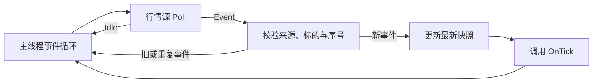

# 行情驱动与策略事件循环

`yquant-strategyd` 从模拟源或本机共享内存读取行情，在更新最新行情后调用策略。行情传输由宿主配置选择，策略使用统一的订阅和回调接口。

## 功能范围

每个进程运行一个策略实例，连接一个行情源，最多配置 64 个标的。`mock` 在进程内按间隔生成一档报价，`shm` 从本机 `marketd` 发布的共享内存流逐条读取。策略在启动时声明订阅，运行期间通过回调接收行情，并查询最新快照。

组件提供 `QuoteTick`、行情查询、启动订阅及行情源接口。交易执行及委托、持仓与资金账本见[交易执行设计](trading.md)；策略定时回调、运行中变更订阅及断线重连由后续设计扩展。

行情接入及跨机中继见[行情进程设计](marketd.md)，本机分发见[共享内存广播协议](shared-memory-broadcast.md)。动态库和配置的公共约定分别见[策略进程设计](strategyd.md)、[策略配置设计](strategy-config.md)。行情类型的分类依据见 [Tick 数据分类](../research/tick-data-model.md)；本阶段只实现一档报价，不引入该研究中全部事件头和载荷类型。

## 单线程运行模型



行情源返回后，宿主先校验并更新最新快照，再调用 `OnTick()`。行情与交易回报由同一主线程公平驱动，共享事件批次额度；完整调度及停止流程见[交易执行设计](trading.md#主循环与收尾)。

| 组件 | 主线程中的职责 |
| --- | --- |
| 事件循环 | 调度行情、交易回报、源维护与停止处理 |
| 行情源 | 非阻塞地生成或读取一条定长记录，不直接调用策略 |
| 策略运行时 | 更新最新行情缓存，串行执行全部策略回调 |

`strategyd` 只使用主线程，不创建行情生产线程或信号等待线程，不建立跨线程行情队列、唤醒计数及错误邮箱。行情源的 `Poll()` 返回后，运行时才校验、更新缓存并调用策略，避免源接口内重入策略回调。

策略通过 `StrategyContext::market_data()` 取得宿主提供的 `MarketData` 行情接口。行情源接口在宿主内部实现，供应商 SDK 类型不跨策略动态库边界。真实适配器优先采用非阻塞读取；供应商 SDK 必须自行创建线程时，再针对该 SDK 定义必要的交接通道，本阶段不预建相关线程。

## 公共类型与标识

### 类型模块

公共交易领域类型统一组织为 `yquant::model`，目录为 `include/yquant/model/`。标识、标的定义和行情事件分别放入 `identifiers.h`、`instrument.h`、`quote_tick.h`，避免让通用标的身份依附某一种行情事件。策略上下文仍属于 `yquant::strategy`，行情接入实现留在宿主内部。

NautilusTrader 将这些类型放在 `nautilus_model` / `nautilus_trader.model`：`identifiers` 保存标识，`instruments` 保存标的定义，`data` 保存报价等行情。YQuant 按这些职责组织公共类型，委托与成交类型见[交易执行设计](trading.md#委托模型)。[Nautilus 模型模块](https://github.com/nautechsystems/nautilus_trader/blob/develop/crates/model/src/lib.rs)

### 标的身份

| 概念 | 含义 | 示例 |
| --- | --- | --- |
| Instrument | 交易标的及其规格，行情、委托和持仓共同引用的对象 | 上交所的 `600000` 股票及其价格、数量单位 |
| Venue | 交易场所 | `SSE` 表示上海证券交易所 |
| Symbol | 该场所中标的的代码 | `600000` |
| InstrumentId | 由 `venue + symbol` 稳定编码的标识 | 上述股票在各行情来源间共用的 ID |

同一标的从不同数据供应商接入，仍使用相同的 `InstrumentId`。Nautilus 的 `InstrumentId` 同样由 `Symbol` 与 `Venue` 共同定义；数据供应商不作为交易场所写入该身份。[标的标识定义](https://github.com/nautechsystems/nautilus_trader/blob/develop/crates/model/src/identifiers/instrument_id.rs)

`InstrumentId` 包装 `uint64_t`，`0` 无效。高 32 位保存固定场所编码（`1=SSE`、`2=SZSE`、`3=BSE`），低 32 位保存六位代码的数字值；已有场所编码不重新编号。`model::MakeInstrumentId(venue, symbol, out)` 校验场所及六位 ASCII 数字后生成 ID，失败保持输出不变。

该编码不依赖配置顺序、行情来源或进程生命周期。同一场所与代码在重启、调整配置顺序后仍得到同一个 ID；前导零由六位代码的固定宽度及标的定义中的原始代码保留。内部缓存槽位独立于这个公共身份。

### 行情来源身份

`SourceId` 为包装 `uint32_t` 的强类型，`0` 无效，由宿主配置中的 `source_id` 指定，标识原始行情接入来源。`adapter` 指定宿主读取行情的实现类型：`mock` 或 `shm`。中继及共享内存订阅保留原始来源 ID；读取同一来源的多个策略进程使用相同的 `source_id`，独立接入来源使用不同的 ID。

多个适配器可以提供同一个标的的行情，因此来源身份与标的身份分别保存。每个 `strategyd` 由宿主配置绑定唯一原始来源，策略在该绑定范围内按 `InstrumentId` 订阅和查询。`QuoteTick::source_id` 保留原始来源身份；订阅、缓存和序号均在该绑定范围内按标的维护，入站报价在更新状态前必须通过来源一致性校验。

Nautilus 的行情客户端在接入层持有 `ClientId`，其原生 `QuoteTick` 不含客户端 ID。YQuant 将 `source_id` 放入报价记录，用于来源追踪与协议校验。[客户端适配器](https://github.com/nautechsystems/nautilus_trader/blob/develop/crates/data/src/client.rs)、[原生 QuoteTick](https://github.com/nautechsystems/nautilus_trader/blob/develop/crates/model/src/data/quote.rs)

运行期间不提供选源或切源。多源同时启动、优先级、故障切换和综合报价留待后续设计。扩展时，每个来源独立维护状态，并先按统一标的定义完成数值归一化；不同来源的序号不能互相比较，也不自动按到达先后合并报价。需要支持重连并重置序号时，再定义来源会话代次和缓存失效协议。

## 行情数据

### 标的与计量单位

标的身份由 `venue` 和 `symbol` 共同确定，策略可在启动时通过 `MarketData::FindInstrument()` 查询标的定义及其 ID。

`InstrumentDefinition` 为可复制的定长对象，包含 ID、场所、代码和价格精度。场所使用固定宽度枚举，支持 `SSE`、`SZSE`、`BSE`；代码长度由 `model::kSymbolLength` 定义，当前为六位 ASCII 数字，内联保存且不包含终止符。价格精度 `price_decimals` 表示整数价格的计价单位为 `10^-price_decimals` 元，范围为 `0..6`；数量使用股。

例如 `price_decimals=2`、价格 `1001` 表示 `10.01` 元，数量 `100` 表示 `100` 股。买入申报单位等交易规则不混入行情数量的编码。完整定义由[共享标的字典](#共享标的字典)集中提供，宿主按运行清单复制所需定义，在 `OnStart()` 前建立本地字典，运行期间只读。

### 一档报价

`QuoteTick` 表示指定来源与标的的一档完整报价快照（BBO），只包含买一和卖一，可按值复制，不含堆指针或字符串视图。

| 字段 | 类型与语义 |
| --- | --- |
| `source_id` | `SourceId`，标识原始行情来源，必须与宿主绑定的来源一致 |
| `instrument_id` | `InstrumentId`，关联本次运行的标的定义 |
| `sequence` | `uint64_t`，来源会话内在 `(source_id, instrument_id)` 范围从 `1` 开始递增；Live 接入时首条可大于 `1`，运行期间不重置 |
| `event_time_ns` | `uint64_t`，存在时为 Unix 纪元起的 UTC 纳秒，原始时间的精度不会因换算而提高 |
| `receive_time_ns` | `uint64_t`，适配器取得该记录时的单调时间，与 `StrategyContext::Now()` 使用相同基准 |
| `bid_price`、`ask_price` | `int64_t`，按标的价格精度解释 |
| `bid_qty`、`ask_qty` | `int64_t`，非负，单位为股 |
| `flags` | 固定宽度位标志：买侧存在、卖侧存在、允许交易、事件时间存在 |

一侧不存在时清除该侧标志，价格和数量规范化为 `0`；一侧存在时数量必须大于 `0`。是否存在由标志决定，不能仅通过零价格推断。事件时间缺失时清除对应标志并将值置零。

锁盘、交叉盘及不可交易状态仍可形成完整行情事件，交给策略判断是否采取行动。框架不因 `bid_price >= ask_price` 静默过滤事件。负数量、未知标的、来源与宿主绑定不符、未知标志或字段与存在标志矛盾属于源协议错误，停止运行并报告原因。`receive_time_ns` 不得晚于宿主当前 `Now()`；违反这一约束说明时间域或时间戳错误，同样作为非法行情拒绝。

多档快照后续使用独立的 `OrderBookDepth` 类型，单独定义深度订阅和回调。本阶段只提供一档报价（BBO）订阅和 `OnTick`。

### 时间与顺序

宿主以 `std::chrono::steady_clock` 建立进程内的单调时间基准，`Now()` 返回自该基准起经过的纳秒。模拟源和共享内存源均用本次 `Poll(now, out)` 的 `now` 填写 `receive_time_ns`，运行时不在回调前刷新它。

进程相对时间不通过传输帧透传。共享内存报价解码后接收时间为零，由 `strategyd` 按本进程时钟赋值；来源、来源序号和 UTC 事件时间保持不变。策略计算的报价年龄只覆盖本进程接收到当前时刻的时间，不包含上游处理或传输延迟。

市场事件时间不能与本地单调时间相减。行情过期判断使用 `Now() - receive_time_ns`。首版不提供定时回调，没有新行情时不主动触发策略的过期检查。

运行时先校验报价属于宿主绑定的来源，再按 `instrument_id` 保存最后接受的序号。重复或旧序号不覆盖该标的的快照，也不触发 `OnTick()`，仅累计饱和的 `uint64_t` 诊断计数；停止后仍保留计数，非零时进程输出 `yquant-strategyd: ignored_quotes=N`。报价来源序号跳跃可以被接受，因为每条记录都是完整报价，且上游序号是否连续由适配器按供应商协议解释。共享内存流序号独立于报价来源序号，前者连续扫描并检测覆盖；报告 `Gap` 时停止策略，不用完整快照的规则静默跳过缺失记录。

适配器保留原生序号的解释责任，不直接把重连后清零的上游序号作为当前发布序号。本阶段发生断线或需要重建流状态时，以行情源错误停止运行；发布序号耗尽也停止运行。

## 策略接口

### 上下文

`yquant::strategy::StrategyContext` 提供时间与宿主服务，行情侧关键签名如下：

```cpp
std::uint64_t Now() const noexcept;

MarketData& market_data() noexcept;
const MarketData& market_data() const noexcept;
```

`Now()` 提供宿主的单调时间。`market_data()` 返回同一个宿主持有的行情接口，不创建或转移对象；const 上下文返回只读接口，可查询标的与快照，订阅通过非 const 接口登记。交易服务访问器及其规则见[交易接口](trading.md#策略接口)。

上下文及其返回的 `MarketData` 引用仅在当前主线程回调期间使用，策略不得保存引用或地址供后续调用，也不得交给后台线程。构造器和析构器不访问这些接口。复制得到的定长标的与行情快照可以保存在策略自己的存储中；宿主在 `OnStop()` 期间仍保留最后分派的快照。

### 行情接口

`yquant::strategy::MarketData` 定义标的查询、报价订阅和最新快照查询，策略通过 `context.market_data()` 调用。核心签名如下：

```cpp
base::ErrorCode FindInstrument(
    std::string_view venue, std::string_view symbol,
    model::InstrumentDefinition& out) const noexcept;

base::ErrorCode SubscribeQuotes(model::InstrumentId id) noexcept;

bool TryGetLatestQuote(
    model::InstrumentId id, model::QuoteTick& out) const noexcept;
```

`FindInstrument()` 复制完整标的定义。输入视图只在调用期间借用；找不到标的时返回 `kInvalidArgument`，保持 `out` 不变。名称解析用于启动阶段；行情热路径通过固定容量哈希表将稳定 ID 映射到预分配槽位，不解析场所或代码字符串。

`SubscribeQuotes()` 只允许在 `OnStart()` 中调用，在宿主绑定的来源中登记标的订阅。重复订阅同一标的成功返回且不增加名额；标的 ID 无效或不在配置字典中时返回 `kInvalidArgument`，没有行情源时返回 `kUnsupported`，在其他回调中调用返回 `kInvalidState`。失败不改变已有订阅。

订阅成功表示本地登记完成，不表示已收到行情。`OnStart()` 成功后冻结订阅表，再启动行情源；期间不重入 `OnTick()`。启动失败时撤销本次全部登记，运行中不提供增加或取消订阅的接口。

`TryGetLatestQuote()` 将宿主绑定来源中指定标的的最新已分派快照复制到 `out`。没有行情源、标的 ID 无效或不在配置字典中、未订阅或尚无行情时返回 `false`，保持 `out` 不变。它不等待下一条行情，也不按时间自动删除旧快照；策略自行判断新鲜度。在 `OnTick()` 内按当前 `tick.instrument_id` 查询，结果必须与本次回调参数一致。

### 回调

```cpp
virtual base::ErrorCode OnStart(StrategyContext& context) noexcept = 0;

virtual base::ErrorCode OnTick(
    StrategyContext& context, const model::QuoteTick& tick) noexcept;

virtual base::ErrorCode OnStop(StrategyContext& context) noexcept = 0;
```

`OnTick()` 默认返回 `kOk`，使仅使用生命周期的策略无需提供空重写。`config()` 与工厂入口分别负责配置访问和实例创建、销毁，全部策略回调显式接收上下文。所有策略按最新 SDK 和 ABI 重新编译，不保留旧签名兼容分支。

回调必须及时返回，不阻塞等待下一条行情。`tick` 是主线程持有的定长对象，只在当前回调期间有效；运行时不向策略暴露源内部可复用缓冲区的长期借用。

`OnTick()` 返回非 `kOk` 时，宿主保存错误码及该行情的来源、标的、序号，关闭后续业务回调。宿主继续执行能够完成的交易收尾，最终配对一次 `OnStop()` 并以失败状态退出；规则见[错误与超时](trading.md#错误与超时)。

观察行情的示例策略按下面的逻辑执行：

```text
OnStart(context):
    用 context.market_data().FindInstrument(venue, symbol, definition) 查找标的
    保存 InstrumentId 和计量单位
    用 context.market_data().SubscribeQuotes(id) 登记订阅
    return 成功

OnTick(context, tick):
    用 context.market_data().TryGetLatestQuote(
        tick.instrument_id, snapshot) 查询快照
    检查 snapshot 与 tick 一致
    在预分配状态中记录序号、回调次数和数据年龄
    return 成功
```

示例 [quote_observer_strategy.cc](../../examples/strategies/quote_observer_strategy.cc) 首次收到报价时输出固定标记 `quote_observer: first quote received`，随后只更新计数。停止时输出 `quote_observer: ticks=N last_sequence=N max_age_ns=N` 汇总，行情回调不逐条格式化日志。

## 行情源

### 接口契约

行情源使用宿主内部接口，不向策略暴露底层传输或 SDK：

```text
Prepare(config) -> Status
Start(span<const InstrumentId> subscriptions, now) -> Status
Poll(now, QuoteTick& out) -> Event / Idle / Error
next_deadline() -> optional<单调时间期限>
is_poll_driven() -> bool
Service(now) -> Status
next_service_deadline() -> optional<单调时间期限>
Stop() -> Status
```

这些接口全部由主线程串行调用。`Prepare()` 校验并复制完整配置，不产生行情或连接共享内存。`Start()` 在 `OnStart()` 成功后复制订阅选择，建立运行状态；返回后不再借用输入 span。订阅集合运行期间保持不变。

`Poll()` 非阻塞，每次最多将一条自包含记录复制到 `out`，返回 `Event` 后由运行时校验、更新缓存并调用策略。没有到期事件或读取预算耗尽时返回 `Idle`；出错时返回带失败 `Status` 的 `Error`，诊断由源的 `error_detail()` 提供并复制到运行时。后两种情况保持 `out` 不变。读取路径不分配内存、不做文件 I/O、不调用策略、不睡眠，也不无限循环扫描数据。

`next_deadline()` 指定下一次允许调用 `Poll()` 的时间，不触发策略定时回调；同批或积压记录待取时可以立即就绪。`is_poll_driven()` 区分两种调度约束：

- 模拟源返回 `false`。`Idle` 后的期限必须为空或晚于传入本次 `Poll()` 的 `now`，否则作为源协议错误处理。
- 共享内存源返回 `true`。空读或预算耗尽后允许立即就绪，主循环先回到信号检查，再开始下一轮读取。

`Service(now)` 在每批之间执行冷路径维护，允许有界的文件 I/O 和临时分配，不等待新行情、不调用策略。行情源自行检查维护期限，未到期时直接成功返回。`next_service_deadline()` 参与宿主等待，即使没有业务订阅也不能被忽略。默认实现无维护工作及维护期限，模拟源沿用该行为。维护只在 `Running` 的轮次边界执行；维护失败停止行情并进入[交易错误收尾](trading.md#错误与超时)，有活动委托时仍由宿主推进能够完成的排空。

`Stop()` 幂等且同步，取消行情及维护期限，结束活动订阅并关闭持有的映射。未启动或已经停止时成功返回；已有源故障诊断在关闭后仍有效。关闭资源失败时保留诊断并完成能够安全执行的清理。

### 模拟源

模拟源按配置顺序保存订阅选择，不受策略登记顺序影响。没有订阅时保持空闲，不安排行情或维护期限。

每隔 `interval_ms` 对每个订阅标的生成一次报价，按配置中的标的顺序通过多次 `Poll()` 返回。第一批在激活后经过一个间隔生成，此后持续运行，不设置自动结束条数。

第 `n` 批的价格偏移为 `((n - 1) % 2) * price_step`，同时加到配置的买一和卖一价格上；数量保持不变。每个来源与标的组合的发布序号从 `1` 开始，事件时间填写生成时的 UTC 时间，接收时间使用本次 `Poll()` 的单调时间。价格变化始终有界，初始化时检查基础价格加步长不溢出。

生成当前批最后一条记录时，以传入该次 `Poll()` 的 `now + interval` 安排下一批；该条记录的策略回调尚未执行，回调完成后不再推迟已定期限。调度落后时不补发一串已经过时的批次，系统日历时间的调整不改变发布间隔。

### 共享内存源

`ShmMarketDataSource` 在 `Start()` 连接 `marketd` 当前发布代次，从 `StartPosition::Live()` 开始消费连接后的新事件。宿主此前已经从共享标的文件解析运行清单，接收方根据冻结的策略订阅表选择品种和报价事件类型；多个 `strategyd` 的读取游标互相独立。

`Poll()` 通过 `ShmReader::TryNext()` 逐条取得广播事件，在接收侧过滤后解码完整报价、验证来源并设置本地接收时间。共享内存组件的 `Empty`、`Retry` 映射为 `Idle`。`Gap`、`StreamChanged`、`EndOfGeneration`、意外关闭、损坏帧或来源不符均为终止错误，不自动恢复游标或重新连接。

`poll_interval_us` 默认为 `0`，空读后持续轮询。配置正值时，只有确认读空后才将下一读取期限设为 `now + interval`；有事件或扫描预算耗尽时立即继续，避免延迟积压数据。每轮仍经过信号检查，忙轮询不取消停止边界。

`Service()` 每 250 ms 调用 `Refresh()` 检查发现入口及心跳。新代次立即停止旧代次交付；发布者心跳超过 3 秒未更新、发现入口消失或发布者停止时，先交付保留范围内仍完整的已提交事件，再报告故障。停止代次由组件在读尽后返回 `EndOfGeneration`；过期心跳或发现入口缺失在空读或无法取得一致副本时终止。发生覆盖仍优先报告 `Gap`。

正常无订阅时不安排业务读取期限，但继续维护检查；检测到发布者异常后恢复状态读取，完成有界扫描并终止。源序号、代次、覆盖检测和 seqlock 协议的完整规则见[共享内存广播组件](shared-memory-broadcast.md)。

#### 接收端事件过滤

[EventFilter](../../include/yquant/md/event_filter.h) 独立于广播读取器，通过 `Matches(header)` 判断事件是否符合品种和事件类型条件。两个列表均为借用的只读 span，无固定容量要求，无须排序；调用方保证匹配期间存储有效且不修改。`all_instruments`、`all_event_types` 分别放开对应维度，受限的空列表不匹配任何值。流级状态始终通过，品种级状态按品种匹配并绕过事件类型过滤。

`ShmMarketDataSource` 在 `Start()` 将策略选中的标的复制到自持数组，容量沿用行情服务的 `kMaxMarketDataInstruments`，报价事件类型由适配器指定。`Poll()` 对广播事件的一致副本执行过滤，每次最多检查 64 条事件、累计最多尝试读取槽位 128 次；预算耗尽时返回 `Idle` 并立即安排下一轮读取，让宿主检查停止信号。过滤丢弃的事件已推进读取游标，业务交付序号的跳跃不代表广播缺口。

## 主循环与收尾

行情配置与共享标的字典在加载策略动态库前校验；字典读取失败、定义无效或运行清单引用未知标的时直接终止启动。宿主按 `adapter` 选择 `mock` 或 `shm` 源，行情源 `Prepare` 与行情服务建立自持存储。柜台账户初始化见[交易启动流程](trading.md#启动与事件调度)。`OnStart()` 成功后冻结订阅表，宿主激活行情源；共享内存源此时连接发布者并从 Live 开始读取，全部成功后才进入运行态。

`StrategyRunner::Run(environment)` 统一驱动请求与来源事件，行情读取及报价分派为私有实现。每次从行情源取得一条事件后完成校验、序号检查与缓存更新，再进入 `OnTick()`；旧或重复行情不回调，但仍占用共享事件额度。请求与双来源的额度、公平轮换及等待期限见[启动与事件调度](trading.md#启动与事件调度)，退出信号协议见[主循环与信号](strategyd.md#主循环与信号)。

每个运行轮次在信号检查后调用已激活行情源的 `Service(now)`，行情维护期限也参与最早等待期限的选择。共享内存源没有业务订阅时仍定期检查发布者；没有行情源，或模拟源没有订阅时，行情侧不安排期限。

共享内存源返回 `Idle` 后，本批次不再读取行情，已就绪的交易事件可继续使用剩余额度；批次结束后回到循环入口检查信号，再开始下一轮读取。读取期限仍可已到期，忙轮询不会被误判为模拟源协议错误。

进入 `Stopping` 后不再调用行情源 `Service()`、`Poll()` 或 `OnTick()`，同步停止行情源并取消行情及维护期限，保留最后分派的缓存。交易回报继续按排空规则处理；正常排空期间仍可调用委托与成交回调，其中交易服务只允许查询，最终 `OnStop()` 仍可查询最后行情。委托收尾、回调失败及超时规则集中在[交易执行设计](trading.md#主循环与收尾)。

发布者异常时先交付保留记录的规则只适用于尚未进入策略停止流程的源故障检测；停止请求后不继续消费行情来清空共享内存。没有交易接入或活动委托时，交易侧无需排空，已有行情观察与生命周期示例仍保持停止信号后的正常收尾。

## 配置与启动方式

`--strategy` 和 `--config` 必填，`--market-data-config <path>` 可选且只允许出现一次。没有该参数时不建立行情源，标的字典为空，生命周期示例仍可以运行。

行情配置由宿主读取，绑定原始来源，引用共享标的文件并指定本进程的运行范围。策略在 `OnStart()` 中通过 `MarketData` 从该范围选择实际订阅的标的，宿主据此建立源订阅表。

### 通用校验

`source_id` 为 `1..UINT32_MAX` 的整数，`adapter` 必填且接受 `mock` 或 `shm`，`instrument_catalog` 必填且引用共享字典。`instruments` 为 `1..64` 项的运行清单，以 `venue`、`symbol` 引用字典中的标的，组合必须唯一且已存在；禁止在清单内填写 `price_decimals` 覆盖定义。不同适配器的专用字段不能混用。

行情 JSON 复用 `JsonConfigDocument` 的[通用输入校验](strategy-config.md#配置格式)，行情加载器检查本节字段与取值。行情配置解析完成后释放源码与解析器，源只保留强类型配置。

### 共享标的字典

字典独立保存标的定义，供行情生产端与策略宿主共同引用，不包含来源、运行清单或模拟报价参数。例如：

```json
{
  "instruments": [
    {"venue": "SSE", "symbol": "600000", "price_decimals": 2},
    {"venue": "SZSE", "symbol": "000557", "price_decimals": 4}
  ]
}
```

字典包含 `1..16384` 个定义，与单进程最多 64 个运行标的分别校验。文件同时遵循[通用 JSON 输入校验](strategy-config.md#配置格式)，包括 1 MiB 大小、UTF-8 与嵌套深度限制。每个定义的字段均必填，拒绝未知字段、重复键及重复的场所和代码组合；支持的身份编码及价格精度范围见[标的与计量单位](#标的与计量单位)。

`instrument_catalog` 接受绝对路径，或相对于引用它的配置文件所在目录的路径，不依赖进程工作目录；路径非空、不包含 NUL，解析后最多 4095 字节，不含终止符。目录和文件错误通过配置加载错误返回。

`InstrumentCatalog` 在初始化阶段以有界连续存储加载完整字典，排序去重后按稳定 ID 查找；行情加载器将运行清单引用的定义复制到自持配置中。完整字典及其 JSON 解析存储随后释放，回调期间不加载文件、不解析名称或扩容。策略可查询和交易的标的范围仍由宿主运行清单限定，实际行情回调还需策略成功订阅。

发布端编码价格和消费端解释价格必须引用一致的定义。运行期间不热加载字典；更新定义后应同步重启使用它的生产端和消费端。共享内存、TCP 和录制报价保持原有帧格式，标的定义通过配套文件提供。

共享示例为 [instruments.json](../../examples/instruments.json)，模拟源与策略宿主配置均引用该文件。CSV 回放也从字典按标的读取价格精度，具体规则见[行情回放](market-data-replay.md)。

### 模拟行情配置

```sh
./build/debug/bin/yquant-strategyd \
  --strategy ./build/debug/strategies/quote_observer_strategy.so \
  --config ./build/debug/strategies/quote_observer_strategy.json \
  --market-data-config ./build/debug/strategies/mock_market_data.json
```

模拟源配置示例：

```json
{
  "source_id": 1,
  "adapter": "mock",
  "instrument_catalog": "../instruments.json",
  "interval_ms": 100,
  "instruments": [
    {
      "venue": "SSE",
      "symbol": "600000",
      "bid_price": 1000,
      "bid_qty": 100,
      "ask_price": 1001,
      "ask_qty": 200,
      "price_step": 1
    }
  ]
}
```

模拟配置的所有字段必填。`interval_ms` 为 `1..60000` 的整数；基础价格和数量为正整数，卖价高于买价，步长为非负整数，价格和数量均在 `int64_t` 范围内，基础价格加步长不得溢出。无效行情、重复序号和源故障由测试注入，模拟源的正常配置不制造协议错误。

### 共享内存行情配置

先启动发布对应共享内存流的 `marketd`，再将策略宿主配置中的 `adapter` 设为 `shm`：

```json
{
  "source_id": 1,
  "adapter": "shm",
  "instrument_catalog": "../instruments.json",
  "runtime_directory": "/tmp/yquant-marketd",
  "stream": "quotes",
  "poll_interval_us": 0,
  "instruments": [
    {"venue": "SSE", "symbol": "600000"}
  ]
}
```

`runtime_directory` 和 `stream` 必填，必须指向 `marketd` 的共享内存输出。运行目录为不含父级跳转的绝对路径，最多 4095 字节；所有权与权限要求遵循共享内存组件。流名为 1 至 64 个 ASCII 字符，以字母或数字开头，其余字符允许字母、数字、`_`、`-`、`.`。

`poll_interval_us` 可选，默认 `0`，范围为 `0..60000000` 的整数。共享内存配置禁止 `interval_ms` 及标的中的模拟价格、数量和步长字段。标的定义从引用的字典加载，用于策略名称查询和订阅；配置来源必须与接收到的报价一致。

启动时将 `--market-data-config` 指向 [shm_market_data.json](../../examples/strategies/shm_market_data.json)。本机及跨机 `marketd` 配置见[行情进程设计](marketd.md)。策略动态库及策略配置不因传输类型改变。

### 策略配置

观察策略的配置示例：

```json
{
  "strategy_id": "quote-observer-001",
  "parameters": {
    "venue": "SSE",
    "symbol": "600000"
  }
}
```

`venue`、`symbol` 由观察策略的派生配置类读取，来源由宿主行情配置绑定。宿主运行清单中的定义可供查询，只有策略成功登记的标的才进入源订阅表和行情回调；共享文件中存在定义不代表已加入运行范围或已订阅。同一标的改用其他宿主来源或传输类型时，策略配置保持不变。

## 内存与工程组织

`StrategyRunner` 直接内嵌 `MarketDataImpl`，由它持有标的字典、订阅表、行情缓存、回调阶段和单调时钟引用。`StrategyContextImpl` 是薄视图，借用时钟、`MarketData` 与 `Trading` 服务；行情状态仍由 `MarketDataImpl` 持有。宿主按配置选择内嵌的模拟或共享内存源；测试注入的源替代此选择，配置校验和字典建立规则不变。行情服务与上下文均由宿主管理，存活时间覆盖策略收尾。

本地字典、订阅表和缓存采用最多 64 项的连续存储，稳定标的 ID 通过固定 128 槽哈希表映射到内部数组索引。哈希只用于初始化后不扩容的内部查找，不作为公共 ID 或持久身份。宿主在绑定来源范围内按标的保存状态，入站报价须先通过来源校验。行情热路径中的读取、校验、快照复制和回调调度不动态申请或扩容；策略自身的行情回调也遵循这一约束。共享内存连接的映射与接收端分配发生在 `Start()`，发现入口检查所需的临时分配和文件 I/O 留在 `Service()` 冷路径。

等待与信号设施在初始化阶段建立，资源失败通过显式结果返回。Linux 与 macOS 使用相同的 `pselect()` 和信号掩码协议；通过计时及信号测试验证目标平台行为，不通过额外线程驱动模拟行情。

| 位置 | 职责 |
| --- | --- |
| `include/yquant/model/identifiers.h` | 来源 ID、稳定标的 ID 与场所编码 |
| `include/yquant/model/instrument.h` | 定长标的定义及计量单位 |
| `include/yquant/model/quote_tick.h` | 带来源身份的一档报价 |
| `include/yquant/strategy/market_data.h` | 策略可见的标的查询、订阅及快照接口 |
| `include/yquant/strategy/strategy_context.h` | 单调时间及行情、交易服务访问器 |
| `include/yquant/strategy/strategy.h` | 上下文生命周期与行情回调 |
| `src/strategyd/market_data_source.h` | 宿主内部行情源与非阻塞读取接口 |
| `src/strategyd/mock_market_data_source.h/.cc` | 模拟源的期限、批次和报价生成 |
| `src/strategyd/shm_market_data_source.h/.cc` | 共享内存广播接收、事件过滤、报价解码、本地时间赋值及健康维护 |
| `include/yquant/md/quote_codec.h` | 不携带进程相对时间的统一报价帧编解码 |
| `src/strategyd/market_data_config.h/.cc` | 宿主行情配置的解析与校验 |
| `src/strategyd/json_config_document.h/.cc` | 宿主配置共用的 JSON 文件读取、完整语法及重复键校验 |
| `src/strategyd/strategy_config_loader.h/.cc` | 策略公共字段及原始参数片段加载 |
| `src/strategyd/market_data.h/.cc` | Runner 内嵌的行情服务实现，持有字典、订阅、缓存与回调阶段 |
| `src/strategyd/strategy_context.h` | 借用时钟和宿主服务的上下文薄视图 |
| `src/strategyd/strategy_runner.h/.cc` | 行情读取、回调分派与生命周期收尾 |
| `src/strategyd/monotonic_clock.h` | 源、上下文与调度共用的单调时间基准 |
| `src/strategyd/event_loop_environment.h` | 主循环依赖的等待与停止检查环境，供系统信号及测试实现 |
| `src/strategyd/termination_signals.h/.cc` | 退出信号屏蔽、显式检查和 `pselect` 等待 |
| `src/strategyd/main.cc` | 命令行、启动、运行和退出结果 |
| `examples/strategies/quote_observer_strategy.cc` | 动态库行情观察策略及配套配置 |
| `tests/strategyd/` | 数据、上下文、等待竞态和真实子进程测试 |

行情源不新增动态插件协议。后续适配器实现相同的宿主内部读取与维护契约，策略只依赖公共 SDK。公共签名及布局变化时更新 `kStrategyPluginAbiVersion`，全部示例和测试插件同步重新编译。

## 验证标准

| 场景 | 验收条件 |
| --- | --- |
| 行情接入 | 真实动态库可从模拟源或 `marketd` 共享内存持续收到行情；策略订阅和回调接口相同，收到停止信号后正常退出 |
| 单线程执行 | 行情源读取、维护与全部策略回调在主线程执行，不创建行情或信号等待线程；源不直接调用策略，不发生回调重入 |
| 初始化与订阅 | 名称解析、重复订阅、无效或未知标的、无行情源及错误阶段调用符合约定；`OnStart()` 返回前不发生行情回调 |
| 接口访问 | `StrategyContext` 的 const 与非 const 访问器返回同一宿主行情对象；查询通过 `MarketData` 的 const 方法执行，引用不跨回调保存 |
| 稳定标识 | 同一场所和六位代码跨配置顺序、来源及进程构造得到相同 ID；不同场所分离，前导零保留，稳定 ID 与内部缓存索引独立 |
| 快照一致性 | 无行情源、无效或未知标的、未订阅及首条行情前查询均失败且输出不变；每次先更新缓存再回调，按当前标的查询得到本次回调的完整快照 |
| 顺序与存在标志 | 旧、重复序号不分派，完整快照允许序号跳跃；单边缺失、锁盘和不可交易事件按原语义传给策略 |
| 来源绑定与序号范围 | 订阅和查询使用宿主绑定的唯一来源，运行中不能切源；错误来源事件在序号比较前拒绝，不能改变已保存的快照及序号 |
| 共享标的字典 | 多个配置从同一文件解析完整定义；相对路径不依赖工作目录；字典容量与运行范围独立，未知引用、重复定义及内联覆盖在策略创建前拒绝 |
| 配置边界 | 64 个标的正常加载，65 个、重复标的、非法来源 ID、未知键、非法单位精度及数值溢出均在加载动态库前拒绝 |
| 信号等待竞态 | 在检查停止与进入等待之间发送信号仍能退出；无行情时可停止，持续有行情时也不会使信号饥饿 |
| 行情源故障 | 注入 `Start()`、`Poll()` 或 `Service()` 错误，停止行情并按交易收尾规则处理委托，最终配对停止回调且非零退出；`Idle` 和错误保持输出对象不变 |
| 共享内存消费 | 从 Live 开始，多个策略独立过滤，扫描和重试有预算；覆盖返回缺口，损坏帧或来源不符终止 |
| 轮询调度 | 忙轮询空读保留立即就绪且不误报损坏，正空读间隔被尊重；每轮检查停止，事件积压不等待空读间隔 |
| 发布者健康 | 每 250 ms 维护检查；stale、停止或发现缺失先交付保留事件，代次变化立即终止；无订阅及长空读间隔仍维护 |
| 进程时间隔离 | 不透传发布者进程相对时间，读取时用宿主本次 Poll 的 now 赋值；事件时间及来源序号不变 |
| 回调失败 | `OnTick()` 失败后仍停止源并调用一次 `OnStop()`；诊断在销毁动态库后可读 |
| 停止与启动竞态 | 分别在配置、`OnStart()`、源启动及行情回调期间请求停止；回调配对正确，进入 `Stopping` 后不再开始新的行情回调 |
| 长周期停止 | 将间隔设置为 60000 ms，通过握手确认主线程进入等待；信号能中断等待，不必等下一次发布时间 |
| 收尾异常 | 等待的非 `EINTR` 错误及源关闭错误被记录；已有运行错误不被后续退出信号改成正常停止；继承了屏蔽或忽略信号的进程仍能正常接收停止请求 |
| 内存与生命周期 | 读取和派发路径无动态分配；ASan/UBSan 检查快照、自定义配置及动态库的存储生命周期 |
| 生命周期示例 | 无行情配置时两个既有示例仍能配置、启动、停止；按最新 ABI 验证版本不符的动态库被拒绝 |

测试通过管道或测试钩子控制就绪与竞态，不依赖固定休眠推测状态。测试驱动程序可使用线程辅助注入事件，`strategyd` 的行情源及事件循环仍只使用主线程。单元测试注入时钟验证期限和批次；进程集成测试使用真实时间与真实动态库，验证持续运行、信号和同步收尾。Linux x86_64 与 macOS 均执行适用的构建和功能验证。
