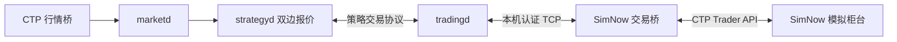

# SimNow 模拟柜台接入

`tradingd` 通过 `CtpTradingAdapter` 将策略报撤单交给 SimNow 柜台，接收柜台委托、
成交及账户查询结果。CTP SDK 在独立 Python 交易桥中运行，C++ 网关管理本地订单、
请求归属、回报校验及策略分发。

## 组件与账户来源



行情接入沿用 [CTP 行情与录制](ctp-market-data.md)。`adapter: "ctp"` 使用柜台
账户模式，资金、持仓及成交来自交易桥；`adapter: "simulated_futures"` 的本地撮合和
固定费率账本见[国内期货模拟交易](domestic-futures.md)。

网关在欢迎账户中发布 `broker_managed`。策略宿主据此关闭 `SimulationQuote` 注入，
并通过 `supports_generic_close()` 选择柜台支持的平仓意图。

## 登录与启动查询

交易桥只接受维护者公开的 SimNow 交易前置和 `BrokerID=9999`。
交易登录始终需要个人模拟账户；行情的匿名登录选项只作用于行情桥。
前置及示例字段依据[维护者配置](https://github.com/Jedore/ctp.examples/blob/main/openctp-ctp/config.py)，
服务时段与账户规则见 [SimNow 环境说明](https://www.simnow.com.cn/product.action)。

启动状态为：

```text
连接 → 认证 → 用户登录 → 结算确认 → 完整账户查询 → 允许策略启动
```

`Init()` 前订阅私有流和公有流。认证读取 `AppID`、`AuthCode`；登录成功后保留
`TradingDay`、`FrontID`、`SessionID` 和 `MaxOrderRef`，确认结算后串行查询资金、
持仓、持仓明细、当日委托和成交。查询限频，逐项等 `bIsLast`；API 返回零只表示请求
已发出。接口流程参考[维护者交易示例](https://github.com/Jedore/ctp.examples/blob/main/openctp-ctp/base_tdapi.py)。

当前运行入口交易单个合约，允许该合约在策略净仓及总仓限制内的非零初始持仓；
启动时账户预占须为零。其他合约的非零持仓、
未归属的活动委托、无法核对的持仓明细或超出有界存储的查询结果会拒绝启动，
保留诊断供账户对账。

## 柜台账户与持仓

金额转换为整数微元，查询原始值按以下含义映射：

| 模型字段 | CTP 查询值 |
| --- | --- |
| `equity` | `Balance` |
| `unrealized_pnl` | `PositionProfit` |
| `balance` | `Balance - PositionProfit`，表示静态余额 |
| `available` | `Available` |
| `margin` | `CurrMargin` |
| `reserved` | `FrozenMargin + FrozenCash + FrozenCommission` |
| `realized_pnl`、`commission` | `CloseProfit`、`Commission` |

柜台模式保留查询的可用资金与冻结口径，不套用本地模拟保证金、手续费和估值公式。
网关校验账户范围、数值边界和仓位单位；金融资源冻结由柜台检查。

四个今昨多空桶按柜台持仓明细的开仓日期、方向、剩余数量及开仓成本汇总，不将
聚合均价四舍五入为一个虚构的开仓价。上期所和能源中心按持仓日期行保留冻结；
其他场所只给方向总冻结时，保存在 `unallocated_long_frozen` 或
`unallocated_short_frozen`，不猜测分摊到今昨桶。

查询与回调是异步数据。桥将查询期间发生变化的批次重新核对，再为规范化回报附上
完整柜台快照；同一批快照可能领先其中逐笔委托回报。策略保留未终结委托，等待
实际终态，不从账户先行归零推断旧单已经结束。查询在途不阻塞报单、撤单或停止请求。

## 报单、成交与撤单

普通限价单使用投机、当日有效和任意数量成交条件。价格与手数按共享字典校验；
`OrderRef` 从登录返回的上界递增，耗尽时显式失败。

| 场所 | 平仓意图与 CTP 标志 |
| --- | --- |
| SHFE、INE | `kCloseToday → 3`，`kCloseYesterday → 4` |
| DCE、CZCE、CFFEX、GFEX | `kClose → 1`，由柜台决定消耗的今昨仓 |

开仓统一为 `kOpen → 0`。普通平仓不能伪装成精确平今或平昨，规则依据
[CTP 报单接口](https://ctpdoc.jedore.top/6.7.11/JYJK/CTHOSTFTDCTRADERAPI/REQORDERINSERT/)。

稳定柜台身份由交易日、前置、会话和 `OrderRef` 组成，绑定后不替换。
交易所 `OrderSysID` 另行保存，并保留前导空格，用于撤单和成交身份核对。
成交去重包含交易日、场所、系统委托号、成交号及方向。

成交只由唯一 `OnRtnTrade` 明细产生。先到的全部成交或撤单状态等待相应明细齐全，
再发布逐单连续的规范化序号；重复回报不再次记账。成交先于委托回报时，缓冲至
系统委托身份核对完成。撤单返回零不确认已撤，最终以委托状态或关联失败回报为准；
迟到的旧撤单失败不能清除新一次撤单。

## 停止与故障

停止时先由策略撤单排空，再由网关排空柜台并退出，随后等待交易桥释放 SDK 并退出；
最后停止 `marketd` 封存行情录制，再由行情桥释放行情 SDK。
交易桥完成最终账户查询后先发送 `Account`，再发送 `Drained`；网关通过正常 `Poll`
提交该最终账户，收到 `Drained` 后才完成正常停止。

断流、回调溢出、身份不符、查询总期限超时及未确认请求都使本次运行失败。
不自动重连、重报未知发送结果或把未知委托改为撤销。重启先重新查询柜台，有未归属活动委托时须先对账。

## 运行

构建 C++ 程序后，在运行脚本使用的 Python 环境中安装
[CTP Python 依赖](../../scripts/requirements-ctp.txt)，并在本机
设置 `YQUANT_CTP_USER_ID` 和 `YQUANT_CTP_PASSWORD`。
`YQUANT_CTP_BROKER_ID` 默认 `9999`，`YQUANT_CTP_APP_ID` 默认
`simnow_client_test`，`YQUANT_CTP_AUTH_CODE` 默认使用 SimNow 公布的认证码。
凭据不放入命令行、配置文件或运行清单。

默认使用第一套前置，行情为 `tcp://182.254.243.31:30011`，交易为
`tcp://182.254.243.31:30001`。须在合约交易时段运行：行情桥要求事件时间与本机
时钟偏差不超过 5 秒，午间或收盘缓存不能驱动策略报价。使用 API 测试环境时，
同时指定 `--md-front` 和 `--td-front`；账户生效及服务时段按
[SimNow 环境说明](https://www.simnow.com.cn/product.action)核对。

```sh
python3 scripts/run_simnow_strategy.py live \
  --run-dir /tmp/yquant-simnow-run \
  --catalog examples/ctp/treasury_instruments.json \
  --venue CFFEX --symbol TF2612 --anonymous-md \
  --duration-seconds 60
```

脚本创建私有运行目录，随机分配本机交易桥令牌，保存配置、分开的标准输出和诊断、
行情录制及运行清单。两个交易方向均取得柜台受理回报后才开始计时；正常退出还须
确认交易桥排空。单独配置适配器时参见
[柜台连接模板](../../examples/tradingd/simnow_bridge.json)。

## 验证

### 离线测试

交易桥测试使用受控 SDK 回调，覆盖登录、结算、查询限频、初始持仓、实际金额口径、
成交乱序、重复回报及撤单竞争。协议与 C++ 编解码逐字节核对，网关和策略测试验证
柜台账户不会进入本地撮合与模拟重算，完整进程测试运行实际 C++ 程序和受控 SDK。

### 柜台验收

柜台验收在合约服务时段完成登录、报单、成交、撤单和最终账户核对。成交以柜台
`OnRtnTrade` 回报和独立会话的成交查询交叉核对，撤单以委托终态为准。

2026-10-23 使用 SimNow 第一套环境验收 `CFFEX/TF2612`：

| 检查项 | 实测结果 |
| --- | --- |
| 原双边报价策略 | 运行 60 秒，买卖两侧均获柜台受理；8 笔委托全部撤销，本轮无成交；录制 65 条有效行情。 |
| 单手成交与撤单 | 临时策略协议客户端经实际 `tradingd` 和 CTP 交易桥，完成 1 笔撤单及买开→卖平、卖开→买平两组往返，共 4 笔一手成交。 |
| 独立柜台查询 | 查询到 13 笔终结委托：9 笔撤销、4 笔全部成交；成交标识、方向、开平、价量与网关回报逐笔一致。 |
| 最终账户 | 持仓、保证金、冻结资金和挂单均为零；已实现损益 -100 元、手续费 6 元，余额及可用资金均为 19999894 元。 |
| 停止收尾 | 两轮运行的网关和交易桥均确认排空，所有子进程正常退出，行情录制通过封存校验。 |

本机证据位于 `test_data/simnow/2026-10-23/`：`verification.json` 保存逐项验收
与文件校验值，`tf2612_live/` 保存原策略运行，`tf2612_execution_check/` 保存策略
协议客户端的委托、成交及账户回报，`account_after_execution_check.json` 保存独立
柜台查询。运行数据不纳入 Git。
