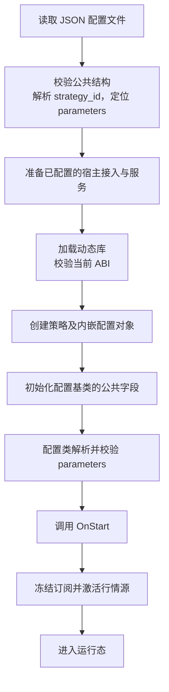

# 策略配置设计

`StrategyConfig` 定义策略配置的公共部分，具体策略通过派生配置类将 JSON 中的 `parameters` 转换为强类型成员。

宿主与所有策略始终使用最新 SDK 和 ABI，配置接口随策略接口统一演进。动态库协议见[策略进程与动态策略加载设计](strategyd.md)。

## 配置格式

基础字段位于 JSON 根对象，自定义参数集中在 `parameters` 对象中。

```json
{
  "strategy_id": "market-maker-001",
  "parameters": {
    "quote_qty": 1,
    "max_position": 5
  }
}
```

配置文件遵循[通用 JSON 输入规则](engineering.md#json-配置文档)，根对象只允许已定义的公共字段。参数数值的具体范围由派生配置处理。

| 字段 | 类型与约束 | 校验归属 |
| --- | --- | --- |
| `strategy_id` | 必填字符串，解码后的 UTF-8 内容为 1 至 64 字节，禁止内嵌 NUL | 框架 |
| `parameters` | 必填 JSON 对象，无自定义参数时填写 `{}` | 框架校验对象类型，具体配置类校验内部参数 |

`strategy_id` 的字节数不包含终止符，也不按 JSON 转义文本的长度计算。校验失败时拒绝配置，不截断 ID。框架保留解码后的原始内容，不修改大小写或裁剪空白。

具体配置类定义允许的参数、必填项、默认值和取值约束。未知参数拒绝，缺省值只按该策略明确声明的规则补全；不把字符串自动转换为数值。

## 强类型配置

### 公共配置基类

公共类型位于 `yquant::strategy`，核心接口如下：

```cpp
class StrategyConfig {
 public:
  virtual ~StrategyConfig() noexcept = default;

  std::string_view strategy_id() const noexcept;
  bool ready() const noexcept;

  [[nodiscard]] base::ErrorCode Initialize(
      const StrategyId& strategy_id,
      std::string_view parameters_json,
      ConfigError& error) noexcept;

 protected:
  [[nodiscard]] virtual base::ErrorCode LoadParameters(
      std::string_view parameters_json,
      ConfigError& error) noexcept;
};
```

`StrategyId` 是公共的定长字符串类型，可完整保存 64 字节内容，并独立记录有效长度。`strategy_id()` 返回指向配置自身存储的只读视图，不分配内存。

`Initialize()` 为非虚函数，宿主传入已经校验的 ID 和 `parameters` JSON 对象文本。基类先保存公共字段，再调用派生类的 `LoadParameters()`；派生类不覆盖公共字段的加载规则。

```text
Initialize(strategy_id, parameters_json, error):
    如果已经尝试过初始化，返回状态错误
    标记已经尝试初始化
    清空 error
    如果 strategy_id 为空，返回参数错误
    保存 strategy_id
    result = LoadParameters(parameters_json, error)
    ready = result 成功
    return result
```

每个配置对象只允许一次初始化尝试，失败后也不重试；重复调用返回状态错误，不修改配置或诊断。成功后配置保持不变；完整配置只在 `ready() == true` 时用于策略运行。`LoadParameters()` 执行期间已经可以读取公共 ID。

基类的 `LoadParameters()` 默认只接受空对象。无自定义参数的策略可直接持有 `StrategyConfig`，不必再定义派生类。

### 具体策略配置

派生配置类表示该策略的完整配置，继承公共字段并增加自己的强类型参数。

```cpp
class MarketMakingConfig final : public StrategyConfig {
 public:
  std::int64_t quote_qty() const noexcept { return quote_qty_; }
  std::int64_t max_position() const noexcept { return max_position_; }

 protected:
  base::ErrorCode LoadParameters(
      std::string_view parameters_json,
      ConfigError& error) noexcept override;

 private:
  std::int64_t quote_qty_ = 0;
  std::int64_t max_position_ = 0;
};
```

`MarketMakingConfig::LoadParameters()` 解析对象，检查参数类型、范围和组合关系。例如，`quote_qty`、`max_position` 为必填整数，满足 `quote_qty > 0`、`max_position >= quote_qty`。读取和校验使用临时值，全部成功后写入成员。

参数值保留在配置对象自身存储中。策略在运行期间直接读取成员，不再解析 JSON 或进行参数类型转换。

整数参数及组合约束的可运行示例见 [parameterized_strategy.cc](../../examples/strategies/parameterized_strategy.cc) 及[配套 JSON](../../examples/strategies/parameterized_strategy.json)。

生命周期示例 [lifecycle_strategy.cc](../../examples/strategies/lifecycle_strategy.cc) 使用派生配置 `LifecycleConfig`，读取必填字符串 `startup_message`。解码后的内容必须为 1 至 128 字节，禁止内嵌 NUL，未知参数拒绝；配置使用定长存储持有消息，不保留 JSON 字符串视图。[配套 JSON](../../examples/strategies/lifecycle_strategy.json) 如下：

```json
{
  "strategy_id": "lifecycle-example",
  "parameters": {
    "startup_message": "lifecycle strategy started"
  }
}
```

`LifecycleStrategy::OnStart` 读取配置中的消息并输出 `lifecycle_strategy: startup_message=lifecycle strategy started`，验证参数在原始 JSON 缓冲释放后仍可使用。

行情观察示例 [quote_observer_strategy.cc](../../examples/strategies/quote_observer_strategy.cc) 的 `QuoteObserverConfig` 读取必填的 `venue`、`symbol`，保存为自持字符串。场所支持 `SSE`、`SZSE`、`BSE`，代码为六位 ASCII 数字；标的是否可供订阅由 `OnStart` 查询、登记时检查。宿主在此之前从[共享标的字典](market-data.md#共享标的字典)解析运行清单，完成本地定义加载。来源由宿主行情配置绑定，策略参数不包含 `source_id`。[配套 JSON](../../examples/strategies/quote_observer_strategy.json) 与宿主行情配置的对应关系见[行情驱动设计](market-data.md#配置与启动方式)。

## 策略持有配置

`Strategy` 通过配置访问器提供强类型配置，生命周期与行情回调通过 `StrategyContext&` 获取运行服务。

```cpp
virtual StrategyConfig& config() noexcept = 0;
```

具体策略内嵌其配置对象，通过协变返回类型提供更具体的访问器。

```cpp
class MarketMakingStrategy final : public Strategy {
 public:
  MarketMakingConfig& config() noexcept override { return config_; }

  base::ErrorCode OnStart(StrategyContext& context) noexcept override {
    // 此时配置已经完整校验，直接使用 config_.quote_qty() 等字段。
    ...
  }

  base::ErrorCode OnStop(StrategyContext& context) noexcept override;

 private:
  MarketMakingConfig config_;
};
```

框架通过 `StrategyConfig&` 读取公共 ID 和初始化状态，具体策略直接访问自己的 `MarketMakingConfig`，不需要向下转型。

`config()` 每次返回同一个内嵌对象，引用在策略实例存活期间有效。配置与策略一起创建、销毁，不增加独立的配置工厂或销毁函数。构造阶段只建立默认状态，运行资源由 `OnStart` 准备；行情标的查询及订阅通过该回调中的 `context.market_data()` 完成。配置对象不保存上下文或行情接口引用，这些引用只在当前回调期间有效。

## 配置加载与启动

### 命令与处理顺序

启动命令同时提供动态库、策略配置和行情配置路径：

```sh
yquant-strategyd --strategy ./market_making.so --config ./market_making.json \
  --market-data-config ./market_data.json
```

`--config <path>` 为必填参数，只出现一次。路径按启动工作目录解释，装配层在创建 runner 前读取并校验文件，再通过 `LoadAndStart` 传入已加载的配置。行情配置同样必填；交易配置可省略。组件选择与生命周期见[组件装配](strategyd.md#组件装配)。



框架先检查完整 JSON、根字段、ID 和 `parameters` 的对象类型，再加载动态库。宿主保留 `parameters` 的原始源码片段，避免通过浮点数中转或重新序列化改变整数精度。

宿主在加载策略动态库前完成已配置接入的校验与服务准备。策略配置初始化后才调用 `OnStart`，成功后激活已配置的行情源。运行与收尾顺序见[策略进程设计](strategyd.md#运行流程)。

配置对象接收的 JSON 文本只在 `Initialize()` 及其调用的 `LoadParameters()` 期间有效。初始化完成后释放文件缓冲和解析临时存储；需要保留的字符串、数组等数据必须由配置对象持有。

### 校验失败与诊断

宿主提供固定容量的 `ConfigError`，它是 `base::ConfigError` 的别名，诊断存储规则见[通用配置文档](engineering.md#json-配置文档)。`Initialize()` 和 `LoadParameters()` 通过 `ConfigError&` 接收这个必须提供的输出对象，仅在当前调用期间借用，配置对象不得保存其引用或地址。首次初始化尝试先清空诊断，再执行校验。派生配置类报告相对于 `parameters` 的字段路径，宿主添加前缀后输出，例如 `parameters.quote_qty: 必须大于 0`。

需要在销毁实例后输出的 ID 和诊断先复制到宿主持有的存储，再执行收尾。

| 失败阶段 | 处理行为 |
| --- | --- |
| 参数解析 | 输出用法，退出码为 `2` |
| 文件读取、JSON 或公共字段校验 | 输出路径和原因，不加载动态库，退出码为 `1` |
| 宿主接入配置校验或服务初始化 | 释放已取得的宿主资源，不加载策略动态库，退出码为 `1` |
| 配置初始化或自定义参数校验 | 保存诊断，销毁实例、释放动态库句柄；不调用 `OnStart`、`OnStop`，退出码为 `1` |
| `OnStart` | 沿用启动失败回滚，销毁实例及内嵌配置，不调用 `OnStop` |
| 行情源 `Start` 或运行期错误 | 已成功启动的策略最终配对一次 `OnStop`，按宿主收尾规则销毁实例与配置，退出码为 `1` |

未启动、配置初始化失败和已经停止的策略都必须可安全销毁。配置一直保留到 `destroy()`，在其中随策略析构；正常运行结束时，宿主按[停止规则](trading.md#主循环与收尾)先排空委托，再调用 `OnStop` 和销毁实例。

## 动态库边界与工程约束

跨动态库只传递公共 SDK 类型和 JSON 文本视图。第三方 JSON DOM、解析器及其分配器留在各自模块内部；宿主解析公共结构，策略在初始化时解析自身参数。

`StrategyConfig` 的初始化、公共字段访问和空参数默认处理通过头文件实现，保持 `yquant::strategy_api` 为 `INTERFACE` target，不依赖宿主额外导出的 C++ 函数。策略配置类型放入 `include/yquant/strategy/strategy_config.h`，其中 `strategy::ConfigError` 是基础诊断类型的别名。各进程的配置加载器共同使用 `base::JsonConfigDocument`，基础库不依赖策略 SDK。

宿主和策略均使用支持显式错误返回的 JSON 解析路径，遵守无异常约定。必要的读取、解码和配置存储分配在初始化阶段完成，检查失败；运行期不扩容配置存储，也不持有原始 JSON 的借用。

JSON 依赖的构建方式见[构建与依赖](engineering.md#构建与依赖)。策略加载器通过持有 `base::JsonConfigDocument` 保留原始 `parameters` 片段，直至配置初始化完成。

公共接口的签名或布局变化时更新 `kStrategyPluginAbiVersion`，宿主和所有策略按最新 SDK 同步重新编译。加载器在创建实例和调用配置访问器之前校验版本一致性，不提供旧 ABI 的兼容路径。工厂通过 `Strategy*&` 接收必须提供的输出变量，创建与销毁协议见[动态库入口与对象所有权](strategyd.md#动态库入口与对象所有权)。

## 验证标准

| 场景 | 验收条件 |
| --- | --- |
| 公共字段 | ID 解码后为 64 字节时完整保留，65 字节、空字符串、内嵌 NUL、错误类型及非法 UTF-8 均拒绝 |
| JSON 结构 | 缺少公共字段、非对象根节点、非对象 `parameters`、未知根字段及任意层级重复键均拒绝 |
| 输入容量 | 1 MiB 文件和 64 层容器正常加载，超过任一上限时拒绝 |
| 无自定义参数 | 基类配置接受空对象，包含未知参数时拒绝 |
| 强类型参数 | 派生类正确读取整数等字段，缺项、未知项、数值溢出和组合约束失败给出对应路径；整数不经过浮点数中转 |
| 生命周期策略参数 | `startup_message` 为必填字符串，解码后 1 至 128 字节且无内嵌 NUL；缺项、错误类型、空字符串、超长及未知参数均拒绝，启动时输出配置中的消息 |
| 一次初始化 | 成功或失败后再次初始化均返回状态错误，配置及已有诊断不被修改 |
| 生命周期 | 配置全部校验后才调用 `OnStart`；配置失败直接销毁，无启动或停止回调；`OnStart` 成功后的接入激活或运行失败仍执行一次 `OnStop` |
| 存储生命周期 | 初始化后释放原始 JSON 缓冲，配置中的 ID、字符串和容器仍可正确读取，销毁后无残留引用 |
| 诊断生命周期 | 实例销毁和动态库句柄释放后，宿主仍可输出字段路径及原因 |
| ABI | 版本与 `kStrategyPluginAbiVersion` 不符的插件在工厂调用前被拒绝，当前版本策略完成配置、启动和停止 |
