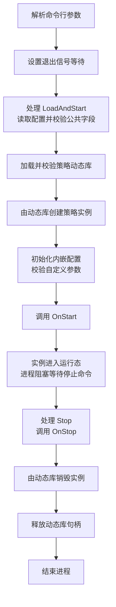

# 策略进程与动态策略加载设计

`yquant-strategyd` 通过运行时命令加载用户编译的策略动态库，管理单个策略实例的生命周期。

## 功能范围

策略通过配置访问器提供强类型配置，通过启动和停止回调管理运行资源。动态库负责创建、销毁策略对象；策略进程负责校验配置、加载动态库、调用生命周期回调和释放动态库句柄。

`StrategyConfig` 与 JSON 参数的结构、接口和启动校验见[策略配置设计](strategy-config.md)。

当前命令来源为启动参数和退出信号：命令行指定动态库与配置文件路径，进程启动后将其转换为加载命令；`SIGINT`、`SIGTERM` 转换为停止命令。命令由主线程串行处理，进程以前台常驻方式运行。

每次进程运行只加载一个策略实例，不提供重新加载、热替换或多实例管理。行情、交易、策略轮询和业务事件回调不进入这一阶段；[一档双边做市策略](bbo-market-making.md)中的交易接口与交易循环由后续功能承载。

## 启动方式与命令

```sh
# Linux 构建产物的运行示例
./build/debug/bin/yquant-strategyd \
  --strategy ./build/debug/strategies/lifecycle_strategy.so \
  --config ./build/debug/strategies/lifecycle_strategy.json
```

`--strategy <path>` 与 `--config <path>` 为必填参数，各出现一次，顺序不限。缺少路径、空路径、重复参数或未知参数均输出用法并退出；`--help` 单独使用时输出用法并成功退出。

以 `-` 开头的路径使用 `./` 前缀或绝对路径传入，避免与命令行选项混淆。

相对路径以进程启动工作目录为基准。加载器将参数按文件路径解释，传给 `dlopen()` 前转换为绝对路径，避免把不含斜线的文件名解释为动态库搜索名称。运行时按路径打开动态库，不根据文件扩展名判断格式。

内部只定义两种命令：

| 命令 | 含义 | 当前来源 |
| --- | --- | --- |
| `LoadAndStart{library_path, config_path}` | 读取配置，加载动态库，创建、配置并启动策略实例 | `--strategy` 与 `--config` 参数 |
| `Stop` | 停止策略、销毁实例、释放动态库句柄并结束运行 | `SIGINT`、`SIGTERM`，以及运行期错误收尾 |

命令行解析只生成初始命令，加载操作由运行时的命令处理入口执行。当前不建立命令队列、IPC 服务或独立控制线程；未来其他命令来源复用同一分派入口。

## 策略接口

### 生命周期回调

用户使用 C++ 继承 `yquant::strategy::Strategy`。关键签名如下：

```cpp
virtual StrategyConfig& config() noexcept = 0;
virtual base::ErrorCode OnStart() noexcept = 0;
virtual base::ErrorCode OnStop() noexcept = 0;
virtual ~Strategy() noexcept = default;
```

回调使用现有 `base::ErrorCode`，`kOk` 表示成功。跨模块返回值只包含错误码，运行时的加载错误使用项目 `Status` 表达；阶段、路径及系统加载器诊断由宿主输出。

`config()` 返回策略内嵌的配置对象，宿主完成公共字段和自定义参数校验后才调用 `OnStart()`。配置初始化失败时直接销毁实例，不调用启动或停止回调。

`OnStart()` 准备运行资源，成功返回后实例进入运行态。回调必须及时返回，进程随后保持实例存活并等待停止命令；当前没有持续调用策略的 `OnRun()` 或定时回调。

`OnStart()` 失败时，策略回滚本次启动操作，实例保持可安全销毁。宿主直接销毁该实例，不调用 `OnStop()`。

`OnStop()` 只配对成功的 `OnStart()`，由宿主调用一次。无论返回成功还是失败，回调返回前都必须停止实例拥有的全部活动，并收回自有线程和异步任务；错误码用于报告资源收尾的结果。宿主记录失败后继续销毁和释放动态库句柄，最终以失败状态退出。

构造器只建立可安全销毁的对象及配置状态；可失败的运行资源准备放在 `OnStart()`。析构器支持尚未启动、配置失败、启动失败及已经停止的实例，释放对象仍持有的资源；`destroy()` 完成策略及内嵌配置的析构与存储释放。动态库全局构造、析构不承担策略的启动或停止职责。

所有生命周期操作由主线程同步执行，不并发调用同一实例。策略不得修改宿主的退出信号约定；同步回调执行期间，停止请求等待该回调返回后再处理。

### 动态库入口与对象所有权

每个动态库只提供一个策略类型，导出固定入口 `YQuantGetStrategyPlugin`。入口返回不可变描述符，不创建实例或启动策略。

```text
StrategyPlugin:
    abi_version: uint32                         # kStrategyPluginAbiVersion
    struct_size: uint32                         # 描述符字节数
    create(Strategy** out) noexcept -> ErrorCode
    destroy(Strategy* instance) noexcept

extern "C" YQuantGetStrategyPlugin() noexcept -> const StrategyPlugin*
```

宿主先检查入口返回值非空、`abi_version == kStrategyPluginAbiVersion`、`struct_size == sizeof(StrategyPlugin)`，以及 `create`、`destroy` 均非空，再调用工厂。

宿主在调用 `create()` 前将输出指针初始化为空。工厂成功时返回 `kOk` 和非空实例；失败时释放本次临时资源，返回错误码并将输出指针置空。用户策略可在创建阶段使用 `new (std::nothrow)`，分配失败返回 `kResourceExhausted`。

工厂写入输出的任何非空实例都必须可由 `destroy()` 回收。返回码与指针不一致时，宿主报告插件协议错误；若指针非空，先销毁再释放动态库句柄，不调用 `OnStart()`。

实例始终由同一动态库的 `destroy()` 释放，宿主不直接 `delete`。`destroy()` 在支持的实例状态下必须完成销毁，不抛异常。

描述符和工厂函数指针由动态库持有，只在动态库句柄有效期间使用。宿主在 `destroy()` 返回后清空实例引用，再释放动态库句柄；释放后不再访问描述符、工厂函数或实例的虚函数。

入口使用 C linkage 固定符号名，生命周期接口仍依赖 C++ ABI。密集开发期间，宿主与所有策略始终采用最新 SDK 和 ABI，同步重新编译，不维护旧 ABI 的兼容实现。接口的虚函数布局或描述符布局变化时更新 `kStrategyPluginAbiVersion`，加载器只接受与自身版本一致的策略动态库。

宿主与策略使用相同目标平台和架构、兼容的编译器与标准库构建；验收使用同一工程和同一构建 preset。

## 运行流程

### 状态与资源

运行时的状态为 `Idle`、`Starting`、`Running`、`Stopping`、`Finished`。配置文件读取与公共校验、动态库加载、实例创建、配置初始化、启动在 `Starting` 内顺序执行；运行时分别保存动态库句柄、描述符、实例指针和启动成功标记，失败时只释放已经取得的资源。策略 ID 另存定长宿主副本，销毁实例后仍可用于诊断。

| 触发条件 | 状态变化 |
| --- | --- |
| 空闲态处理 `LoadAndStart` 并成功启动 | `Idle → Starting → Running` |
| 启动任一阶段失败 | `Starting → 失败收尾 → Finished`，保留失败结果 |
| 运行态处理 `Stop` | `Running → Stopping → Finished`，停止返回错误时也完成销毁与动态库句柄释放 |
| 空闲态处理 `Stop` | `Idle → Finished` |
| 结束态重复处理 `Stop` | 保持 `Finished`，不重复回调或释放 |
| 非空闲态处理 `LoadAndStart` | 返回 `kInvalidState`，保持现有状态和实例 |



图中为正常路径。启动失败时按下文的失败阶段收尾，进程不自动重试或重新加载。

### 主循环与信号

主线程在任何后台线程创建、动态库加载或策略代码执行之前，通过 `pthread_sigmask()` 阻塞 `SIGINT`、`SIGTERM`，再将这两个信号的处置恢复为默认，接管执行程序时可能继承的忽略状态。随后使用 `sigwait()` 同步接收这两个信号，将等待结果转换为 `Stop` 命令。新线程继承创建者的信号掩码，运行态等待不轮询、不忙等。[信号掩码与线程继承](https://man7.org/linux/man-pages/man3/pthread_sigmask.3.html)、[同步等待信号](https://man7.org/linux/man-pages/man3/sigwait.3.html)。

```text
Main(args):
    options = ParseArguments(args)
    if 参数非法:
        输出用法
        return 2
    if 请求帮助:
        输出用法
        return 0

    阻塞 SIGINT、SIGTERM
    if 信号设置失败:
        输出错误
        return 1

    result = runtime.Handle(
        LoadAndStart{options.strategy_path, options.config_path})
    if result 成功:
        输出 Running 状态
        wait_result = 等待 SIGINT 或 SIGTERM
        if 等待失败:
            记录运行错误
        stop_result = runtime.Handle(Stop)
        汇总等待与停止结果

    return 全部成功时为 0，否则为 1
```

启动过程中到达的停止信号保持为待处理信号；`OnStart()` 成功返回后，`sigwait()` 接收它并执行停止。若启动本身失败，完成失败收尾后直接退出。生命周期回调不被信号处理函数抢占执行清理。

信号掩码保留到进程退出，使后续停止信号不会中断对象销毁和动态库句柄释放。这个版本不提供超时强制中断用户回调的能力，生命周期回调必须遵守及时返回的约定。

### 动态库加载与释放

使用 `dlopen(path, RTLD_NOW | RTLD_LOCAL)` 加载策略动态库，成功后保存返回的动态库句柄。加载时解析所需符号，缺失依赖当场返回错误；策略动态库的符号不用于后续动态库的全局符号解析。随后查找固定入口并校验描述符。`dlsym()` 调用前清空 `dlerror()`，调用后立即检查错误；加载器诊断在后续加载器操作前复制到宿主诊断存储。[动态加载接口](https://man7.org/linux/man-pages/man3/dlopen.3.html)。

正常释放顺序固定为：

```text
OnStop() → destroy(instance) → 清空实例引用
         → 清空描述符与函数引用 → dlclose(handle)
```

`dlclose()` 检查返回值，失败记录为进程运行错误。关闭操作释放宿主持有的动态库引用，不依赖操作系统立即移除动态库映射作为正确性条件。测试同样验证调用顺序和所有权，不以地址空间中的映射消失作为断言。

### 失败处理

| 失败阶段 | 收尾动作 |
| --- | --- |
| 参数解析、信号设置、路径准备 | 输出错误并退出，不执行策略工厂 |
| 配置文件读取、JSON 或公共字段校验 | 保存文件路径和诊断，不加载动态库 |
| `dlopen()` | 输出加载器诊断；无实例，无动态库引用需要释放 |
| 符号查找、描述符版本或字段校验 | 释放动态库句柄，不创建实例 |
| `create()` | 按工厂约定无有效实例，释放动态库句柄 |
| 工厂返回码与实例指针不一致 | 报告插件协议错误；非空实例先销毁，再释放动态库句柄，不调用生命周期回调 |
| 配置初始化或自定义参数校验 | 保存诊断，销毁实例及配置，再释放动态库句柄；不调用 `OnStart()`、`OnStop()` |
| `OnStart()` | 策略完成启动回滚后，销毁实例、释放动态库句柄；不调用 `OnStop()` |
| 运行态信号等待 | 记录错误，仍执行停止、销毁和动态库句柄释放 |
| `OnStop()` | 记录收尾错误，继续销毁实例、释放动态库句柄 |
| `dlclose()` | 记录错误，以失败状态退出，不再访问策略代码 |

每项资源只释放一次。已有错误不会因后续清理成功被覆盖；阶段、动态库路径、配置路径、已校验的策略 ID、错误码和诊断输出到标准错误流。正常启动输出明确的 `Running` 状态和策略 ID。

退出码统一为：`0` 表示正常停止或帮助输出，`2` 表示命令行用法错误，`1` 表示加载、启动、运行或收尾失败。正常处理 `SIGINT`、`SIGTERM` 后返回 `0`。

## 工程组织与构建

公开接口放入 `yquant::strategy`，加载器和命令分派保持为策略进程的内部实现。

```text
include/yquant/strategy/strategy.h          生命周期接口
include/yquant/strategy/strategy_config.h   配置基类、策略 ID 与配置诊断
include/yquant/strategy/strategy_plugin.h   动态库入口与描述符
src/strategyd/main.cc                       参数与信号等待
src/strategyd/strategy_runtime.h/.cc        命令分派与生命周期管理
src/strategyd/strategy_library.h/.cc        动态库加载与释放
src/strategyd/strategy_config_loader.h/.cc  配置文件读取与公共校验
examples/strategies/lifecycle_strategy.cc   最小用户策略动态库
examples/strategies/parameterized_strategy.cc 强类型参数策略示例
tests/strategyd/                            运行时与进程集成测试
tests/strategyd/strategy_fixture.cc         生命周期及失败场景的测试动态库
tests/strategyd/missing_dependency.cc       缺失依赖场景的测试库
```

| CMake target | 类型与用途 |
| --- | --- |
| `yquant_strategy_api`，别名 `yquant::strategy_api` | `INTERFACE`，提供公开头文件与编译要求 |
| `yquant_strategyd_runtime` | 内部静态库，供程序和运行时测试复用加载与生命周期逻辑 |
| `yquant_strategyd` | 可执行程序，`OUTPUT_NAME` 为 `yquant-strategyd` |
| `lifecycle_strategy` | `MODULE`，用户策略示例，不链接进策略进程 |
| `parameterized_strategy` | `MODULE`，展示派生强类型配置，通过私有依赖解析自定义参数 |

程序输出到 `build/<preset>/bin/`，策略模块输出到 `build/<preset>/strategies/`。示例模块去掉默认 `lib` 前缀，使用 CMake 的本机模块后缀；Linux 示例为 `lifecycle_strategy.so`。macOS 使用本机 `MODULE` 产物，测试与构建命令通过 `$<TARGET_FILE:...>` 取得实际路径，不手写后缀。

策略模块使用 `add_library(... MODULE ...)`，由 CMake 为模块启用位置无关代码。模块默认隐藏符号，公开头文件中的 `YQUANT_STRATEGY_EXPORT` 标记固定入口为默认可见。[CMake MODULE 库](https://cmake.org/cmake/help/v3.21/command/add_library.html)。

加载目标通过 `${CMAKE_DL_LIBS}` 获取平台所需链接项，不硬编码 `-ldl`；信号操作使用 `Threads::Threads`。[CMake 动态加载库变量](https://cmake.org/cmake/help/latest/variable/CMAKE_DL_LIBS.html)。

宿主与策略都遵守 C++20、无异常编译选项，并使用相同的 sanitizer 配置。接口 target 复用项目编译配置；示例策略只依赖接口头文件，不静态链接整份 `yquant_base`，也不依赖宿主导出的全局业务符号。

策略实例和路径缓冲的必要分配放在加载、创建阶段，检查分配失败；运行态只保留已建立的对象和动态库引用。加载器、描述符与实例的所有权明确分离，避免释放动态库句柄后仍调用其中的代码。

## 示例策略与验收

示例 `LifecycleStrategy` 内嵌派生配置 `LifecycleConfig`，读取必填字符串 `parameters.startup_message`。消息解码后为 1 至 128 字节，禁止内嵌 NUL，未知参数拒绝；配置通过校验后将消息复制到自身定长存储。配套 JSON 使用 `lifecycle strategy started`，`OnStart()` 从配置读取消息并输出 `lifecycle_strategy: startup_message=lifecycle strategy started`，随后进入运行态。`OnStop()` 将其改为停止态，工厂负责销毁。

`ParameterizedStrategy` 使用派生配置读取 `quote_qty`、`max_position`。两个示例都不创建业务线程或进行行情、交易操作，配套 JSON 在构建时复制到策略产物目录。

验收使用真实动态库和真实 `yquant-strategyd` 子进程。测试模块通过继承的管道或临时文件记录调用轨迹；测试控制信息只用于测试模块，不加入生产策略接口。

| 场景 | 验收条件 |
| --- | --- |
| 示例策略冒烟 | 真实加载示例库，观察宿主的 `Running` 状态；生命周期示例输出与配置一致的 `startup_message`；发送停止信号后正常退出，退出码为 `0` |
| 生命周期策略参数 | 消息解码后为 128 字节时完整输出，缺项、空字符串、129 字节、内嵌 NUL、错误类型和未知参数均在启动前拒绝 |
| 生命周期轨迹 | 测试动态库记录 `Create → OnStart`，停止信号后为 `OnStop → Destroy`；各阶段均为一次，资源测试确认随后释放动态库句柄 |
| 两种停止信号 | 分别验证 `SIGINT`、`SIGTERM`，正常退出码为 `0` |
| 启动中收到停止信号 | 测试库通过管道握手暂停 `OnStart()`，发送信号后再解除暂停；启动返回后完整收尾，不丢失停止请求 |
| 启动失败 | 轨迹为 `Create → OnStartFailed → Destroy`，不调用 `OnStop()`，释放动态库句柄并非零退出 |
| 停止返回失败 | 策略已停止全部自有活动，仍执行 `Destroy` 和动态库句柄释放，退出码为 `1` |
| 工厂失败与协议错误 | 创建失败不进入启动阶段；成功码配空实例、失败码配非空实例均被识别为协议错误；非空实例先销毁再关闭动态库句柄 |
| 动态库不合法 | 路径错误、缺少依赖、缺少入口、空描述符、ABI 版本不符、描述符尺寸不符及空工厂指针均在对应阶段失败，不执行后续回调 |
| 命令状态 | 运行态重复加载返回状态错误，不覆盖实例；重复停止不重复回调或释放 |
| 销毁顺序 | 加载器的资源测试确认 `destroy()` 完成后才调用关闭操作；可观测的动态库终结事件作为辅助证据，不要求各平台与 sanitizer 都发生物理卸载 |
| 命令行与路径 | 缺参、重复参数、未知参数及帮助输出符合约定；相对路径按工作目录解释，带空格的路径可通过单个参数加载 |

进程测试等待明确的启动事件再发送停止信号，不用固定休眠推测就绪。每个子进程设置测试超时，超时后终止并回收。Debug、Release 与 sanitizer 验收沿用[工程组织与验证方案](engineering.md)；Linux x86_64 验证生产行为，macOS 验证本机动态库加载与生命周期。
