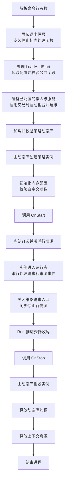

# 策略进程与动态策略加载设计

`yquant-strategyd` 通过运行时命令加载用户编译的策略动态库，管理单个策略实例的生命周期。

## 功能范围

策略通过配置访问器提供强类型配置，通过上下文取得行情和交易服务。动态库负责创建、销毁策略对象；策略进程校验配置、管理接入并串行调度策略回调。

`StrategyConfig` 与 JSON 参数的结构、接口和启动校验见[策略配置设计](strategy-config.md)。

行情数据与订阅见[行情驱动设计](market-data.md)，交易接口、委托账本及双来源调度见[交易执行设计](trading.md)。

当前命令来源为启动参数和退出信号：命令行指定动态库与策略配置文件路径，可选提供宿主行情与交易配置，进程启动后将其转换为加载命令；`SIGINT`、`SIGTERM` 发布停止请求。策略进程仅使用主线程，同步处理请求、来源事件和策略回调，以前台常驻方式运行。

每次进程运行只加载一个策略实例，支持模拟或共享内存行情与模拟柜台，不提供重新加载、热替换或多实例管理。持仓与资金账本随交易服务维护，真实柜台接入另行扩展。

## 启动方式与命令

```sh
# Linux 构建产物的运行示例
./build/debug/bin/yquant-strategyd \
  --strategy ./build/debug/strategies/lifecycle_strategy.so \
  --config ./build/debug/strategies/lifecycle_strategy.json
```

`--strategy <path>` 与 `--config <path>` 为必填参数，各出现一次，顺序不限。缺少路径、空路径、重复参数或未知参数均输出用法并退出；`--help` 单独使用时输出用法并成功退出。

`--market-data-config <path>` 为可选参数，最多出现一次，仅供宿主配置行情源。省略时标的字典为空，不接受行情订阅；不订阅行情的策略仍可正常启动和停止。行情配置按 `adapter` 选择 `mock` 或 `shm`；格式与命令示例见[行情驱动设计](market-data.md#配置与启动方式)，行情发布端见[行情进程设计](marketd.md)。

`--trading-config <path>` 为可选参数，配置模拟柜台时必须同时提供行情配置，用它引用的共享字典解析运行范围并建立本地标的字典。参数约束和交易配置见[宿主交易配置](trading.md#宿主配置)。

以 `-` 开头的路径使用 `./` 前缀或绝对路径传入，避免与命令行选项混淆。

相对路径以进程启动工作目录为基准。加载器将参数按文件路径解释，传给 `dlopen()` 前转换为绝对路径，避免把不含斜线的文件名解释为动态库搜索名称。运行时按路径打开动态库，不根据文件扩展名判断格式。

内部只定义两种命令：

| 命令 | 含义 | 当前来源 |
| --- | --- | --- |
| `LoadAndStart{library_path, config_path, market_data_config_path, trading_config_path}` | 读取配置，建立交易账户，加载并配置策略，调用启动回调后激活行情；两种接入配置路径可空 | 命令行参数 |
| `Stop` | 运行期登记停止请求，由 `Run()` 推进排空与最终释放 | `SIGINT`、`SIGTERM`，以及运行期错误收尾 |

命令行解析只生成初始命令，加载操作由运行时的命令处理入口执行。当前不建立外部命令队列或 IPC 服务；信号处理函数只记录停止请求，主线程完成回调与收尾。未来其他命令来源复用同一分派入口。

## 策略接口

### 策略回调

用户使用 C++ 继承 `yquant::strategy::Strategy`。关键签名如下：

```cpp
virtual StrategyConfig& config() noexcept = 0;
virtual base::ErrorCode OnStart(StrategyContext& context) noexcept = 0;
virtual base::ErrorCode OnStop(StrategyContext& context) noexcept = 0;
// 默认返回 kOk；不处理行情的策略可不重写。
virtual base::ErrorCode OnTick(
    StrategyContext& context, const model::QuoteTick& tick) noexcept;
virtual ~Strategy() noexcept = default;
```

回调使用现有 `base::ErrorCode`，`kOk` 表示成功。跨模块返回值只包含错误码，运行时的加载错误使用项目 `Status` 表达；阶段、路径及系统加载器诊断由宿主输出。

`config()` 返回策略内嵌的配置对象，宿主完成公共字段和自定义参数校验后才调用 `OnStart`。配置初始化失败时直接销毁实例，不调用启动或停止回调。

`OnStart` 准备策略运行资源，通过 `context.market_data().FindInstrument(venue, symbol, definition)` 查询标的，通过 `context.market_data().SubscribeQuotes(instrument_id)` 登记启动订阅。回调成功返回后订阅集合冻结，宿主再激活行情源；全部成功后进入运行态。回调必须及时返回，当前没有策略轮询或定时回调。行情接口的输入输出与错误约定见[行情接口](market-data.md#行情接口)。

行情与标识公共类型位于 `yquant::model`。宿主为行情服务绑定唯一来源，在该范围内按标的保存订阅、最新快照和序号；来源身份及入站校验见[行情驱动设计](market-data.md#行情来源身份)。

`OnStart` 失败时，策略回滚本次启动操作，实例保持可安全销毁。宿主直接销毁该实例，不调用 `OnStop`。

宿主在 `OnTick` 前更新最新行情缓存，在交易回调前更新委托、持仓与资金账本。`OnOrderUpdate` 和 `OnFill` 默认返回成功，签名与落账顺序见[交易服务与回调](trading.md#服务与回调)。业务回调失败后关闭后续业务回调，宿主仍处理能够完成的交易收尾，规则见[错误与超时](trading.md#错误与超时)。

`OnStop` 只配对成功的 `OnStart`，由宿主调用一次；`OnStart` 成功后的行情源激活失败也必须配对。正常运行结束时，`Run()` 先停止行情与策略新请求，完成委托排空后再调用 `OnStop`；无法继续排空或超时时保留未确认状态并失败收尾。该回调可查询最后行情、最终已知委托及账户状态，交易请求入口关闭。回调返回前必须结束实例拥有的全部活动，随后宿主销毁实例并释放动态库句柄。停止阶段的回调与排空规则见[正常停止](trading.md#正常停止)。

上下文及其返回的 `MarketData`、`Trading` 引用仅在当前主线程回调期间有效，策略不得保存其引用或地址供后续调用。`OnTick` 的行情引用同样只在当前回调内有效；需要保留的数据复制到策略自身存储。

构造器只建立可安全销毁的对象及配置状态；可失败的运行资源准备放在 `OnStart`。析构器支持尚未启动、配置失败、启动失败及已经停止的实例，释放对象仍持有的资源；`destroy()` 完成策略及内嵌配置的析构与存储释放。动态库全局构造、析构不承担策略的启动或停止职责。

全部策略回调由主线程同步执行，不并发调用同一实例。策略不得修改宿主的退出信号约定；同步回调执行期间，停止请求等待该回调返回后再处理。

### 动态库入口与对象所有权

每个动态库只提供一个策略类型，导出固定入口 `YQuantGetStrategyPlugin`。入口返回不可变描述符，不创建实例或启动策略。

```text
StrategyPlugin:
    abi_version: uint32                         # kStrategyPluginAbiVersion
    struct_size: uint32                         # 描述符字节数
    create(Strategy*& out) noexcept -> ErrorCode
    destroy(Strategy* instance) noexcept

extern "C" YQuantGetStrategyPlugin() noexcept -> const StrategyPlugin*
```

宿主先检查入口返回值非空、`abi_version == kStrategyPluginAbiVersion`、`struct_size == sizeof(StrategyPlugin)`，以及 `create`、`destroy` 均非空，再调用工厂。

宿主在调用 `create()` 前将保存实例的指针变量初始化为 `nullptr`，通过 `Strategy*&` 交给工厂填写。调用方必须提供这个输出变量，变量中的指针值允许为空。工厂成功时返回 `kOk` 和非空实例；失败时释放本次临时资源，返回错误码并将输出变量设为 `nullptr`。用户策略可在创建阶段使用 `new (std::nothrow)`，分配失败返回 `kResourceExhausted`。

工厂写入输出的任何非空实例都必须可由 `destroy()` 回收。返回码与指针不一致时，宿主报告插件协议错误；若指针非空，先销毁再释放动态库句柄，不调用 `OnStart`。

实例始终由同一动态库的 `destroy()` 释放，宿主不直接 `delete`。`destroy()` 在支持的实例状态下必须完成销毁，不抛异常。

描述符和工厂函数指针由动态库持有，只在动态库句柄有效期间使用。宿主在 `destroy()` 返回后清空实例引用，再释放动态库句柄；释放后不再访问描述符、工厂函数或实例的虚函数。

入口使用 C linkage 固定符号名，生命周期接口仍依赖 C++ ABI。当前 `kStrategyPluginAbiVersion` 为 `9`，宿主与所有策略按该版本 SDK 同步重新编译，不维护旧 ABI 的兼容实现。公共接口的签名或布局变化时更新该版本，加载器只接受与自身版本一致的策略动态库。

宿主与策略使用相同目标平台和架构、兼容的编译器与标准库构建；验收使用同一工程和同一构建 preset。

## 运行流程

### 状态与资源

`StrategyRunner` 的状态类型 `RunnerState` 包含 `Idle`、`Starting`、`Running`、`Stopping`、`Finished`。启动期间先校验配置，从[共享标的字典](market-data.md#共享标的字典)解析运行清单并准备行情字典与接入，启用交易时启动柜台并以初始账户快照建立交易账本，再加载并配置策略。字典读取或引用解析失败时不创建策略。`OnStart` 成功后激活行情源，共享内存源此时连接发布者并从 Live 开始；全部成功才进入 `Running` 并允许策略交易请求。接入初始化顺序与失败边界见[启动与事件调度](trading.md#启动与事件调度)。

`StrategyRunner` 分别保存动态库句柄、描述符、实例指针、启动成功标记和宿主资源，失败时只释放已经取得的资源。启动成功标记在 `OnStart` 返回成功后设置，使随后发生的行情源启动失败也执行一次 `OnStop`。策略 ID 另存定长宿主副本，销毁实例后仍可用于诊断。

启动各同步阶段的边界检查停止请求。尚未调用 `OnStart` 时取消启动并回收资源，不调用 `OnStop`；`OnStart` 成功返回后，即使尚未启动行情源，也必须配对一次 `OnStop`。行情源 `Start` 前检查停止，成功后再次检查，再进入运行态，避免停止后发出首个 `OnTick`。停止与失败同时发生时保留失败结果。

| 触发条件 | 状态变化 |
| --- | --- |
| 空闲态处理 `LoadAndStart` 并成功启动 | `Idle → Starting → Running` |
| 启动任一阶段失败 | `Starting → 失败收尾 → Finished`，保留失败结果 |
| 启动阶段处理停止请求 | `Starting → Stopping → Finished`，仅在 `OnStart` 已成功时调用 `OnStop`；无其他错误时成功退出 |
| 运行态处理 `Stop` | 保持 `Running`，只登记停止请求，不调用策略 |
| `Run()` 处理停止请求 | `Running → Stopping → Finished`，推进委托排空后最终释放；无法排空时失败收尾 |
| 空闲态处理 `Stop` | `Idle → Finished` |
| 结束态重复处理 `Stop` | 保持 `Finished`，不重复回调或释放 |
| 非空闲态处理 `LoadAndStart` | 返回 `kInvalidState`，保持现有状态和实例 |



图中为正常路径。启动失败时按下文的失败阶段收尾，进程不自动重试或重新加载。

### 主循环与信号

`main()` 持有 `StrategyRunner`，通过 `Handle(LoadAndStart)` 启动策略，再调用 `Run(environment)` 驱动主循环。行情批次处理与单条报价分派是 `StrategyRunner` 的私有实现，外部不直接调用。

主线程在动态库加载或策略代码执行前，通过 `pthread_sigmask()` 屏蔽 `SIGINT`、`SIGTERM`，使用 `sigaction()` 安装处理函数。处理函数只将 `volatile sig_atomic_t` 停止标志置位，不调用策略、记录日志或释放资源。普通代码、SDK 调用和全部策略回调执行时保持这两个信号被屏蔽。

接入的 `Poll()` 非阻塞，每次至多返回一条事件；宿主校验并更新对应行情或交易账本后调用策略。请求与来源事件按[事件调度规则](trading.md#启动与事件调度)公平推进，共享有界事件额度。无立即工作时，以最早期限通过 FD 集合全空的 `pselect(0, ...)` 等待；没有期限时传入空超时指针。

已激活行情源的 `Service(now)` 只在 `Running` 轮次边界执行，其维护期限参与整体最早期限；共享内存源无业务订阅时仍检查发布者。维护契约及忙轮询让出规则见[行情源接口](market-data.md#接口契约)。进入 `Stopping` 后停止行情读取和维护，交易侧继续排空；行情读取或维护失败同样先关闭新请求，再推进仍可完成的交易收尾。

`pselect` 期间临时解除退出信号屏蔽，返回后恢复屏蔽并立即检查停止。事件批次与启动同步阶段的边界通过 `pthread_sigmask()` 临时设置 `wait_mask`，立即恢复 `blocked_mask`，再读取停止标志；检查窗口不调用策略或 SDK。信号和时间期限的等待采用同一主线程协议。[pselect](https://man7.org/linux/man-pages/man2/select.2.html)、[信号掩码](https://man7.org/linux/man-pages/man3/pthread_sigmask.3p.html)

运行态的 `Handle(Stop)` 只登记请求，不执行回调或资源释放。调用方在 `Run()` 完成收尾后再销毁 `StrategyRunner`；析构不另建排空事件循环。

```text
Main(args):
    options = ParseArguments(args)
    if 参数非法:
        输出用法
        return 2
    if 请求帮助:
        输出用法
        return 0

    屏蔽 SIGINT、SIGTERM，并安装只设置停止标志的处理函数
    if 信号设置失败:
        输出错误
        return 1

    result = runner.Handle(
        LoadAndStart{options.strategy_path, options.config_path,
                     options.market_data_config_path, options.trading_config_path})
    if result 成功且 runner 处于 Running:
        输出 Running 状态
        result = runner.Run(termination_signals)
        # Run 在停止请求或运行错误后完成同步收尾再返回

    释放上下文及宿主资源

    return 全部成功时为 0，否则为 1
```

启动或回调执行期间到达的退出信号保持待处理，在下一次显式信号检查或 `pselect` 等待期间送达；当前同步操作不会被信号处理函数抢占执行清理。若启动本身失败，完成失败收尾后退出；停止与失败同时发生时保留失败结果。

执行最终停止回调、对象销毁和动态库句柄释放时保持信号屏蔽，使后续停止信号不会中断同步释放。这个版本不提供超时强制中断用户回调的能力，所有策略回调必须及时返回。

### 动态库加载与释放

使用 `dlopen(path, RTLD_NOW | RTLD_LOCAL)` 加载策略动态库，成功后保存返回的动态库句柄。加载时解析所需符号，缺失依赖当场返回错误；策略动态库的符号不用于后续动态库的全局符号解析。随后查找固定入口并校验描述符。`dlsym()` 调用前清空 `dlerror()`，调用后立即检查错误；加载器诊断在后续加载器操作前复制到宿主诊断存储。[动态加载接口](https://man7.org/linux/man-pages/man3/dlopen.3.html)。

正常释放顺序固定为：

```text
Run 关闭策略请求入口与行情分派 → source.Stop() → 推进委托收尾
→ OnStop(context) → destroy(instance) → 清空实例引用
→ 清空描述符与函数引用 → dlclose(handle)
→ 关闭交易接入 → 释放宿主服务存储
```

`dlclose()` 检查返回值，失败记录为进程运行错误。关闭操作释放宿主持有的动态库引用，不依赖操作系统立即移除动态库映射作为正确性条件。测试同样验证调用顺序和所有权，不以地址空间中的映射消失作为断言。

### 失败处理

| 失败阶段 | 收尾动作 |
| --- | --- |
| 参数解析、信号设置、路径准备 | 输出错误并退出，不执行策略工厂 |
| 配置文件读取、JSON 或公共字段校验 | 保存文件路径和诊断，不加载动态库 |
| 接入配置校验或 `Prepare` | 保存诊断，释放已取得的宿主资源，不加载策略动态库 |
| `dlopen()` | 输出加载器诊断；无实例，无动态库引用需要释放 |
| 符号查找、描述符版本或字段校验 | 释放动态库句柄，不创建实例 |
| `create()` | 按工厂约定无有效实例，释放动态库句柄 |
| 工厂返回码与实例指针不一致 | 报告插件协议错误；非空实例先销毁，再释放动态库句柄，不调用生命周期回调 |
| 配置初始化或自定义参数校验 | 保存诊断，销毁实例及配置，再释放动态库句柄；不调用 `OnStart`、`OnStop` |
| `OnStart` | 策略完成启动回滚后，销毁实例、释放动态库句柄；不调用 `OnStop` |
| 柜台 `Start`、账户快照读取或建账 | 保存诊断并释放资源，不加载策略动态库 |
| 行情源 `Start` | 启动期间无策略委托，配对一次 `OnStop` 后释放资源 |
| 运行期接入（含行情 `Poll`、`Service`）、回报协议或业务回调 | 保存错误，按[交易收尾规则](trading.md#错误与超时)继续排空或记录未确认状态，最终释放 |
| 信号检查时设置或恢复掩码失败 | 保存系统错误，仍完成行情源停止与策略收尾 |
| `pselect` 返回非 `EINTR` 的错误 | 保存等待错误，仍执行行情源停止、策略收尾和动态库句柄释放 |
| 接入 `Stop` | 记录关闭错误，继续能够安全执行的资源释放 |
| `OnStop` | 记录收尾错误，继续销毁实例、释放动态库句柄 |
| `dlclose()` | 记录错误，以失败状态退出，不再访问策略代码 |

每项资源只释放一次。已有错误不会因后续清理成功被覆盖；阶段、动态库路径、策略、行情及交易配置路径、已校验的策略 ID、错误码和诊断输出到标准错误流。正常启动输出明确的 `Running` 状态和策略 ID。旧或重复行情的累计忽略计数在停止后保留，非零时输出 `yquant-strategyd: ignored_quotes=N`。

失败收尾同样在策略销毁、动态库句柄释放后释放上下文资源。

退出码统一为：`0` 表示正常停止或帮助输出，`2` 表示命令行用法错误，`1` 表示加载、启动、运行或收尾失败。正常处理 `SIGINT`、`SIGTERM` 后返回 `0`。

## 工程组织与构建

公开接口放入 `yquant::strategy`，加载器和命令分派保持为策略进程的内部实现。

```text
include/yquant/model/identifiers.h         来源与标的标识
include/yquant/model/instrument.h          定长标的定义
include/yquant/model/quote_tick.h          一档报价
include/yquant/strategy/strategy.h          生命周期接口
include/yquant/strategy/strategy_config.h   配置基类、策略 ID 与配置诊断
include/yquant/strategy/strategy_context.h  单调时间及行情、交易服务访问器
include/yquant/strategy/market_data.h       策略可见的行情接口
include/yquant/strategy/trading.h           策略可见的交易接口
include/yquant/strategy/strategy_plugin.h   动态库入口与描述符
src/strategyd/main.cc                       参数与主线程调度
src/strategyd/strategy_runner.h/.cc         命令分派、事件循环与生命周期管理
src/strategyd/market_data.h/.cc             行情服务实现与状态
src/strategyd/strategy_context.h            上下文薄视图
src/strategyd/strategy_library.h/.cc        动态库加载与释放
src/strategyd/strategy_config_loader.h/.cc  策略公共字段与原始参数片段加载
include/yquant/base/json_config_document.h / src/base/json_config_document.cc    通用 JSON 文档读取与完整校验
src/strategyd/termination_signals.h/.cc     信号屏蔽、检查与期限等待
examples/strategies/lifecycle_strategy.cc   最小用户策略动态库
examples/strategies/parameterized_strategy.cc 强类型参数策略示例
examples/strategies/quote_observer_strategy.cc 行情订阅与快照观察示例
tests/strategyd/                            运行时与进程集成测试
tests/strategyd/strategy_fixture.cc         生命周期及失败场景的测试动态库
tests/strategyd/missing_dependency.cc       缺失依赖场景的测试库
```

| CMake target | 类型与用途 |
| --- | --- |
| `yquant_strategy_api`，别名 `yquant::strategy_api` | `INTERFACE`，提供公开头文件与编译要求 |
| `yquant_strategyd_runtime` | 内部静态库，供程序和运行时测试复用加载、账本、调度及生命周期逻辑 |
| `yquant_host_support` | 两个守护进程共用的配置读取、模拟行情和退出信号支持 |
| `yquant_md`，别名 `yquant::md` | 行情事件广播适配与报价帧编解码 |
| `yquant_strategyd` | 可执行程序，`OUTPUT_NAME` 为 `yquant-strategyd` |
| `lifecycle_strategy` | `MODULE`，用户策略示例，不链接进策略进程 |
| `parameterized_strategy` | `MODULE`，展示派生强类型配置，通过私有依赖解析自定义参数 |
| `quote_observer_strategy` | `MODULE`，订阅行情，检查回调快照并输出停止汇总；宿主配置选择模拟或共享内存源 |
| `order_lifecycle_strategy` | `MODULE`，提交一次限价委托，检查委托与成交回调及最终状态 |

程序输出到 `build/<preset>/bin/`，策略模块输出到 `build/<preset>/strategies/`。示例模块去掉默认 `lib` 前缀，使用 CMake 的本机模块后缀；Linux 示例为 `lifecycle_strategy.so`。macOS 使用本机 `MODULE` 产物，测试与构建命令通过 `$<TARGET_FILE:...>` 取得实际路径，不手写后缀。

策略模块使用 `add_library(... MODULE ...)`，由 CMake 为模块启用位置无关代码。模块默认隐藏符号，公开头文件中的 `YQUANT_STRATEGY_EXPORT` 标记固定入口为默认可见。[CMake MODULE 库](https://cmake.org/cmake/help/v3.21/command/add_library.html)。

加载目标通过 `${CMAKE_DL_LIBS}` 获取平台所需链接项，不硬编码 `-ldl`。[CMake 动态加载库变量](https://cmake.org/cmake/help/latest/variable/CMAKE_DL_LIBS.html)。信号和期限等待采用 POSIX `sigaction`、`pthread_sigmask` 与 `pselect`。

宿主与策略都遵守 C++20、无异常编译选项，并使用相同的 sanitizer 配置。接口 target 复用项目编译配置；示例策略只依赖接口头文件，不静态链接整份 `yquant_base`，也不依赖宿主导出的全局业务符号。

策略实例、路径缓冲及行情存储的必要分配放在准备、加载和创建阶段，检查分配失败；运行态复用行情源存储与固定容量缓存。加载器、描述符与实例的所有权明确分离，避免释放动态库句柄后仍调用其中的代码。

## 示例策略与验收

示例 `LifecycleStrategy` 内嵌派生配置 `LifecycleConfig`，读取必填字符串 `parameters.startup_message`。消息解码后为 1 至 128 字节，禁止内嵌 NUL，未知参数拒绝；配置通过校验后将消息复制到自身定长存储。配套 JSON 使用 `lifecycle strategy started`，`OnStart` 从配置读取消息并输出 `lifecycle_strategy: startup_message=lifecycle strategy started`，随后进入运行态。`OnStop` 将其改为停止态，工厂负责销毁。

`ParameterizedStrategy` 使用派生配置读取 `quote_qty`、`max_position`。两个示例均使用带上下文的生命周期回调，不登记行情订阅，也不进行交易；省略行情配置时仍保持运行直至收到停止请求。配套 JSON 在构建时复制到策略产物目录。

`QuoteObserverStrategy` 从派生配置读取场所和代码，在 `OnStart` 查询标的并订阅宿主绑定来源的报价，在 `OnTick` 检查最新缓存与回调一致。首次报价输出固定标记，`OnStop` 输出回调数、末次序号和最大数据年龄；运行方式与配套行情配置见[行情驱动设计](market-data.md#配置与启动方式)。

`OrderLifecycleStrategy` 从行情回调提交一次限价单，通过委托和成交回调检查账本，在停止阶段查询最终状态。配置、预期轨迹与收尾验收见[示例与预期轨迹](trading.md#示例与预期轨迹)。

验收使用真实动态库和真实 `yquant-strategyd` 子进程。测试模块通过继承的管道或临时文件记录调用轨迹；测试控制信息只用于测试模块，不加入生产策略接口。

| 场景 | 验收条件 |
| --- | --- |
| 示例策略冒烟 | 真实加载示例库，观察宿主的 `Running` 状态；生命周期示例输出与配置一致的 `startup_message`；发送停止信号后正常退出，退出码为 `0` |
| 无行情源或无订阅 | 空字典查询及订阅返回错误；不登记订阅的生命周期示例仍正常运行、停止 |
| 回调与错误收尾 | 行情及交易回调在主线程串行执行；启动、业务回调或接入失败仍按约定配对 `OnStop`，保留首个错误 |
| 等待与停止检查 | 等待返回、事件批次及启动阶段边界检查信号；运行期 `Stop` 只登记请求，`Run()` 完成排空与最终释放 |
| 生命周期策略参数 | 消息解码后为 128 字节时完整输出，缺项、空字符串、129 字节、内嵌 NUL、错误类型和未知参数均在启动前拒绝 |
| 生命周期轨迹 | 测试动态库记录 `Create → OnStart`，停止信号后为 `OnStop → Destroy`；各阶段均为一次，资源测试确认随后释放动态库句柄 |
| 两种停止信号 | 分别验证 `SIGINT`、`SIGTERM`，正常退出码为 `0` |
| 启动中收到停止信号 | 测试库通过管道握手暂停 `OnStart`，发送信号后再解除暂停；启动返回后完整收尾，不丢失停止请求 |
| 启动失败 | 轨迹为 `Create → OnStartFailed → Destroy`，不调用 `OnStop`，释放动态库句柄并非零退出 |
| 停止返回失败 | 策略已停止全部自有活动，仍执行 `Destroy` 和动态库句柄释放，退出码为 `1` |
| 工厂失败与协议错误 | 创建失败不进入启动阶段；成功码配空实例、失败码配非空实例均被识别为协议错误；非空实例先销毁再关闭动态库句柄 |
| 动态库不合法 | 路径错误、缺少依赖、缺少入口、空描述符、ABI 版本不符、描述符尺寸不符及空工厂指针均在对应阶段失败，不执行后续回调 |
| 命令状态 | 运行态重复加载返回状态错误，不覆盖实例；重复停止不重复回调或释放 |
| 销毁顺序 | 加载器的资源测试确认 `destroy()` 完成后才调用关闭操作；可观测的动态库终结事件作为辅助证据，不要求各平台与 sanitizer 都发生物理卸载 |
| 命令行与路径 | 缺参、重复参数、未知参数及帮助输出符合约定；相对路径按工作目录解释，带空格的路径可通过单个参数加载 |

进程测试等待明确的启动事件再发送停止信号，不用固定休眠推测就绪。每个子进程设置测试超时，超时后终止并回收。Debug、Release 与 sanitizer 验收沿用[工程组织与验证方案](engineering.md)；Linux x86_64 验证生产行为，macOS 验证本机动态库加载与生命周期。
