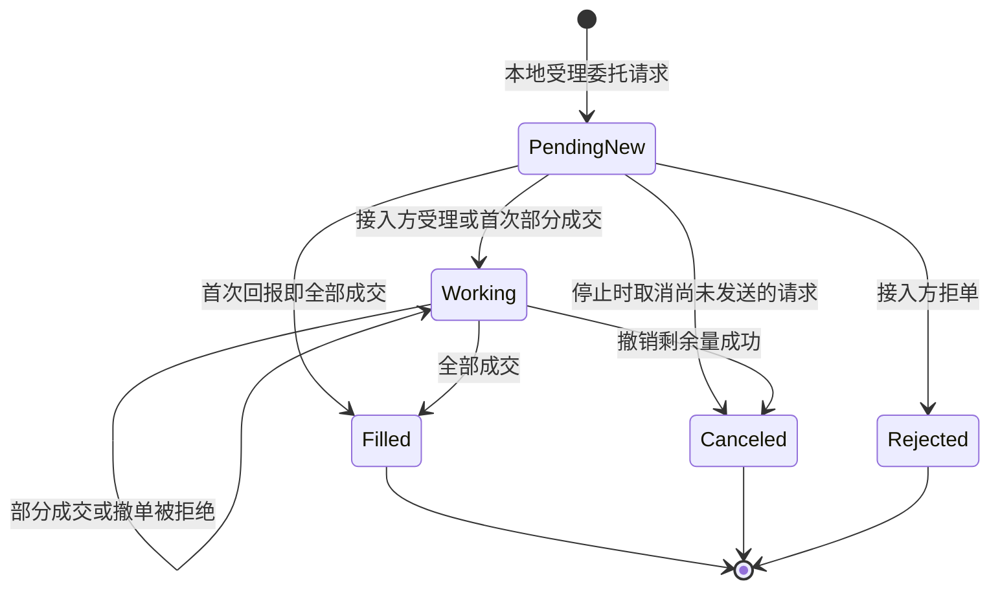

# 交易模块设计

交易模块为策略提供交易能力，并管理交易产生的业务状态。

## 功能需求

### 订单与成交管理

- **委托操作**：支持提交委托与撤单，并反馈处理结果。
- **交易结果处理**：根据回报更新订单状态和成交记录。
- **异常处理**：委托或撤单结果无法确认时，持续跟踪并通过查询或对账核实。
- **查询与通知**：提供订单与成交查询，并在相关信息变化时通知策略。

### 账户管理

- **账户状态维护**：维护账户资金状态，分别维护账户整体持仓和各策略持仓。
- **查询与通知**：提供账户状态查询和变化通知。

具体要求见[账户管理需求](#账户管理需求)。

### 交易环境支持

- **统一接入**：提供统一的交易接口，对接不同交易所。
- **交易模式**：支持真实交易和模拟交易。

### 状态持久化、恢复与对账

- **状态持久化**：保存交易状态及其变更记录，并提供历史查询。
- **自动恢复**：重启后自动恢复交易状态和处理进度，继续处理未完成的交易。
- **交易对账**：启动或柜台重连后、运行中定期及结果存疑时，核对本地记录与柜台数据并处理差异。

### 运行控制

- **请求受理控制**：支持暂停和恢复新交易请求的受理。

风控功能暂不实现。

## 关键概念

### 账户 Account

账户确定交易活动所属的资金和持仓范围。

| 概念 | 含义 |
| --- | --- |
| 系统账户 | 交易模块内部使用的账户，以 `AccountId` 标识 |
| 交易账户 | 用于真实交易的账户，由交易所、券商或期货公司管理 |
| 交易所账户 | 交易所直接管理的交易账户，属于交易账户的一种 |
| 模拟账户 | 用于模拟交易的账户，由本地模拟服务或 SimNow 等外部模拟柜台提供 |

每个系统账户与一个交易账户或模拟账户一一对应。

### 适配器 Adapter

适配器封装交易所、柜台或模拟环境的交易接口，为交易模块提供统一的接入方式。它将统一的交易请求转换为接入方的接口调用，并将接入方数据转换为规范化交易事件和账户数据。

当前版本提供以下两类适配器：

| 类型 | 接入方式 |
| --- | --- |
| 本地模拟适配器 | 接入本地模拟环境，按模拟规则生成订单回报和成交，资金与持仓由本地模拟账本计算。当前包括股票现金模拟和[本地期货模拟](domestic-futures.md) |
| SimNow 适配器 | 通过 CTP 接口连接 [SimNow 外部模拟柜台](simnow-trading.md)，由柜台提供订单回报、成交及账户资金和持仓数据 |

### 交易 Trading

交易是通过账户买卖交易标的的业务活动。订单（Order）记录买卖委托及其处理状态。提交委托用于创建订单，撤单用于请求撤销订单中尚未成交的部分。

### 成交 Fill

成交是订单实际执行形成的交易事实。一张订单可以对应多笔成交，每笔成交分别记录。

### 持仓 Position

持仓表示账户在某个交易标的上的实际持有情况。

账户持仓按归属划分：归属于具体策略的部分称为策略持仓，归属类型为 `STRATEGY`；其余持仓的归属类型为 `EXTERNAL`。

### 资金 Funds

资金表示账户的货币资源及其使用状态，按币种记录。具体字段见[账户状态内容](#账户状态内容)。

## 账户管理需求

### 账户身份与属性

`AccountId` 在系统内唯一，在账户配置中分配并固定。进程重启、连接重建或网关部署位置变化均不改变该标识；停用的标识不再分配给其他账户。

由 `trading` 库统一提供 `AccountId` 定义及账户配置加载能力，供各进程复用。

账户包含以下属性：

| 属性 | 含义 |
| --- | --- |
| 账户名称 | 便于展示和识别的可选名称，可以修改 |
| 接入方 | 账户所属的具体交易接入服务，例如某期货公司的生产柜台、SimNow 或本地模拟服务 |
| 接入方账户标识 | 在指定接入方内唯一确定账户的标识，子账户身份包含在内；本地模拟账户配置独立、稳定的模拟账户标识 |
| 账户类型 | 决定适用账务规则的账户类别，例如现金账户、期货账户 |

真实或模拟作为接入方的属性维护，同一机构的不同交易环境使用不同的接入方标识。

接入方标识与接入方账户标识共同确定对应的交易账户或模拟账户。同一账户只能对应一个 `AccountId`，同一 `AccountId` 只能绑定一个账户；映射冲突时拒绝使用该配置。更换对应的交易账户或模拟账户时，分配新的 `AccountId`。

订单、成交及账户状态通过 `AccountId` 关联账户，订单和成交同时保留可确定的策略归属。账户查询和变化通知使用同一标识，策略能够核对所连接的账户身份。

### 账户状态内容

金额的币种和计量单位随状态提供，同一币种的资金金额与持仓金额采用一致的计量单位。

#### 资金

资金按账户和币种记录。

| 字段 | 含义 |
| --- | --- |
| `account_id` | 所属系统账户 |
| `currency` | 金额币种，同一账户的不同币种分别记录 |
| `trading_day` | 已实现损益与费用统计所属的交易日 |
| `balance` | 已确认的现金余额，已反映入账收支 |
| `equity` | 计入持仓估值后的账户净资产 |
| `available` | 当前可用于新增交易的资金，已扣除尚未被柜台冻结覆盖的本地预占 |
| `broker_available` | 柜台报告的可用资金，保留柜台原值，适用于柜台管理的账户 |
| `broker_frozen` | 柜台确认的订单冻结资金，包括适用的保证金及费用冻结 |
| `local_reserved` | 本地订单仍需保留、尚未被柜台冻结覆盖的资金预占 |
| `margin` | 已有持仓占用的保证金，适用于保证金账户 |
| `realized_pnl` | 该交易日已实现的交易损益 |
| `unrealized_pnl` | 当前持仓的未实现损益 |
| `fees` | 该交易日已发生的手续费、税费等交易费用 |

#### 账户持仓

持仓按账户、标的、持仓方向和适用的持仓日期分类记录。数量和价格单位沿用标的定义。

| 字段 | 含义 |
| --- | --- |
| `account_id` | 所属系统账户 |
| `instrument_id` | 系统中明确的交易标的 |
| `position_side` | 持仓方向，按账户规则区分多头、空头或净持仓 |
| `trading_day` | 持仓状态所属的交易日，用于解释今仓和昨仓 |
| `position_date` | 持仓日期分类，适用时区分今仓和昨仓 |
| `total_qty` | 实际持有数量，包含被冻结或预占的数量 |
| `available_qty` | 当前可卖出或平仓的数量，已排除冻结、预占及交易规则限制的部分 |
| `broker_frozen_qty` | 柜台确认的订单冻结数量 |
| `local_reserved_qty` | 尚未被柜台冻结覆盖的本地订单预占数量 |
| `currency` | 持仓成本、估值及保证金等金额的计价币种 |
| `open_cost` | 当前剩余持仓的开仓成本总额 |
| `market_value` | 当前持仓市值，适用于股票等按资产市值计价的持仓 |
| `margin` | 该持仓占用的保证金，适用于保证金账户 |
| `unrealized_pnl` | 该持仓的未实现损益 |

净持仓的 `total_qty` 以正数表示多头、负数表示空头；分方向记录的 `total_qty` 为非负数。可交易、冻结和预占数量均为非负数。

支持双向持仓的账户分别保留多头和空头，净持仓为零时仍可存在实际持仓。柜台仅提供方向总冻结时，冻结保留在方向层级，不强行分摊到今仓和昨仓。

### 持仓归属

持仓归属记录按账户、标的、持仓方向和持仓日期分类记录各部分持有数量，并包含以下字段：

| 字段 | 含义 |
| --- | --- |
| `ownership_type` | 持仓归属类型，取值为 `STRATEGY` 或 `EXTERNAL`，含义见[持仓概念](#持仓-position) |
| `strategy_id` | `STRATEGY` 记录所属策略的标识；`EXTERNAL` 不填写策略标识 |
| `attribution_basis` | 初始分配、成交或归属调整的记录依据 |

策略持仓依据初始归属、所属成交和有依据的归属调整维护。多个策略交易同一标的时，各自的成交只调整相应策略的归属记录。

未明确归属到具体策略的持仓，包括初始持仓及人工交易等形成的持仓，记为 `EXTERNAL` 并保留来源依据。初始持仓不因当前只有一个在线策略就自动归入该策略。`EXTERNAL` 本身不表示数据异常，数据是否待核对单独表达。

平仓成交应减少对应的归属持仓。无法确定减少哪部分持仓时，保留成交事实并标记归属待核对，不自动扣减其他策略的持仓。

对账时同时纳入 `STRATEGY` 和 `EXTERNAL`，按账户的净额或分方向规则汇总比较。差异不能通过无依据地增减 `EXTERNAL` 持仓消除。

策略持仓表示交易归属，不代表资金额度或独占的账户交易权限。策略运行会话变化不自动清空已有持仓归属。`EXTERNAL` 与策略之间，以及策略之间的归属调整，均须保留依据；调整只改变归属记录，不改变账户整体持仓。

### 数据来源与更新

| 数据 | 来源及更新要求 |
| --- | --- |
| 柜台管理的账户状态 | 以柜台确认的数据为依据，保留其指标含义；本地推导值应与柜台值区分。真实柜台和 SimNow 等外部模拟柜台均适用 |
| 本地模拟账户状态 | 根据初始账户状态和本地账务规则计算资金与持仓变化 |

账户变化可以独立于订单和成交回报到达。资金变动、柜台账户刷新或估值变化等更新应能单独处理，不依赖某笔订单触发。

占用信息应区分柜台冻结与本地预占，同一订单的占用不能因两个来源都提供数据而重复计入。

账户快照可能已经包含尚未送达本地的成交。随后收到成交明细时，应补齐订单和持仓归属记录，避免再次把同一笔成交叠加到账户整体状态。账户数据变化也不能代替订单的最终处理结果。

每次更新应保留数据来源、本地更新时间及更新版本；来源提供业务时间或查询批次时一并保留。来源业务时间与本地处理时间分别表达，不以本地接收时间冒充业务发生时间。无法确认数据完整性或覆盖范围时，应能够识别待核对状态。

### 查询与变化通知

- 支持按账户查询资金和整体持仓，按账户与策略查询策略持仓。
- 支持按账户查询 `EXTERNAL` 持仓。
- 能够区分没有持仓、标的未知、账户尚未就绪和数据待核对等结果。
- 查询结果标识尚未取得或不适用的指标，不以零值代替。
- 账户状态和持仓归属变化均可通知策略，通知标明变化范围及更新版本。
- 发布通知时，相应更新已经可以查询；策略能够判断查询结果与通知的先后关系。
- 开始接收变化通知时，提供可衔接后续更新的初始状态，避免查询初始状态与接收通知之间遗漏变化。

同一查询范围内，同一更新版本对应同一份状态。同一批数据中的资金与持仓具有明确的来源和覆盖范围，不将尚未核对的不同批次拼接成完整账户状态。重新建立基线后，应能区分新旧更新序列，避免旧通知覆盖新状态。

### 初始化、恢复与对账

首次启动时取得账户基线，并建立持仓归属记录。尚未取得必要数据时，对外说明未就绪的范围，不发布默认零账户。

重启时自动恢复已保存的账户状态、持仓归属和处理进度，不以初始配置覆盖已保存的状态。本地模拟账户从保存状态继续运行；柜台管理的账户在恢复后核对柜台数据，补齐停机期间的变化。已计入保存状态的成交，恢复时不再增减资金或持仓。

账户对账同时核对整体状态和持仓归属。比较前需要确认计量规则及数据覆盖范围可比；账户快照领先成交明细时，先补齐相应记录，再判断是否存在真实差异。

差异应能够定位到具体账户指标、持仓或归属记录，并保存比较依据及处理进度。发现差异后不直接覆盖归属记录或虚构成交；修正须有柜台明细、归属调整等可追溯依据。

### 验收要求

| 场景 | 预期结果 |
| --- | --- |
| 同一账户重启或迁移网关 | `AccountId` 保持不变 |
| 账户状态恢复 | 重启后自动恢复资金、持仓及归属，接续处理进度，已处理成交不重复入账 |
| 账户映射冲突 | 拒绝同一 `AccountId` 绑定不同账户或同一账户绑定不同 `AccountId` 的配置 |
| 多策略交易同一标的 | 账户整体状态反映全部交易，各策略持仓按所属成交更新，查询范围明确 |
| 初始持仓或外部交易没有策略归属 | 持仓记为 `EXTERNAL`，可以查询，不自动分摊给在线策略；没有策略归属本身不构成异常 |
| 有依据调整持仓归属 | `EXTERNAL` 与策略之间或策略之间调整归属，保留依据，账户整体持仓不变 |
| 账户快照先于成交明细到达 | 明细到达后补齐订单和持仓归属记录，账户整体不重复增加或扣减 |
| 只有账户状态发生变化 | 策略仍能收到账户更新通知，并查询到对应更新 |
| 查询基线与接收通知衔接 | 初始状态之后的变化不遗漏，重复到达的更新不重复改变状态 |
| 本地与柜台数据不一致 | 在可比范围内识别差异，保留依据和处理状态，不静默改写交易事实 |

## 实现概况

策略通过 `TradingService` 使用交易模块。当前部署中，每个策略进程运行一个策略实例，通过 `yquant-tradingd` 执行交易请求；网关维护账户及订单状态并驱动适配器，策略进程保存查询视图并分发回报。多个策略可以分布在不同机器上，共享同一系统账户；各进程内部由主线程串行驱动。

当前账户通过所连接的网关实例隐式确定，尚无显式的 `AccountId`。

当前实现将交易状态保存在内存中，进程重启后重新初始化。下文的接口与运行规则描述这一实现。

股票现金模拟使用人民币现金账户，只允许足额买入和卖出现有可卖持仓。本地期货开平仓、保证金、手续费、损益及行情驱动撮合见[国内期货模拟交易](domestic-futures.md)；柜台管理的账户保留查询的资金和持仓，不由本地模拟账本重算。股票手续费与税费、融资融券及日切另行扩展。

| 需求相关能力 | 现有设计与待补充内容 |
| --- | --- |
| 交易环境 | 已接入本地模拟及 SimNow，真实柜台接入待扩展 |
| 账户管理 | 当前提供共享账户快照，策略按自身成交归集持仓；策略持仓查询与独立账户通知接口待实现 |
| 持久化与恢复 | 交易状态持久化和重启自动恢复待实现 |
| 运行控制 | 现有请求受理开关用于回调阶段和停止流程；独立的暂停、恢复受理接口待定义 |
| 对账 | SimNow 启动时查询柜台账户及持仓；独立对账流程待实现 |

订单、账户及适配器的公共业务规则在下文维护。共享部署的身份、传输、账户视图及停止协议见[共享交易网关](tradingd.md)。

行情模型与订阅规则见[行情驱动设计](market-data.md)，动态库所有权与配置初始化见[策略进程设计](strategyd.md)。

## 模块与所有权

| 对象 | 职责与所有权 |
| --- | --- |
| `StrategyContext` | 提供时间及行情、交易和定时服务的访问入口，回调期间借用 |
| `Trading` | 策略可见的交易接口，通过 `context.trading()` 访问 |
| `trading::TradingService` | 宿主使用的抽象交易服务接口，定义生命周期、请求处理与事件提交契约 |
| `trading::OrderCore` | 单笔订单的业务状态机，消费事件并产生提交委托、撤单及账务通知动作 |
| `trading::OrderRequestExecutor` | 执行提交委托和撤单命令，持有待发送队列及在途（in-flight）请求表，处理响应、超时和本地结束 |
| `trading::TradingEngine` | 网关的交易引擎，持有订单核心、请求执行器和权威账本，协调预占、索引及状态提交 |
| `trading::TradingAdapter` | 交易接入边界，提供初始账户快照、发送请求和规范化交易事件，不调用策略 |
| `trading::MockTradingAdapter` | 股票现金模拟适配器，以定时脚本生成接入方受理、成交或撤单结果，由使用方持有 |
| `trading::CtpTradingAdapter` | 连接 SimNow 交易桥，接收规范化交易事件及柜台账户快照 |
| `md::InstrumentScope` | 持有运行范围内的只读标的定义，供行情和交易独立查询 |
| `strategyd::TradingServiceImpl` | 策略侧交易服务实现，通过 TCP 访问 `tradingd`，保存本策略订单缓存和账户视图 |
| `StrategyRunner` | 驱动请求、行情、交易回报及停止排空，串行调用策略 |
| `StrategyAssembly` | 读取启动配置，持有标的范围、共享内存行情源和网关客户端 |
| `testing::MockTradingService` | 单元测试替身，记录请求并提交预设回报与账户快照，不接入柜台 |

公共交易实现使用 `yquant::trading` 命名空间，构建为 `yquant_trading`。`TradingEngine` 由网关持有，借用适配器、标的范围和时钟，其存活时间覆盖引擎。引擎不实现策略侧 `TradingService`。策略装配层持有独立的只读标的范围与 `TradingServiceImpl`，不创建引擎或适配器；服务与上下文存活时间覆盖全部回调及实例销毁。价格精度与标的身份均来自[共享标的字典](market-data.md#共享标的字典)，构建归属见[目录与模块](engineering.md#目录与模块)。

单笔订单的业务状态由 `OrderCore` 维护，委托请求与撤单请求的排队、发送和响应跟踪由 `OrderRequestExecutor` 维护；二者的输入输出及事务边界见[订单核心与请求执行](order-core.md)。

`StrategyRunner` 必须借用一个 `TradingService`。策略侧交易服务通过 `Init(config, dictionary)` 连接网关并取得账户视图，通过 `ProcessRequests(now)` 推进传输，通过 `Poll(now, dispatch, event)` 返回已经提交的回调数据。`next_deadline()` 汇总传输与本地工作的期限，`has_ready_event(now)` 单独表示可轮询事件，`is_drained()` 包含账本和传输的排空状态。具体实现选择及所有权见[组件装配](strategyd.md#组件装配)。

## 订单模型

### 标识与计量

公共类型位于 `yquant::model`：

| 类型 | 约定 |
| --- | --- |
| `StrategyOrderId` | 策略侧交易服务分配的非零 `uint64_t`，策略会话内从 1 递增且不复用；策略提交委托、撤单和查询均使用它 |
| `ClientOrderId` | 网关中的 `TradingEngine` 分配的非零 `uint64_t`，网关运行代次内单调递增且不复用 |
| `AdapterOrderId` | 适配器提供的稳定订单标识，最多 64 字节；可来自柜台原始编号或组合编码，尚未取得时为空 |
| `ExecutionId` | 适配器提供的单笔成交标识，最多 64 字节；同一订单内唯一，重复回报保持相同值 |
| `CancelRequestId` | 宿主分配的非零 `uint64_t`，区分同一订单的多次撤单尝试 |
| `OrderSide` | `Buy` 或 `Sell` |

适配器提供的订单和成交标识不能用网关订单 ID 代替，超长标识拒绝而不截断。当前内存实现中，这些标识的解释范围是本次交易接入会话；重启本地模拟适配器建立新会话，不继承上一进程的订单。共享网关通过运行代次与客户端身份区分跨进程的策略订单 ID，具体规则见[网关协议](tradingd.md#身份归属与协议)。

`StrategyOrderId` 与 `ClientOrderId` 是不同强类型，不隐式转换。策略订单使用 `(generation, client_id, strategy_order_id)` 关联，网关订单使用 `(generation, client_order_id)` 关联。两个数值字段在线路中均显式编码为 64 位小端整数；零为无效值，耗尽时报错，不回绕。网关保存策略订单 ID 到网关订单 ID 的映射，回报填入策略订单 ID 并保留网关订单 ID。

`ExecutionId` 在 SimNow 交易桥中为 `(TradingDay, ExchangeID, OrderSysID, TradeID, Direction)` 的 NUL 分隔 UTF-8 编码经 SHA-256 得到的 64 字节十六进制文本；股票现金模拟适配器为 `mock-fill-<client_order_id>-<成交序号>`，本地期货模拟适配器为 `FE-<client_order_id>-<成交序号>`。同一成交的重复回报沿用原值。

订单价格和成交价格使用 `int64_t`，按标的的 `price_decimals` 解释；委托数量和单笔成交数量使用正的 `int64_t`，股票单位为股，期货单位为手，与行情模型一致。交易请求中的标的必须存在于共享标的字典中，允许未订阅该标的行情的策略提交委托。

### 请求与快照

`OrderRequest` 包含 `instrument_id`、`side`、`limit_price`、`quantity` 和 `position_effect`。现有接口支持限价订单，价格和数量都必须大于零，并符合标的的价位及数量步长。股票的开平仓意图为 `kNone`，本地期货开平仓意图见[开平仓](domestic-futures.md#开平仓意图)；柜台管理账户的普通平仓 `kClose` 及其交易所约束见 [SimNow 报单规则](simnow-trading.md#报单成交与撤单)。

`OrderSnapshot` 是可复制、自包含的定长快照：

| 字段 | 含义 |
| --- | --- |
| `strategy_order_id` | 策略订单标识；网关账本中的记录为零，路由回报时由网关填入 |
| `client_order_id` | 网关订单标识；本地排队或网关登记订单前拒绝时为零，取得后保持不变 |
| `adapter_order_id` | 适配器提供的订单标识 |
| `instrument_id`、`side`、`limit_price`、`position_effect` | 原始订单的标的、方向、价格和开平仓意图 |
| `original_qty` | 原始订单数量，不因成交或撤单改变 |
| `cumulative_filled_qty` | 已入账的累计成交数量 |
| `leaves_qty` | 仍可能成交的数量；非终态为原始数量减累计成交量，终态为零 |
| `state` | `PendingNew`、`Working`、`Filled`、`Canceled` 或 `Rejected` |
| `cancel_pending` | 是否仍有未决撤单请求，独立于订单状态 |
| `cancel_request_id` | 最近一次本地受理的撤单尝试；尚未撤单时为零 |
| `report_sequence` | 最后接受的规范化回报序号；尚无回报时为零 |
| `receive_time_ns` | 最后接受的适配器回报的本地单调时间，与 `Now()` 同基准；尚无回报时为零，本地操作不刷新它 |

例如，原始数量为 200、成交 100 后撤单成功，快照为 `Canceled`、累计成交 100、`leaves_qty=0`；未成交的 100 股不再形成活动订单。

### 状态与撤单



部分成交仍使用 `Working`，通过数量字段表达进度。撤单本地受理后设置 `cancel_pending`，不减少 `leaves_qty`，原订单仍可能成交。该标记覆盖排队、已尝试发送、结果不确定及本地结果尚未消费的阶段；匹配的接入方回报或本地结束结果清除对应标记。撤单拒绝保留订单状态和剩余量。

`Filled`、`Canceled` 和 `Rejected` 不恢复为活动状态。全部成交时，尚未发送的撤单由执行器取消发送，并通过 `CancelNotSent` 本地结果结束该次尝试；已经尝试发送或结果不确定的撤单继续等待匹配结果或对账。两条路径均保留 `Filled`，没有未决撤单时无需等待额外结果。

## 持仓与资金账本

本节说明现有股票现金模拟账本的实现规则。账户管理的业务要求见[账户管理需求](#账户管理需求)，期货账户的保证金及按多空和今昨划分的持仓见[期货账本](domestic-futures.md#保证金与损益)。

### 初始账户与计量

网关先启动交易接入会话，读取完整的初始账户快照，再建立账本。策略宿主通过握手取得当前账户视图，成功后才加载策略，因此 `OnStart()` 可查询资金与持仓；共享账户此时可以已有其他策略的交易和预占。

`TradingAccountSnapshot` 用于本地模拟账本初始化。本节的股票现金模拟使用非负 `cash_balance` 和最多 64 项持仓。每项持仓要求标的存在于共享标的字典、标的不重复、`0 <= available_qty <= total_qty` 且 `reserved_qty=0`。未列出的字典标的初始持仓为零。初始资金和持仓来自本地模拟适配器配置，不放入策略参数。共享账户快照另用 `AccountView`，允许已经存在的预占。

公共快照位于 `yquant::model`：

| 类型及字段 | 含义与不变量 |
| --- | --- |
| `CashSnapshot.balance` | 已确认现金余额；成交改变余额，本地提交委托不改变余额 |
| `CashSnapshot.reserved` | 全部非终态买入订单的剩余限价资金预占 |
| `CashSnapshot.available` | 可用于新买单的资金，等于 `balance - reserved` |
| `PositionSnapshot.instrument_id` | 持仓标的 |
| `PositionSnapshot.total_qty` | 已确认总持仓，包括本会话买入且尚不可卖的股份 |
| `PositionSnapshot.available_qty` | 当前可用于新卖单的数量，不含已预占数量 |
| `PositionSnapshot.reserved_qty` | 全部非终态卖出订单的剩余数量预占 |

本节的股票现金模拟数量和金额均为非负 `int64_t`。持仓满足 `available_qty + reserved_qty <= total_qty`；差额为不可卖持仓。资金统一以微元计量，`1 元 = 1,000,000 微元`，不使用浮点数。价格仍使用标的原有精度：

```text
成交金额或限价金额（微元）= price * quantity * 10^(6 - price_decimals)
```

例如精度为 2、价格为 1001、数量为 200，金额为 2,002,000,000 微元，即 2,002 元。每次乘法、加法及扣减都先检查范围，不通过整数回绕或截断处理溢出。

模拟账本采用本会话买入不可卖的规则：买入成交只增加总持仓，不增加可卖数量；卖出所得立即增加可用资金。新会话的可卖数量重新由初始快照提供。账本不计算可取资金，也不执行自动日切。

### 预占与成交

网关受理时将订单、请求队列及预占一次性提交。多笔买单共用同一份可用资金，多笔卖单共用该标的的可卖数量。仅挂出的卖单不增加可用资金。策略本地排队不修改账户缓存。

| 操作或回报 | 买单 | 卖单 |
| --- | --- | --- |
| 网关受理 | 按 `限价 × 数量` 预占资金，可用资金相应减少 | 从可卖数量转入预占数量 |
| 接入方受理、撤单在途、撤单拒绝 | 保持剩余资金预占 | 保持剩余数量预占 |
| 唯一成交 | 按实际成交额扣余额，释放本笔数量对应的限价预占；总持仓增加 | 总持仓及预占数量减少，按实际成交额增加现金余额 |
| 拒单、撤单成功、发送前取消 | 释放全部剩余资金预占 | 将全部剩余数量预占退回可卖数量 |

买入成交价改善时，限价预占与实际支出的差额立即可用，剩余预占仍为 `限价 × 未成交量`。全部成交后预占归零，即使还有未决撤单请求也不再占用资源。撤单请求本地受理不释放预占，只有确认撤销剩余量才释放。

例如，初始现金 3,000 元，以 10.01 元买入 200 股，随后 100 股以 10.00 元成交，再撤销剩余 100 股：

| 阶段 | 余额（元） | 预占（元） | 可用（元） |
| --- | --- | --- | --- |
| 初始 | 3,000 | 0 | 3,000 |
| 网关受理 | 3,000 | 2,002 | 998 |
| 成交 100 股 | 2,000 | 1,001 | 999 |
| 撤销剩余量 | 2,000 | 0 | 2,000 |

卖出侧，初始总持仓与可卖数量均为 300 股，提交卖出 200 股的委托后为可卖 100、预占 200；成交 100 股后为总持仓 200、可卖 100、预占 100；撤销剩余量后为总持仓及可卖数量 200、预占 0。

发送调用失败时，请求仍可能已到达接入方；排空超时也不能证明撤单成功。这两种情况均保留订单与预占的最终已知事实，供 `OnStop()` 查询并输出诊断。关闭适配器不释放未确认的预占。

### 原子性与查询

每个新回报先校验订单状态、成交幂等、存储容量及全部账本运算，成功后一起更新订单、成交记录、持仓和资金，再执行策略回调。重复回报不重复扣款或增减持仓；协议错误、金额溢出及任一校验失败均保持整笔事件涉及的账本不变。

```cpp
bool TryGetCash(model::CashSnapshot& out) const noexcept;
bool TryGetPosition(
    model::InstrumentId id, model::PositionSnapshot& out) const noexcept;
```

接口通过 `context.trading()` 调用。账户视图尚未就绪时返回 `false`；未知标的的持仓查询也返回 `false`，失败不改变输出。账户视图就绪后，字典内无持仓的标的返回零快照。查询在 `OnStart`、运行和排空回调、`OnStop` 中均可使用，输出不借用内部存储。策略侧服务在策略销毁后释放；共享账户账本由网关继续持有，不随某个策略退出而清空。

## 策略接口

### 服务与回调

`Trading` 位于 `yquant::strategy`，关键签名如下：

```cpp
bool accepting_orders() const noexcept;

base::ErrorCode SubmitOrder(
    const model::OrderRequest& request,
    model::StrategyOrderId& out) noexcept;

base::ErrorCode CancelOrder(model::StrategyOrderId id) noexcept;

bool TryGetOrder(
    model::StrategyOrderId id, model::OrderSnapshot& out) const noexcept;
```

上下文通过交易服务访问器返回同一宿主对象：

```cpp
Trading& trading() noexcept;
const Trading& trading() const noexcept;
```

策略提供两个默认返回 `kOk` 的交易回调：

```cpp
base::ErrorCode OnOrderUpdate(
    StrategyContext& context, const model::OrderUpdate& update) noexcept;

base::ErrorCode OnFill(
    StrategyContext& context, const model::Fill& fill) noexcept;
```

`OrderUpdate` 包含当前订单快照、更新类型、关联的撤单请求 ID 和定长原因说明。更新类型包括接入方受理、拒单、成交、撤单成功、撤单拒绝、订单发送前取消及撤单未发送（`CancelNotSent`）。撤单未发送结果关联具体尝试，只结束该次撤单请求，不改写订单终态，也不重复处理成交或资源释放。

原因码使用 `int32_t`，说明文字最多 128 字节，超出时保留原因码并标记文字截断。标识和数量不使用截断处理。

`Fill` 包含网关订单 ID、策略订单 ID、适配器订单 ID、成交 ID、标的、方向、开平仓意图、成交价格、本笔成交量及本地接收时间。成交发生时间可缺省；存在时保存 UTC 时间及有效标志，不与本地单调时间混用。

服务引用和回调参数仅在当前主线程回调期间借用。查询输出和回调数据均可复制到策略自身存储，不借用柜台 SDK 的缓冲区。

### 本地受理

`SubmitOrder()` 校验生命周期、标的、方向、价格、数量和本地容量，原子地登记 `PendingNew` 订单及待发送请求。成功时填写 `out`，该 ID 立即可查询。`kOk` 表示宿主受理了请求，网关资金检查和预占仍未完成；网关检查失败、接入方受理或拒单由后续回报通知。

本地失败不登记订单、不排入请求、不修改查询视图或 `out`。必需的输出参数使用引用。参数无效或限价金额超出 `int64_t` 返回 `kInvalidArgument`，本地容量或 ID 不足返回 `kResourceExhausted`。资金或可卖持仓不足由网关作为异步拒单回送。

`CancelOrder()` 只接受 `Working` 且没有未决撤单的订单。成功时分配新的撤单请求 ID，登记请求并设置 `cancel_pending`；失败不改变订单或请求队列。未知 ID 返回 `kInvalidArgument`，待接入方受理、终态及重复撤单返回 `kInvalidState`，请求容量或 ID 耗尽返回 `kResourceExhausted`。接入方回报及本地结束结果都必须关联具体撤单尝试，迟到结果不能清除后一次撤单的标记。

提交委托和撤单只复制请求到宿主的有界队列，发送发生在当前回调返回后的主循环中。这两个接口不会在调用栈内触发 `OnOrderUpdate()` 或 `OnFill()`。

`TryGetOrder()` 复制最新本地快照；未知 ID 返回 `false` 且保持输出不变。终态订单保留到本次运行结束，不自动淘汰。

### 生命周期限制

| 阶段 | 订单查询 | 策略提交委托、撤单 |
| --- | --- | --- |
| `OnStart` | 可查询，初始为空 | 返回 `kInvalidState` |
| 正常运行的 `OnTick`、`OnOrderUpdate`、`OnFill`、`OnTimer` | 可查询 | 按本地受理规则执行 |
| 停止排空中的订单、成交回调 | 可查询排空进展 | 返回 `kInvalidState`，撤单由宿主负责 |
| `OnStop` | 可查询最终已知状态 | 返回 `kInvalidState` |

`accepting_orders()` 仅在允许策略提交委托且配置了交易接入时为 `true`，不代替参数与容量校验。策略在成交回调中准备继续提交委托时使用它判断是否进入停止阶段。

`OnStart` 可查询初始账户视图、初始化策略、声明行情订阅及登记定时器；交易请求由进入运行态后的业务回调触发。这样启动失败时仍可直接销毁实例，不会留下启动回调发出的委托请求。

`StrategyRunner` 使用 `strategy::CallbackPhase` 区分回调阶段，只在正常运行的业务回调期间通过 `SetAcceptingRequests(true)` 开放交易请求，回调结束即关闭。停止排空和启动、停止回调期间保持关闭。交易运行时只检查宿主给出的请求权限，不依赖策略回调阶段；`BeginStopping()` 会关闭请求，直至 `Reset()` 才可建立新会话。网关在完成身份、客户端状态和订单归属检查后开放单次请求入口，关闭入口后再推进发送与回报处理。

## 交易回报与订单账本

### 规范化事件

适配器向宿主提供规范化交易事件 `model::TradingEvent`。每条事件包含网关订单 ID、适配器订单 ID、逐订单的规范化回报序号 `report_sequence`、事件类型、累计成交量、本地接收时间，以及该类型需要的成交或撤单结果字段。

| 事件 | 必要内容与处理 |
| --- | --- |
| 接入方受理 | 绑定适配器订单 ID；尚待接入方受理时进入 `Working` |
| 拒单 | 原因；仅在尚无成交的 `PendingNew` 上进入 `Rejected` |
| 成交 | 唯一成交 ID、价格、本笔数量；更新累计量，进入 `Working` 或 `Filled` |
| 撤单成功 | 本地请求使用对应撤单 ID；接入方主动撤单可为零。最终累计成交量核对后，剩余量归零，进入 `Canceled` |
| 撤单拒绝 | 撤单请求 ID、原因；结束对应请求，保留原订单状态 |

规范化回报序号由适配器按订单从 1 开始连续递增，接入方的原生回报序号不直接作为规范化回报序号。第一次有效成交可以隐式确认接入方受理，允许 `PendingNew` 直接进入 `Working` 或 `Filled`；随后到达的接入方受理事件仅更新回报序号与接收时间，不重复通知，也不改变已确认的状态。接入方受理和成交事件必须提供非空适配器订单 ID。

非成交事件的累计成交量必须等于账本中的累计量；成交事件必须满足：

```text
新累计成交量 = 原累计成交量 + 本笔成交量
0 < 本笔成交量 <= 原始数量 - 原累计成交量
```

累计量用于核对，本笔唯一成交推进账本一次。适配器若先收到累计量领先的状态回报，须在有界存储中等待对应成交明细，再发布完整事件；不能先发布终态再补入迟到成交。明细缺失无法完成关联时报告接入错误。多笔成交拆成多条事件，只有最后一笔处理完才能确认相应终态。

成交价格必须为正，买入成交价不高于委托限价，卖出成交价不低于委托限价。成交的标的、方向、开平仓意图及适配器订单 ID 与原订单保持一致，价格和数量满足标的定义的步长。回报的本地接收时间不得晚于当前 `Now()`；成交发生时间缺失时清除有效标志并将值置零。

### 校验与幂等

宿主先检查 ID、字段范围和时间域，再处理逐订单的规范化回报序号：

- 旧或重复序号不入账、不回调，仍占事件批次额度；不对旧事件执行依赖当前账本的状态转换校验。
- 新序号必须等于上次序号加一，序号缺口属于协议错误，不能套用完整行情快照允许跳号的规则。
- 新成交的去重键为 `(client_order_id, execution_id)`。同一成交的重传由适配器归一为旧事件；以新序号再次发布已存在的成交 ID 属于协议错误，账本不再次增加数量。
- 适配器订单 ID 绑定后不可改变。新序号的接入方撤单结果必须关联当前未决请求 ID；柜台管理账户模式允许没有本地未决请求的主动撤单。旧序号的迟到结果按序号去重，不能改变后一次撤单的标记。
- 本地结束结果按具体请求身份幂等消费，不占用 `OrderCore` 的规范化回报序号，也不刷新最后适配器回报接收时间。其提交推进账本修订号，网关路由正常分配客户端回报序号，策略侧查询视图可以据此结清未决请求。
- 累计量倒退、超量成交、终态反转、未知订单、未知事件类型和非法时间戳均拒绝处理，保留当前账本并进入错误收尾。

### 入账与回调顺序

网关先校验事件及存储容量，再一次性提交订单状态、成交记录、请求状态和[持仓与资金变更](#预占与成交)。随后将订单更新及完整账户快照发送给所属策略。策略侧交易服务校验并更新本地查询视图后，`StrategyRunner` 先调用 `OnOrderUpdate()`，成交事件再调用 `OnFill()`；两者之间不读取下一条交易事件。

进入 `OnOrderUpdate()` 时，本地订单查询与传入快照一致。柜台账户快照来自最近完成的一批账户查询，可能领先该批中的逐笔订单回报；不能据此认定尚未收到终态回报的订单已进入终态。该回调可以登记新的本地请求，随后的 `OnFill()` 订单查询也可包含前一个回调新增的请求状态。

回调失败不回滚已经接受的交易事实。任一业务回调失败后，停止后续行情、订单和成交回调，宿主继续执行能够完成的撤单与入账；成功启动的实例最终仍调用一次 `OnStop()`。

## 适配器接入

### 宿主接入接口

适配器由 `tradingd` 创建和驱动；策略进程只持有网关客户端。下面的接口属于网关与适配器之间的边界。

`TradingAdapter` 不跨策略动态库边界，关键操作为：

```text
Prepare(config) -> Status
Start(now) -> Status
ReadAccountSnapshot(TradingAccountSnapshot& out) -> Status
ReadBrokerAccountSnapshot(BrokerAccountSnapshot& out) -> Status
OnQuote(quote, now) -> Status
SendOrder(client_order_id, request, now) -> Status
SendCancel(client_order_id, adapter_order_id, cancel_request_id, now) -> Status
Poll(now, model::TradingEvent& out) -> Event / Account / Idle / Error
next_deadline() -> optional<单调时间期限>
is_drained() -> bool
BeginStopping()
Stop() -> Status
```

全部操作由主线程串行调用。`Prepare` 分配或初始化有界存储，`Start` 完成接入初始化。本地模拟账户通过 `ReadAccountSnapshot` 取得初始账户快照；柜台管理账户模式通过 `ReadBrokerAccountSnapshot` 读取柜台账户快照，保留其实际金额、成本和冻结。发送操作复制请求，不保留输入借用；`Poll` 非阻塞，每次至多返回一条自包含事件。`Account` 表示独立账户更新，不改变事件输出；`Idle` 或错误也保持 `out` 不变。

柜台管理账户模式在提交订单事件前校验对应账户版本和运行范围，随后一起提交本地订单与柜台账户快照；不进入本地模拟 FIFO 账本。`BeginStopping` 只登记停止状态，常规轮询继续提交最终账户快照，适配器确认本次交易接入会话排空后才返回 `is_drained=true`。

`next_deadline()` 表示下一事件的期限，立即就绪时不晚于当前单调时间，无事件时为空；返回 `Idle` 时，下一期限必须为空或晚于传入该次 `Poll()` 的 `now`。`is_drained()` 只有在没有非终态订单、未决请求及待发布事件时为真。

调用发送操作前，请求执行器将请求从 `Queued` 推进到 `InFlight`，引擎记录并提交该次尝试，再由执行器调用适配器。调用失败将请求标为 `Uncertain`，保留订单及撤单的未确认事实，进入错误收尾，不自动重发或回退到 `Queued`。`Stop()` 释放接入资源，不表示撤单已确认成功。

`OnQuote` 在报价通过宿主校验、最新行情及期货估值更新后调用，早于策略 `OnTick`；它只计划交易回报，不直接调用策略。默认实现无操作，本地期货模拟适配器据此更新外部盘口及撮合。

### 股票现金模拟回报规则

股票现金模拟适配器 `MockTradingAdapter` 使用单调时间定时发布回报，成交价取委托限价，行情不参与撮合。每一步发布后，以本次 `Poll(now)` 的 `now + interval` 安排下一步；不补发一串落后于当前时间的阶段。相同期限按计划登记顺序发布，使测试结果可重复。

| 模式 | 提交委托后的事件 |
| --- | --- |
| `fill` | 一个间隔后生成接入方受理回报；再一个间隔成交 `floor(quantity / 2)`；再一个间隔成交剩余量。数量为 1 时，接入方受理后的下一个间隔直接全部成交 |
| `working` | 一个间隔后生成接入方受理回报，随后保持挂单直到撤单 |
| `reject` | 一个间隔后生成拒单回报，不产生成交 |

每张订单在 `fill` 模式最多产生两笔成交。取得撤单请求后，该适配器安排一个间隔后的撤单结果；此期限前到期的成交仍正常发布。撤单生效时若仍有剩余量，撤销剩余量并移除后续成交计划；若已经全部成交，则返回该次撤单的拒绝结果。

该适配器保存挂单、事件计划与标识，定时调度采用预分配的有界结构，不在轮询路径扩容或执行无界清扫。故障测试通过注入测试适配器制造撤单拒绝、重复回报和乱序，不将这些异常加入正常配置。

## 主循环与收尾

策略进程驱动行情和交易网关客户端；网关维护共享账户并驱动适配器。两侧通过 `Stop` / `Drained` 协调收尾，详见[网关停止协议](tradingd.md#资源与故障边界)。

### 启动与事件调度

装配层依次校验策略、行情和网关客户端配置。`StrategyRunner` 准备行情源，通过 `TradingService::Init()` 连接网关并完成身份、标的和账户视图同步，成功后才加载和初始化策略。`OnStart()` 成功后固定订阅集合并启动行情源，全部成功后才允许交易请求。配置装配阶段检查停止信号；`LoadAndStart()` 不处理退出请求，成功后由 `Run()` 在业务分派前统一检查。

主循环先处理最多 64 个客户端待发送请求，再处理一批最多 64 个行情、交易或策略定时事件。三个来源通过持久轮转位置公平调度；旧行情、重复回报和客户端发送前取消同样占事件额度。回调中新建的请求在回调返回后的下一轮发送，不递归执行。网关按客户端限制请求处理额度，并分批消费适配器回报，提交权威账本后发布事件。

客户端轮询和行情维护均不等待新数据。没有立即工作时，以行情、维护、交易客户端和排空期限的最小值等待；每批结束及等待返回后检查停止信号。账户推送可独立于本策略订单到达，策略不能用本地订单缓存重建共享账户余额。

`StrategyRunner` 在 `Run()` 中通过 `EventLoopEnvironment::CheckStop()` 接收停止请求并完成排空与释放；重复检查到停止请求不延长期限。调用方应在 `Run()` 返回后再销毁 `StrategyRunner`，析构不另建排空循环。

### 正常停止

1. 关闭策略请求入口，同步停止行情源，保留最后行情快照。
2. 客户端将尚未尝试发送的订单转换为发送前取消事件；已尝试发送的请求保持未确认事实，并向网关发送 `Stop`。
3. 网关为该客户端的非终态订单安排撤单，处理成交和撤单结果；其他客户端继续运行。撤单重试与客户端归属由网关管理。
4. 策略侧交易服务持续处理回报并更新账户视图，`StrategyRunner` 可在排空期间调用订单和成交回调，但请求入口保持关闭。
5. 所有本地请求结束、订单进入终态并收到网关 `Drained` 确认后，调用一次 `OnStop()`，销毁策略并关闭客户端。

`OnStop()` 可查询最终已知视图。关闭客户端或适配器均不等价于撤单成功；超时与断线不能把结果未确认的订单改写为已撤销。

### 错误与超时

策略业务回调失败时关闭后续业务回调，仍由网关推进撤单，客户端接收回报，最终配对 `OnStop()`。接入方拒单与撤单拒绝是正常业务结果，不直接导致进程失败。

排空截止时间从首次进入 `Stopping` 时开始，后续信号和重试不延长它。在循环入口和事件批次边界检查期限；尚未排空且到期时，保留非终态订单及仍有未决撤单请求的终态订单，记录其 ID、状态、累计成交量、剩余量及撤单尝试，输出诊断并以失败状态退出，不把超时订单伪造为已撤销。检查不抢占用户回调，回调仍须及时返回。

接入、回报协议或等待设施错误使排空无法继续时，记录未应用事件及未确认请求，完成能够安全执行的释放后失败退出。调用接入发送操作前即标记“已尝试发送”，其失败也不能走发送前取消路径。始终保留首先发生的错误，关闭成功不能覆盖它。

启动阶段禁止策略交易，因此启动失败时没有需要撤销的策略订单；交易接入启动或初始账户同步失败不调用策略，`OnStart` 成功后的行情启动失败仍须配对 `OnStop`。

## 配置与示例策略

### 网关客户端配置

`--trading-config <path>` 是策略进程的必填参数。`TradingClientConfigLoader` 只接受 TCP 网关连接、客户端身份和超时配置，拒绝适配器及初始账户字段；缺少参数返回用法错误，连接或握手失败在创建策略前退出。客户端格式见[网关配置与运行](tradingd.md#配置与运行)。

### 适配器配置

适配器配置通过公共 `trading::TradingConfigLoader` 加载，并以 `trading::ValidateTradingConfig()` 校验类型化结果。股票现金模拟适配器的配置字段如下，全部必填且拒绝未知字段：

```json
{
  "adapter": "mock",
  "mode": "fill",
  "report_interval_ms": 1,
  "shutdown_timeout_ms": 5000,
  "initial_cash": 100000000000000,
  "initial_positions": [
    {"venue": "SSE", "symbol": "600000", "total_qty": 1000, "available_qty": 800}
  ]
}
```

上例 `adapter` 为 `mock`，本地期货模拟适配器使用 `simulated_futures`，见[期货运行与配置](domestic-futures.md#运行与配置)；`mode` 为 `fill`、`working` 或 `reject`；两个时间字段均为 `1..60000` 的整数。`initial_cash` 为非负 `int64_t` 微元，上例为 1 亿元。`initial_positions` 可为空，最多 64 项；条目只接受上例中的四个字段，交易所、代码、数量及重复标的按[初始账户规则](#初始账户与计量)校验。文件读取、JSON 完整校验和字段诊断复用现有配置基础设施，配置错误在加载策略动态库前拒绝。

### 示例与预期轨迹

示例 [order_lifecycle_strategy.cc](../../examples/strategies/order_lifecycle_strategy.cc) 通过自身的[派生配置](../../examples/strategies/order_lifecycle_strategy.json)选择交易所、代码和委托数量，行情来源由宿主配置绑定。在 `OnStart` 解析标的、订阅并查询初始账户视图，在第一条有效报价中按卖一价提交一次买入限价委托，随后只观察该订单，不追加交易。[股票现金模拟配置](../../examples/tradingd/mock_trading.json)默认使用 `fill` 模式；完整运行命令见 [README](../../README.md#策略进程)。

```text
OnTick(context, tick):
    if 已提交过委托或 context.trading().accepting_orders() 为 false:
        return 成功
    if 卖侧不存在或不可交易:
        return 成功
    result = context.trading().SubmitOrder(
        买入本标的、价格 tick.ask_price、数量 config.quantity, order_id)
    if result 失败:
        return result
    保存 order_id，标记已提交
    return 成功

OnOrderUpdate(context, update):
    查询 order_id，检查快照与 update.order 一致
    查询账户，检查剩余预占与持仓已更新
    return 成功

OnFill(context, fill):
    记录本笔成交，检查查询累计量已包含该笔成交
    按实际成交额核对现金扣减和持仓增加
    return 成功
```

`fill` 模式、数量 200 时，预期正常轨迹为：

| 阶段 | 状态 | 累计成交 | 剩余量 | 回调 |
| --- | --- | --- | --- | --- |
| 本地受理 | `PendingNew` | 0 | 200 | 提交委托返回，可立即查询 |
| 接入方受理 | `Working` | 0 | 200 | `OnOrderUpdate` |
| 首笔成交 | `Working` | 100 | 100 | `OnOrderUpdate → OnFill` |
| 第二笔成交 | `Filled` | 200 | 0 | `OnOrderUpdate → OnFill` |
| 收到退出信号 | `Filled` | 200 | 0 | 排空后 `OnStop` |

订单成交后进程继续等待行情或停止信号，结束由宿主生命周期决定。

示例使用 `order_lifecycle: ready`、`order_lifecycle: submitted` 和 `order_lifecycle: working` 标记初始化、提交与接入方受理。数量 200 全部成交后输出 `order_lifecycle: terminal state=filled cumulative=200 leaves=0`，最终停止汇总为 `order_lifecycle: stopped fills=2 filled_qty=200 state=filled`。`working` 模式下，等到受理标记后停止，网关撤销挂单，最终状态为 `Canceled`。

示例还在初始化、成交和停止时输出 `order_lifecycle: account`，其中资金为微元、持仓为股；用于观测网关发布的账户变化，账户中可包含其他策略的交易。

## 容量与实现位置

持仓槽最多 64 项，与本进程运行标的上限一致。订单账本初始上限为 1024 张，唯一成交记录上限为 8192 条，待发送请求和本地待更新队列各为 256 条。存储在准备阶段建立，运行期不扩容；终态订单和成交去重记录保留至实例销毁，达到订单上限后拒绝新的委托请求。

股票现金模拟适配器在 `fill` 模式下每张订单最多产生两笔成交，成交记录容量可覆盖全部受理订单。新的事件在校验和容量检查完成前不修改账本；异常事件导致容量耗尽时保留未应用事件的诊断并进入错误收尾。ID、回报序号和时间计算均检查溢出。

| 位置 | 职责 |
| --- | --- |
| `include/yquant/model/identifiers.h` | 策略订单、网关订单、适配器订单、成交与撤单请求标识 |
| `include/yquant/model/account.h` | 资金和持仓快照 |
| `include/yquant/model/order.h` | 委托请求、订单快照与订单状态 |
| `include/yquant/model/trading_event.h` | 规范化交易事件、订单更新与成交记录 |
| `include/yquant/strategy/trading.h` | 策略交易接口 |
| `include/yquant/strategy/strategy_context.h` | 交易服务访问器 |
| `include/yquant/strategy/strategy.h` | 订单和成交回调 |
| `include/yquant/trading/trading_account.h` | 本地模拟账本初始快照与柜台账户快照 |
| `include/yquant/trading/trading_adapter.h` | 交易接入与事件轮询接口 |
| `include/yquant/trading/trading_service.h`、`trading_dispatch.h` | 统一交易服务接口与已提交事件 |
| `include/yquant/trading/trading_engine.h`、`src/trading/trading_engine.cc` | 网关交易会话、账本、预占、请求与回报处理及停止排空 |
| `tests/mock_trading_service.h` | 记录请求并按脚本提交回报的单元测试服务 |
| `include/yquant/trading/trading_limits.h` | 交易记录和请求的容量上限 |
| `include/yquant/trading/mock_trading_adapter.h`、`src/trading/mock_trading_adapter.cc` | 定时模拟回报 |
| `include/yquant/trading/trading_config.h`、`src/trading/trading_config.cc` | 网关适配器配置加载与校验 |
| `include/yquant/trading/trading_client_config.h`、`src/trading/trading_client_config.cc` | 策略网关连接配置加载与校验 |
| `src/strategyd/trading_service_impl.h/.cc` | 策略侧远端交易请求与只读账户视图 |
| `src/strategyd/strategy_runner.h/.cc` | 行情、交易和定时事件调度、停止排空与最终释放 |
| `examples/strategies/order_lifecycle_strategy.cc` | 单笔订单闭环示例及配套 JSON |
| `tests/trading/` | 公共交易配置、账本、适配器、协议及连接测试 |

公共接口签名或布局变化时更新 `kStrategyPluginAbiVersion`，宿主、示例与测试动态库统一重编译，不保留旧接口转发。

## 验证标准

| 场景 | 验收条件 |
| --- | --- |
| 初始账户 | `OnStart` 可查询初始快照和零持仓；未知、重复标的、非法数量或资金拒绝启动 |
| 资源预占 | 多笔买单共用现金、多笔卖单共用可卖量；不足或溢出时账本、队列和输出保持不变 |
| 成交入账 | 买入扣实付金额、释放价差且不增加可卖量；卖出消耗预占并增加现金；两个交易回调均可见新账本 |
| 预占释放 | 部分成交后撤单、拒单、发送前取消释放剩余；撤单拒绝、发送结果不确定及超时保持预占 |
| 本地受理 | 成功后立即可查 `PendingNew`；无同步回调；参数、阶段或容量失败保持账本、队列和输出不变 |
| 订单标识 | 策略订单 ID 和网关订单 ID 不复用；适配器订单 ID 延迟绑定且保持一致；撤单结果关联正确尝试 |
| 正常成交 | 200 股依次接入方受理、成交 100、成交 100；累计量、剩余量及双回调顺序正确 |
| 最小数量 | 数量 1 不生成零数量部分成交，直接全部成交 |
| 回调查询 | 更新回调入口的查询与参数一致；成交回调查询包含该笔成交；前一回调登记撤单后仍正确可见 |
| 拒单与撤单 | 拒单使订单进入终态；撤单在途不减少剩余量；部分成交后撤单正确保留成交量；撤单拒绝不改变原订单状态 |
| 成交竞争 | 首次成交可先于接入方受理回报；迟到的受理回报不重复通知或使订单退出终态；全部成交时，未发送的撤单请求在本地结束，已发送的撤单请求等待匹配结果；本地结束结果清除对应未决标记并通知 |
| 回报幂等 | 旧与重复事件不再入账或回调；新序号重复成交 ID、序号缺口、累计量矛盾及终态反转被拒绝 |
| 公平调度 | 行情、交易和定时来源持续就绪时轮换处理，每批合计不超过 64 个事件；重复数据占额度；请求发送与发送前取消都受处理额度限制 |
| 独立唤醒 | 行情间隔很长时，交易回报仍按自身期限推进；无立即工作时等待最早期限 |
| 正常排空 | 未发送订单超过单轮扫描额度时仍不发给适配器；待接入方受理的订单、部分成交订单及在途撤单请求均被处理；本地更新计入事件额度且清空后才调用 `OnStop` |
| 超时与错误 | 撤单拒绝后的重试有间隔，等待接入方受理和撤单结果时不空转；排空截止时间不被延长；发送调用失败不自动重发，接入错误和排空超时保留未确认状态并失败退出 |
| 回调失败 | 已确认事件不回滚；停止后续业务回调，宿主收尾，成功启动的实例仍执行一次 `OnStop` |
| 存储生命周期 | 撤单与回报不借用 SDK 缓冲区；停止回调可查询最终已知状态；ASan/UBSan 检查对象与动态库生命周期 |
| 内存活动 | 对请求登记、事件入账、查询和派发检查运行期 C++ 堆活动，预分配完成后不申请、释放或扩容 |
| 进程闭环 | 实际启动 `yquant-strategyd`，加载示例动态库并连接 `yquant-tradingd`，持续运行并在信号后排空退出；缺少交易配置时拒绝启动 |

组件测试注入时钟和规范化交易事件；主循环单元测试通过 `Run()` 驱动 `MockTradingService`；交易闭环测试实际启动 `yquant-tradingd`，进程测试加载策略动态库并通过信号控制停止，覆盖正常成交、拒单、撤单与排空。仅在协议边界注入故障，不公开宿主内部事件分派方法来适配测试。
