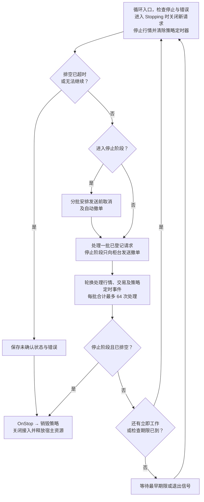

# 交易执行与账户账本

交易服务接收策略请求，处理委托与成交回报，并在提交订单和账户状态后调用策略。运行时可选择进程内模拟柜台，或连接共享 `yquant-tradingd`。

## 功能范围

每个策略进程运行一个策略实例。进程内模式使用独立模拟柜台；共享模式允许多台机器上的策略连接同一个网关，由网关管理唯一账户账本。支持买入和卖出限价委托、撤单、委托与账户查询及委托和成交回调；各进程内部由主线程串行驱动。

本文维护订单、账户和模拟柜台的公共业务规则。共享模式的身份、传输、账户视图及停止协议见[共享交易网关](tradingd.md)。当前共享网关使用股票现金账户；期货模拟由策略宿主中的 `simulated_futures` 接入提供。

股票账本使用人民币现金账户，只允许足额买入和卖出现有可卖持仓。期货开平仓、保证金、手续费、损益和行情驱动撮合见[国内期货模拟交易](domestic-futures.md)。股票手续费与税费、融资融券、日切、真实柜台接入、账户对账与重启恢复另行扩展。

行情模型与订阅规则见[行情驱动设计](market-data.md)，动态库所有权与配置初始化见[策略进程设计](strategyd.md)。本设计扩展其事件循环和收尾流程。

## 模块与所有权

| 对象 | 职责与所有权 |
| --- | --- |
| `StrategyContext` | 提供时间及行情、交易和定时服务的访问入口，回调期间借用 |
| `Trading` | 策略可见的交易接口，通过 `context.trading()` 访问 |
| `TradingImpl` | 可写的委托、持仓与资金账本、预占、成交去重记录和待发送请求，供进程内模拟运行时或共享网关使用 |
| `RemoteTrading` | 策略宿主内的远端运行时，保存本策略订单缓存和网关发布的账户视图 |
| `TradingAdapter` | 宿主内部的柜台接入边界，提供初始账户快照、发送请求和规范化回报，不调用策略 |
| `MockTradingAdapter` | 以定时脚本生成受理、成交或撤单结果，由宿主持有 |
| `SimulatedFuturesExchange` | 依据外部报价撮合期货限价单，异步发布回报 |
| `StrategyRunner` | 驱动请求、行情、交易回报及停止排空，串行调用策略 |

`TradingImpl` 使用与行情服务相同的标的定义，价格精度与标的身份只有一份来源。上下文借用行情和交易服务，服务与时钟的存活时间覆盖全部策略回调及实例销毁。

## 委托模型

### 标识与计量

公共类型位于 `yquant::model`：

| 类型 | 约定 |
| --- | --- |
| `ClientOrderId` | 宿主分配的非零 `uint64_t`，本次运行内单调递增且不复用；策略提交、撤单和查询均使用它 |
| `BrokerOrderId` | 柜台分配的不透明标识，最多 64 字节，自持数据和长度；尚未取得时为空 |
| `ExecutionId` | 柜台成交标识，最多 64 字节，自持数据和长度；在同一委托内唯一 |
| `CancelRequestId` | 宿主分配的非零 `uint64_t`，区分同一委托的多次撤单尝试 |
| `OrderSide` | `Buy` 或 `Sell` |

柜台标识不能用本地委托 ID 代替，超长标识拒绝而不截断。柜台委托和成交标识的解释范围是当前交易接入会话。每次启动模拟柜台建立新会话，不继承上一进程的订单。共享网关通过代次与客户端身份区分跨进程的本地订单号，具体规则见[网关协议](tradingd.md#身份归属与协议)。

价格使用 `int64_t`，按标的的 `price_decimals` 解释；数量使用正的 `int64_t`，股票单位为股，期货单位为手，与行情模型一致。交易请求中的标的必须存在于宿主字典中，允许未订阅该标的行情的策略提交委托。

### 请求与快照

`OrderRequest` 包含 `instrument_id`、`side`、`limit_price`、`quantity` 和 `position_effect`。提供限价单，价格和数量都必须大于零，并符合标的的价位及数量步长。股票意图为 `kNone`，期货意图见[开平仓](domestic-futures.md#开平仓意图)。

`OrderSnapshot` 是可复制、自包含的定长快照：

| 字段 | 含义 |
| --- | --- |
| `client_order_id`、`broker_order_id` | 本地与柜台的关联标识 |
| `instrument_id`、`side`、`limit_price`、`position_effect` | 原始委托的标的、方向、价格和开平意图 |
| `original_qty` | 原始委托数量，不因成交或撤单改变 |
| `cumulative_filled_qty` | 已入账的累计成交数量 |
| `leaves_qty` | 仍可能成交的数量；非终态为原始数量减累计成交量，终态为零 |
| `state` | `PendingNew`、`Working`、`Filled`、`Canceled` 或 `Rejected` |
| `cancel_pending` | 是否仍有未决撤单请求，独立于委托状态 |
| `cancel_request_id` | 最近一次本地受理的撤单尝试；尚未撤单时为零 |
| `report_sequence` | 最后接受的规范化回报序号；尚无回报时为零 |
| `receive_time_ns` | 最后接受的柜台回报的本地单调时间，与 `Now()` 同基准；尚无回报时为零，本地操作不刷新它 |

例如，原始数量为 200、成交 100 后撤单成功，快照为 `Canceled`、累计成交 100、`leaves_qty=0`；未成交的 100 股不再形成活动委托。

### 状态与撤单


部分成交仍使用 `Working`，通过数量字段表达进度。撤单本地受理后只设置 `cancel_pending`，不减少 `leaves_qty`，原委托仍可能成交。撤单拒绝清除对应在途标记，保留委托状态和剩余量。

`Filled`、`Canceled` 和 `Rejected` 不恢复为活动状态。全部成交时若仍有撤单请求未决，委托保持 `Filled`，但撤单请求继续等待结果；其拒绝回报只结束该次请求。

## 持仓与资金账本

本节描述股票现金账户；期货账户的保证金和四分持仓见[期货账本](domestic-futures.md#保证金与损益)。

### 初始账户与计量

账户账本的所有者先启动柜台会话，读取完整的初始账户快照，再建立账本。进程内模式由策略宿主完成；共享模式由网关完成，策略宿主通过握手取得当前账户视图。全部成功后才加载策略，因此 `OnStart()` 可查询资金与持仓；共享账户此时可以已有其他策略的交易和预占。

`TradingAccountSnapshot` 用于新柜台会话的账户初始化，包含非负 `cash_balance` 和最多 64 项持仓。每项持仓要求标的存在于行情字典、标的不重复、`0 <= available_qty <= total_qty` 且 `reserved_qty=0`。未列出的字典标的初始持仓为零。初始资金和持仓来自柜台配置，不放入策略参数。共享账户的远端视图另用 `AccountView`，允许已经存在的预占。

公共快照位于 `yquant::model`：

| 类型及字段 | 含义与不变量 |
| --- | --- |
| `CashSnapshot.balance` | 已确认现金余额；成交改变余额，本地下单不改变余额 |
| `CashSnapshot.reserved` | 全部未终结买单的剩余限价资金预占 |
| `CashSnapshot.available` | 可用于新买单的资金，等于 `balance - reserved` |
| `PositionSnapshot.instrument_id` | 持仓标的 |
| `PositionSnapshot.total_qty` | 已确认总持仓，包括本会话买入且尚不可卖的股份 |
| `PositionSnapshot.available_qty` | 当前可用于新卖单的数量，不含已预占数量 |
| `PositionSnapshot.reserved_qty` | 全部未终结卖单的剩余数量预占 |

所有数量和金额均为非负 `int64_t`。持仓满足 `available_qty + reserved_qty <= total_qty`；差额为不可卖持仓。资金统一以微元计量，`1 元 = 1,000,000 微元`，不使用浮点数。价格仍使用标的原有精度：

```text
成交金额或限价金额（微元）= price * quantity * 10^(6 - price_decimals)
```

例如精度为 2、价格为 1001、数量为 200，金额为 2,002,000,000 微元，即 2,002 元。每次乘法、加法及扣减都先检查范围，不通过整数回绕或截断处理溢出。

模拟账本采用本会话买入不可卖的规则：买入成交只增加总持仓，不增加可卖数量；卖出所得立即增加可用资金。新会话的可卖数量重新由初始快照提供。账本不计算可取资金，也不执行自动日切。

### 预占与成交

账户账本受理时将订单、请求队列及预占一次性提交。多笔买单共用同一份可用资金，多笔卖单共用该标的的可卖数量。仅挂出的卖单不增加可用资金。共享模式的最终受理和预占发生在网关，策略本地排队不修改账户缓存。

| 操作或回报 | 买单 | 卖单 |
| --- | --- | --- |
| 本地受理 | 按 `限价 × 数量` 预占资金，可用资金相应减少 | 从可卖数量转入预占数量 |
| 受理、撤单在途、拒撤 | 保持剩余资金预占 | 保持剩余数量预占 |
| 唯一成交 | 按实际成交额扣余额，释放本笔数量对应的限价预占；总持仓增加 | 总持仓及预占数量减少，按实际成交额增加现金余额 |
| 拒单、撤单成功、发送前取消 | 释放全部剩余资金预占 | 将全部剩余数量预占退回可卖数量 |

买入成交价改善时，限价预占与实际支出的差额立即可用，剩余预占仍为 `限价 × 未成交量`。全部成交后预占归零，即使还有未决撤单请求也不再占用资源。撤单请求本地受理不释放预占，只有确认撤销剩余量才释放。

例如，初始现金 3,000 元，以 10.01 元买入 200 股，随后 100 股以 10.00 元成交，再撤销剩余 100 股：

| 阶段 | 余额（元） | 预占（元） | 可用（元） |
| --- | --- | --- | --- |
| 初始 | 3,000 | 0 | 3,000 |
| 本地受理 | 3,000 | 2,002 | 998 |
| 成交 100 股 | 2,000 | 1,001 | 999 |
| 撤销剩余量 | 2,000 | 0 | 2,000 |

卖出侧，初始总持仓与可卖量均为 300 股，卖出 200 股后为可卖 100、预占 200；成交 100 股后为总持仓 200、可卖 100、预占 100；撤销剩余量后为总持仓及可卖量 200、预占 0。

发送失败可能已经到达柜台，排空超时也不能证明撤单成功；这两种情况保留订单与预占的最终已知事实，供 `OnStop()` 查询并输出诊断。关闭适配器不释放未确认的预占。

### 原子性与查询

每个新回报先校验订单状态、成交幂等、存储容量及全部账本运算，成功后一起提交订单、成交记录、持仓和资金，再执行策略回调。重复回报不重复扣款或增减持仓；协议错误、金额溢出及任一校验失败均保持整笔事件涉及的账本不变。

```cpp
bool TryGetCash(model::CashSnapshot& out) const noexcept;
bool TryGetPosition(
    model::InstrumentId id, model::PositionSnapshot& out) const noexcept;
```

接口通过 `context.trading()` 调用。账户未建立时返回 `false`；未知标的的持仓查询也返回 `false`，失败不改变输出。已建立账户中，字典内无持仓的标的返回零快照。查询在 `OnStart`、运行和排空回调、`OnStop` 中均可使用，输出不借用内部存储。策略侧服务在策略销毁后释放；共享账户账本由网关继续持有，不随某个策略退出而清空。

## 策略接口

### 服务与回调

`Trading` 位于 `yquant::strategy`，关键签名如下：

```cpp
bool accepting_orders() const noexcept;

base::ErrorCode SubmitOrder(
    const model::OrderRequest& request,
    model::ClientOrderId& out) noexcept;

base::ErrorCode CancelOrder(model::ClientOrderId id) noexcept;

bool TryGetOrder(
    model::ClientOrderId id, model::OrderSnapshot& out) const noexcept;
```

上下文通过交易服务访问器返回同一宿主对象：

```cpp
Trading& trading() noexcept;
const Trading& trading() const noexcept;
```

策略提供两个默认返回 `kOk` 的交易回调：

```cpp
base::ErrorCode OnOrderUpdate(
    StrategyContext& context, const model::OrderUpdate& update) noexcept;

base::ErrorCode OnFill(
    StrategyContext& context, const model::Fill& fill) noexcept;
```

`OrderUpdate` 包含当前委托快照、更新类型、关联的撤单请求 ID 和定长原因。更新类型包括受理、拒单、成交、撤单成功、撤单拒绝及发送前取消。

原因码使用 `int32_t`，说明文字最多 128 字节，超出时保留原因码并标记文字截断。标识和数量不使用截断处理。

`Fill` 包含本地委托 ID、柜台委托 ID、成交 ID、标的、方向、开平意图、成交价格、本笔成交量及本地接收时间。市场事件时间可缺省；存在时保存 UTC 时间及有效标志，不与本地单调时间混用。

服务引用和回调参数仅在当前主线程回调期间借用。查询输出和回调数据均可复制到策略自身存储，不借用柜台 SDK 的缓冲区。

### 本地受理

`SubmitOrder()` 校验生命周期、接入是否配置、标的、方向、价格、数量和本地容量，原子地登记 `PendingNew` 委托及待发送请求。成功时填写 `out`，该 ID 立即可查询。`kOk` 表示宿主接收了请求；共享模式中网关资金检查和预占仍未完成，网关或柜台的受理、拒单由后续回报通知。

本地失败不登记委托、不排入请求、不修改账本或 `out`。必需的输出参数使用引用。参数无效或限价金额超出 `int64_t` 返回 `kInvalidArgument`；本地容量或 ID 不足返回 `kResourceExhausted`；未配置交易接入返回 `kUnsupported`。进程内模式还在本地检查并同步预占股票可用资金或可卖持仓、期货开仓保证金或可平库存，不足时返回 `kResourceExhausted`；共享模式由网关统一检查，不足时返回异步拒单。

`CancelOrder()` 只接受 `Working` 且没有在途撤单的委托。成功时分配新的撤单请求 ID，登记请求并设置 `cancel_pending`；失败不改变委托或请求队列。未知 ID 返回 `kInvalidArgument`，待受理、终态及重复撤单返回 `kInvalidState`，未配置接入返回 `kUnsupported`，请求容量或 ID 耗尽返回 `kResourceExhausted`。柜台回报必须关联具体撤单尝试，迟到结果不能清除后一次撤单的标记。

下单和撤单只复制请求到宿主的有界队列，发送发生在当前回调返回后的主循环中。这两个接口不会在调用栈内触发 `OnOrderUpdate()` 或 `OnFill()`。

`TryGetOrder()` 复制最新本地快照；未知 ID 返回 `false` 且保持输出不变。已终结的委托保留到本次运行结束，不自动淘汰。

### 生命周期限制

| 阶段 | 查询委托 | 策略下单、撤单 |
| --- | --- | --- |
| `OnStart` | 可查询，初始为空 | 返回 `kInvalidState` |
| 正常运行的 `OnTick`、`OnOrderUpdate`、`OnFill`、`OnTimer` | 可查询 | 按本地受理规则执行 |
| 停止排空中的委托、成交回调 | 可查询排空进展 | 返回 `kInvalidState`，撤单由宿主负责 |
| `OnStop` | 可查询最终已知状态 | 返回 `kInvalidState` |

`accepting_orders()` 仅在允许策略发出新委托且配置了交易接入时为 `true`，不代替参数与容量校验。策略在成交回调中准备继续下单时使用它判断是否进入停止阶段。

`OnStart` 可查询初始账户、初始化策略、声明行情订阅及登记定时器；交易请求由进入运行态后的业务回调触发。这样启动失败时仍可直接销毁实例，不会留下启动回调发出的委托。

## 柜台回报与委托账本

### 规范化事件

柜台适配器向宿主提供单一的 `TradingEvent`。每条事件包含本地委托 ID、柜台委托 ID、逐委托 `report_sequence`、事件类型、累计成交量、本地接收时间，以及该类型需要的成交或撤单结果字段。

| 事件 | 必要内容与处理 |
| --- | --- |
| 受理 | 绑定柜台委托 ID；尚待受理时进入 `Working` |
| 拒单 | 原因；仅在尚无成交的 `PendingNew` 上进入 `Rejected` |
| 成交 | 唯一成交 ID、价格、本笔数量；更新累计量，进入 `Working` 或 `Filled` |
| 撤单成功 | 撤单请求 ID、最终累计成交量；剩余量归零，进入 `Canceled` |
| 撤单拒绝 | 撤单请求 ID、原因；结束对应请求，保留原委托状态 |

规范化序号由适配器按委托从 1 开始连续递增，原生回报序号不直接作为宿主序号。第一次有效成交可以隐式确认受理，允许 `PendingNew` 直接进入 `Working` 或 `Filled`；随后到达的受理事件仅更新回报序号与接收时间，不重复通知，也不改变已确认的状态。受理和成交事件必须提供非空柜台委托 ID。

非成交事件的累计成交量必须等于账本中的累计量；成交事件必须满足：

```text
新累计成交量 = 原累计成交量 + 本笔成交量
0 < 本笔成交量 <= 原始数量 - 原累计成交量
```

累计量用于核对，本笔唯一成交推进账本一次。适配器若先收到累计量领先的状态回报，须在有界存储中等待对应成交明细，再发布完整事件；不能先发布终态再补入迟到成交。明细缺失无法完成关联时报告接入错误。多笔成交拆成多条事件，只有最后一笔处理完才能确认相应终态。

成交价格必须为正，买入成交价不高于委托限价，卖出成交价不低于委托限价。成交的标的、方向、开平意图及柜台委托 ID 与原单保持一致，价格和数量满足合约步长。回报的本地接收时间不得晚于当前 `Now()`；市场事件时间缺失时清除有效标志并将值置零。

### 校验与幂等

宿主先检查 ID、字段范围和时间域，再处理逐委托序号：

- 旧或重复序号不入账、不回调，仍占事件批次额度；不对旧事件执行依赖当前账本的状态转换校验。
- 新序号必须等于上次序号加一，序号缺口属于协议错误，不能套用完整行情快照允许跳号的规则。
- 新成交的去重键为 `(client_order_id, execution_id)`。同一成交的重传由适配器归一为旧事件；以新序号再次发布已存在的成交 ID 属于协议错误，账本不再次增加数量。
- 柜台委托 ID 绑定后不可改变。新序号的撤单结果必须关联当前在途请求 ID，否则为协议错误；旧序号的迟到结果按序号去重，不能改变后一次撤单的标记。
- 累计量倒退、超量成交、终态反转、未知订单、未知事件类型和非法时间戳均拒绝处理，保留当前账本并进入错误收尾。

### 落账与回调顺序

每条事件先完成全部校验并确认存储容量，再一次性提交委托状态、成交记录、请求完成状态及[持仓与资金变更](#预占与成交)。随后按固定顺序调用 `OnOrderUpdate()`，成交事件再调用 `OnFill()`；两者之间不读取下一条柜台事件。

进入 `OnOrderUpdate()` 时，查询结果与传入的委托快照一致。该回调可以发出新的本地请求，例如登记撤单；因此随后的 `OnFill()` 查询已包含本笔成交，也可以包含前一个回调新增的本地请求状态。

回调失败不回滚已经接受的柜台事实。任一业务回调失败后，停止后续行情、委托和成交回调，宿主继续执行能够完成的撤单与入账；成功启动的实例最终仍调用一次 `OnStop()`。

## 模拟柜台

### 宿主接入接口

`TradingAdapter` 不跨策略动态库边界，关键操作为：

```text
Prepare(config) -> Status
Start(now) -> Status
ReadAccountSnapshot(TradingAccountSnapshot& out) -> Status
OnQuote(quote, now) -> Status
SendOrder(client_order_id, request, now) -> Status
SendCancel(client_order_id, broker_order_id, cancel_request_id, now) -> Status
Poll(now, TradingEvent& out) -> Event / Idle / Error
next_deadline() -> optional<单调时间期限>
is_drained() -> bool
Stop() -> Status
```

全部操作由主线程串行调用。`Prepare` 分配或初始化有界存储，`Start` 建立无历史委托的模拟会话。`ReadAccountSnapshot` 只在启动成功且尚未接收委托时调用，复制自持的初始账户；失败保持输出不变，不在轮询期重新初始化账本。发送操作复制请求，不保留输入借用；`Poll` 非阻塞，每次至多返回一条自包含事件，`Idle` 或错误保持 `out` 不变。

`next_deadline()` 表示下一事件的期限，立即就绪时不晚于当前单调时间，无事件时为空；返回 `Idle` 时，下一期限必须为空或晚于传入该次 `Poll()` 的 `now`。`is_drained()` 只有在没有活动委托、未决请求及待发布事件时为真。

调用发送操作前，宿主将请求标记为“已尝试发送”，移出待发送队列；无论返回成功还是失败，都不将同一请求自动重发。发送错误保留委托及撤单请求的未确认状态，进入错误收尾，不把它回滚成“从未发送”。`Stop()` 释放接入资源，不等价于柜台撤单。

`OnQuote` 在报价通过宿主校验、最新行情及期货估值更新后调用，早于策略 `OnTick`；它只计划交易回报，不直接调用策略。默认实现无操作，期货模拟交易所据此更新外部盘口及撮合。

### 回报生成规则

`MockTradingAdapter` 使用单调时间定时发布回报，成交价取委托限价，行情不参与撮合。每一步发布后，以本次 `Poll(now)` 的 `now + interval` 安排下一步；不补发一串落后于当前时间的阶段。相同期限按计划登记顺序发布，使测试结果可重复。

| 模式 | 下单后的事件 |
| --- | --- |
| `fill` | 一个间隔后受理；再一个间隔成交 `floor(quantity / 2)`；再一个间隔成交剩余量。数量为 1 时，受理后的下一个间隔直接全部成交 |
| `working` | 一个间隔后受理，随后保持挂单直到撤单 |
| `reject` | 一个间隔后拒绝新委托，不产生成交 |

每张订单在 `fill` 模式最多产生两笔成交。取得撤单请求后，柜台安排一个间隔后的撤单结果；此期限前到期的成交仍正常发布。撤单生效时若仍有剩余量，撤销剩余量并移除后续成交计划；若已经全部成交，则返回该次撤单的拒绝结果。

模拟柜台的挂单、事件计划与 ID 均自持存储，定时调度采用预分配的有界结构，不在轮询路径扩容或执行无界清扫。故障测试通过注入测试适配器制造拒撤、重复回报和乱序，不将这些异常塞入正常配置。

## 主循环与收尾

以下给出进程内模拟运行时的调度步骤。远端运行时保持相同策略生命周期，由网关推进已发送订单的撤单，使用 `Stop` / `Drained` 协调收尾，见[网关停止协议](tradingd.md#资源与故障边界)。

### 启动与事件调度

启动时依次校验策略、行情和交易配置，准备标的字典与两个接入。启动交易接入、读取并校验初始账户、建立交易账本后，再加载和初始化策略。`OnStart()` 成功后冻结订阅并启动行情源，全部成功才允许策略提交交易请求。各阶段边界沿用现有停止信号检查。

运行期的 `Handle(Stop)` 登记停止请求并清除策略定时器，由 `Run()` 统一推进排空与最终释放；重复请求不延长停止期限。产生委托后，调用方须等待 `Run()` 完成收尾再销毁 `StrategyRunner`，析构不另建排空事件循环。启动失败或尚未运行时没有策略委托，仍可同步释放已有资源。

主循环每轮分批安排停止撤单，处理最多 64 个已登记请求，再处理一批最多 64 个来源事件。发送及发送前取消都占请求处理额度。行情、交易和策略定时事件逐事件轮换，轮换位置跨批次保留；未就绪的来源被跳过。旧行情、重复回报与立即重新设置的定时事件也占处理额度。定时事件接口及调度契约见[策略定时事件](strategy-timer.md)。

交易侧包括柜台回报和宿主的发送前取消事件，两者就绪时也轮换处理，共用这 64 个事件额度。本地事件先登记到有界待更新队列，由同一交易派发路径落账和回调；不在停止扫描中直接执行回调。登记失败时不改变委托状态，保留扫描进度等待队列腾出空间。



请求发送不调用策略；来源事件校验、落账后才进入相应回调。当前回调新建的请求在回调返回后的下一轮发送，不递归执行。已登记的撤单即使在发送前遇到全部成交，仍须发送并取得关联结果，不能仅因委托已 `Filled` 而丢弃；模拟柜台用拒撤结束该请求。停止阶段只选择交易侧事件。

进入 `Stopping` 后，发送路径全局禁止新委托，不受撤单扫描进度影响。请求处理遇到未发送新委托时，只将它转为本地取消事件；队列暂满则保留待办，不转发到柜台。登记本地事件与移出待发送队列一次完成，每张委托只登记一次。

没有立即工作时，等待期限取行情读取、冷维护、柜台、策略定时器、自动撤单重试和排空截止时间的最小值。本地待发送、待更新队列非空或仍有尚未检查的委托槽时，立即进入下一轮；待受理、撤单在途和重试冷却中的订单不算立即工作，完成扫描后等待对应期限或回报。继续使用主线程 `pselect` 和现有退出信号协议，不增加线程。

事件批次结束后、进入等待前再次检查停止请求；等待返回后回到循环入口。每个 `Poll` 返回错误立即结束当前批次，转入相应的错误收尾。

### 正常停止

收到退出信号后进入 `Stopping`：

1. 关闭策略交易请求入口并清除定时器，停止 `OnTimer()`、行情读取和 `OnTick()`，同步停止行情源。
2. 为尚未尝试发送的新委托登记“发送前取消”事件，移除对应待发送请求，不再送入柜台。该事件沿交易侧派发路径将委托改为 `Canceled`，不占用柜台回报序号。
3. 已发送但尚待受理的委托继续等待确认或成交；有剩余量的 `Working` 委托由宿主自动撤单。在途撤单不重复发送。
4. 持续处理交易回报、更新账本并调用委托与成交回调。拒撤后至少间隔 10 ms 再自动重试，重试受统一排空截止时间约束。
5. 所有委托终结、本地请求及待更新队列为空、撤单请求全部结束且适配器 `is_drained()` 为真后，调用一次 `OnStop()`，再销毁策略、关闭交易接入并释放资源。

自动撤单分批生成，单轮最多检查 64 个委托槽；队列满时保留进度，下轮继续。完成全部待检查工作前不进入无限等待。

`OnStop()` 是最终资源释放回调，执行时交易接口只读。停止时仍到达的成交正常入账；全部成交与撤单竞争的结果以已接受的规范化回报为准。

### 错误与超时

策略业务回调失败时关闭后续业务回调，仍由宿主撤单和处理回报，最终配对 `OnStop()`。柜台拒单与拒撤是正常业务结果，不直接导致进程失败。

排空截止时间从首次进入 `Stopping` 时开始，后续信号和重试不延长它。在循环入口和事件批次边界检查期限；尚未排空且到期时，保留未确认委托的 ID、状态、累计成交量、剩余量及撤单尝试，输出诊断并以失败状态退出，不把超时订单伪造为已撤销。检查不抢占用户回调，回调仍须及时返回。

接入、回报协议或等待设施错误使排空无法继续时，记录未应用事件及未确认请求，完成能够安全执行的释放后失败退出。调用接入发送操作前即标记“已尝试发送”，其失败也不能走发送前取消路径。始终保留首先发生的错误，关闭成功不能覆盖它。

启动阶段禁止策略交易，因此启动失败时没有需要撤销的策略委托；交易接入启动或初始账户失败不调用策略，`OnStart` 成功后的行情启动失败仍须配对 `OnStop`。

## 配置与示例策略

### 宿主配置

`--trading-config <path>` 为可选参数，省略时仍提供可查询的空交易服务，允许阶段内的交易请求返回 `kUnsupported`。本阶段启用交易时还须提供行情配置，从[共享标的字典](market-data.md#共享标的字典)解析其中的运行清单，以此建立本进程可交易范围；不要求策略订阅全部可交易标的。指定交易配置却缺少行情配置路径时，按命令行用法错误退出，退出码为 2。

交易配置由宿主加载，字段如下，全部必填且拒绝未知字段：

```json
{
  "adapter": "mock",
  "mode": "fill",
  "report_interval_ms": 1,
  "shutdown_timeout_ms": 5000,
  "initial_cash": 100000000000000,
  "initial_positions": [
    {"venue": "SSE", "symbol": "600000", "total_qty": 1000, "available_qty": 800}
  ]
}
```

上例 `adapter` 为 `mock`，期货模拟使用 `simulated_futures`，见[期货运行与配置](domestic-futures.md#运行与配置)；`mode` 为 `fill`、`working` 或 `reject`；两个时间字段均为 `1..60000` 的整数。`initial_cash` 为非负 `int64_t` 微元，上例为 1 亿元。`initial_positions` 可为空，最多 64 项；条目只接受上例中的四个字段，场所、代码、数量及重复标的按[初始账户规则](#初始账户与计量)校验。文件读取、JSON 完整校验和字段诊断复用现有配置基础设施，配置错误在加载策略动态库前拒绝。远端模式选择 `adapter: "tcp"`，只配置连接身份和超时，不在策略配置中提供账户余额，见[网关客户端配置](tradingd.md#配置与运行)。

### 示例与预期轨迹

示例 [order_lifecycle_strategy.cc](../../examples/strategies/order_lifecycle_strategy.cc) 通过自身的[派生配置](../../examples/strategies/order_lifecycle_strategy.json)选择场所、代码和下单数量，行情来源由宿主配置绑定。在 `OnStart` 解析标的、订阅并查询初始账户，在第一条有效报价中按卖一价提交一次买入限价委托，随后只观察该委托，不追加交易。[模拟柜台配置](../../examples/strategies/mock_trading.json)默认使用 `fill` 模式；完整运行命令见 [README](../../README.md#策略进程)。

```text
OnTick(context, tick):
    if 已提交过委托或 context.trading().accepting_orders() 为 false:
        return 成功
    if 卖侧不存在或不可交易:
        return 成功
    result = context.trading().SubmitOrder(
        买入本标的、价格 tick.ask_price、数量 config.quantity, order_id)
    if result 失败:
        return result
    保存 order_id，标记已提交
    return 成功

OnOrderUpdate(context, update):
    查询 order_id，检查快照与 update.order 一致
    查询账户，检查剩余预占与持仓已更新
    return 成功

OnFill(context, fill):
    记录本笔成交，检查查询累计量已包含该笔成交
    按实际成交额核对现金扣减和持仓增加
    return 成功
```

`fill` 模式、数量 200 时，预期正常轨迹为：

| 阶段 | 状态 | 累计成交 | 剩余量 | 回调 |
| --- | --- | --- | --- | --- |
| 本地受理 | `PendingNew` | 0 | 200 | 下单返回，可立即查询 |
| 柜台受理 | `Working` | 0 | 200 | `OnOrderUpdate` |
| 首笔成交 | `Working` | 100 | 100 | `OnOrderUpdate → OnFill` |
| 第二笔成交 | `Filled` | 200 | 0 | `OnOrderUpdate → OnFill` |
| 收到退出信号 | `Filled` | 200 | 0 | 排空后 `OnStop` |

委托成交后进程继续等待行情或停止信号，结束由宿主生命周期决定。

示例使用 `order_lifecycle: ready`、`order_lifecycle: submitted` 和 `order_lifecycle: working` 标记初始化、提交与柜台受理。数量 200 全部成交后输出 `order_lifecycle: terminal state=filled cumulative=200 leaves=0`，最终停止汇总为 `order_lifecycle: stopped fills=2 filled_qty=200 state=filled`。`working` 模式下，等到受理标记后停止，宿主撤销挂单，最终状态为 `Canceled`。

示例还在初始化、成交和停止时输出 `order_lifecycle: account`，其中资金为微元、持仓为股；用来核对扣款、剩余预占及买入后可卖量保持不变。

## 容量与实现位置

持仓槽最多 64 项，与本进程运行标的上限一致。委托账本初始上限为 1024 张，唯一成交记录上限为 8192 条，待发送请求和本地待更新队列各为 256 条。存储在准备阶段建立，运行期不扩容；终态委托和成交去重记录保留至实例销毁，达到委托上限后拒绝新单。

股票脚本模拟单最多产生两笔成交，成交记录容量可覆盖全部受理订单。新的事件在校验和容量检查完成前不修改账本；异常事件导致容量耗尽时保留未应用事件的诊断并进入错误收尾。ID、回报序号和时间计算均检查溢出。

| 位置 | 职责 |
| --- | --- |
| `include/yquant/model/identifiers.h` | 本地委托、柜台委托、成交与撤单请求标识 |
| `include/yquant/model/account.h` | 资金和持仓快照 |
| `include/yquant/model/order.h` | 委托请求、快照与状态 |
| `include/yquant/model/trading_event.h` | 策略可见的委托更新与成交记录 |
| `include/yquant/strategy/trading.h` | 策略交易接口 |
| `include/yquant/strategy/strategy_context.h` | 交易服务访问器 |
| `include/yquant/strategy/strategy.h` | 委托和成交回调 |
| `src/strategyd/trading_account.h` | 柜台初始账户快照 |
| `src/strategyd/trading.h/.cc` | 本地请求、委托与账户账本、预占及成交幂等 |
| `src/strategyd/trading_adapter.h` | 宿主接入与规范化事件协议 |
| `src/strategyd/mock_trading_adapter.h/.cc` | 定时模拟回报 |
| `src/strategyd/futures_ledger.h/.cc` | 期货 FIFO 成本、保证金、冻结、费用与估值 |
| `src/strategyd/simulated_futures_exchange.h/.cc` | 报价驱动的期货模拟撮合 |
| `src/strategyd/trading_config.h/.cc` | 宿主交易配置加载与校验 |
| `src/strategyd/strategy_runner.h/.cc` | 事件调度、停止排空与最终释放 |
| `examples/strategies/order_lifecycle_strategy.cc` | 单笔委托闭环示例及配套 JSON |

公共接口签名或布局变化时更新 `kStrategyPluginAbiVersion`，宿主、示例与测试动态库统一重编译，不保留旧接口转发。

## 验证标准

| 场景 | 验收条件 |
| --- | --- |
| 初始账户 | `OnStart` 可查询初始快照和零持仓；未知、重复标的、非法数量或资金拒绝启动 |
| 资源预占 | 多笔买单共用现金、多笔卖单共用可卖量；不足或溢出时账本、队列和输出保持不变 |
| 成交落账 | 买入扣实付金额、释放价差且不增加可卖量；卖出消耗预占并增加现金；两个交易回调均可见新账本 |
| 预占释放 | 部分成交后撤单、拒单、发送前取消释放剩余；拒撤、发送不明及超时保持预占 |
| 本地受理 | 成功后立即可查 `PendingNew`；无同步回调；参数、阶段或容量失败保持账本、队列和输出不变 |
| 委托标识 | 本地 ID 不复用；柜台 ID 延迟绑定且保持一致；撤单结果关联正确尝试 |
| 正常成交 | 200 股依次受理、成交 100、成交 100；累计量、剩余量及双回调顺序正确 |
| 最小数量 | 数量 1 不生成零数量部分成交，直接全部成交 |
| 回调查询 | 更新回调入口的查询与参数一致；成交回调查询包含该笔成交；前一回调登记撤单后仍正确可见 |
| 拒单与撤单 | 拒单终结新委托；撤单在途不减少剩余量；部分成交后撤单正确保留成交量；拒撤不错误终结原单 |
| 成交竞争 | 首次成交可先于受理；迟到受理不重复通知或恢复终态；撤单入队后、发送前全部成交时仍完成撤单请求，不遗留在途标记 |
| 回报幂等 | 旧与重复事件不再入账或回调；新序号重复成交 ID、序号缺口、累计量矛盾及终态反转被拒绝 |
| 公平调度 | 两来源持续就绪时轮换处理，每批合计不超过 64 个事件；重复数据占额度；请求发送与发送前取消都受处理额度限制 |
| 独立唤醒 | 行情间隔很长时，交易回报仍按自身期限推进；无立即工作时等待最早期限 |
| 正常排空 | 未发送委托超过单轮扫描额度时仍不送柜台；待受理单、部分成交单及在途撤单均被处理；本地更新计入事件额度且清空后才 `OnStop` |
| 超时与错误 | 拒撤重试有间隔，等待受理和撤单时不空转；停止期限不被延长；发送失败不重发，接入错误和排空超时保留未确认状态并失败退出 |
| 回调失败 | 已确认事件不回滚；停止后续业务回调，宿主收尾，成功启动的实例仍执行一次 `OnStop` |
| 存储生命周期 | 撤单与回报不借用 SDK 缓冲区；停止回调可查询最终已知状态；ASan/UBSan 检查对象与动态库生命周期 |
| 内存活动 | 对请求登记、事件入账、查询和派发检查运行期 C++ 堆活动，预分配完成后不申请、释放或扩容 |
| 进程闭环 | 真实 `yquant-strategyd` 加载示例动态库，持续运行并在信号后退出；没有交易配置时既有示例继续通过 |

组件测试注入时钟和规范化事件；主循环测试通过 `Run()` 驱动可控接入；进程测试使用真实动态库和信号握手，覆盖正常、拒单、撤单与停止排空。仅在协议边界注入故障，不公开宿主内部事件分派方法来适配测试。
