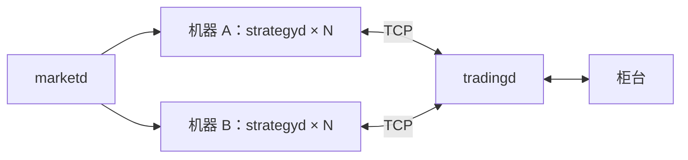

# 共享交易网关

`yquant-tradingd` 为多个策略进程提供共享的交易接入和账户账本。策略可以分布在多台机器上，网关串行执行最终资金、可卖持仓检查与预占，并将委托和成交回报发送给所属策略。

## 拓扑与职责

行情、策略与订单网关的分层参考 [Network Design Considerations for Trading Systems 的图 1(c)](https://conferences.sigcomm.org/hotnets/2024/papers/hotnets24-262.pdf#page=3)。



同机和跨机使用相同的 TCP 二进制协议。行情继续使用 [marketd 管线](marketd.md)，交易网关不订阅行情；其运行范围由行情配置声明，标的定义从配置引用的[共享标的字典](market-data.md#共享标的字典)载入。每个实例管理一个账户和一个柜台会话，当前柜台适配器为模拟实现。多个账户通过多个网关实例部署；同一真实账户不能由互不协调的网关分别预占完整余额。

| 组件 | 职责 |
| --- | --- |
| `tradingd::Server` | 网关程序专用的身份握手、请求归属、共享账户受理、柜台驱动、回报路由、断线撤单与排空 |
| `md::InstrumentScope` | 网关持有的运行标的范围，供握手校验及交易账本查询 |
| `trading::TradingImpl` | 网关唯一可写的委托、成交、资金和持仓账本，复用公共整数计算与事件校验 |
| `trading::Connection` | 两端共用的有界非阻塞 TCP 收发、帧完整性、逐方向连续序号及背压 |
| `trading::TradingRuntime` | 本机账本与策略侧远端服务共用的生命周期边界 |
| `strategyd::RemoteTrading` | 策略程序专用的交易服务，维护本策略委托缓存和共享账户只读快照 |

各进程内部串行驱动交易，不在策略回调栈内处理远端回报。策略通过 `context.trading()` 访问公共 [Trading 接口](../../include/yquant/strategy/trading.h)，进程内与共享模式复用该接口。本机模拟模式保留原行为。

网关与策略客户端通过公共 `yquant::trading` 库复用账本、配置、模拟柜台、协议和连接。网关自行持有 `md::InstrumentScope` 并提供给账本，客户端借用策略宿主的标的范围；公共交易代码不依赖 `strategyd::MarketDataImpl`。协议定义与编解码位于 `include/yquant/trading/protocol.h`、`src/trading/protocol.cc`，连接位于 `include/yquant/trading/connection.h`、`src/trading/connection.cc`。`src/tradingd/` 仅保留网关配置、服务器及入口，`RemoteTrading` 保留在 `src/strategyd/`；构建归属见[目录与模块](engineering.md#目录与模块)。

## 账户与事件一致性

`tradingd` 对所有客户端使用同一份可用资金和可卖数量。受理、预占、发送、成交入账及释放规则沿用[交易账本设计](trading.md)。两个客户端即使都看到足够余额，最终仍按网关接收顺序检查，不能同时占用同一份资源。

远端 `SubmitOrder()` 成功表示本地登记 `PendingNew` 并排队，不代表网关风控通过，不同步修改账户缓存。网关资金、持仓或容量不足时返回委托拒绝事件。返回本地错误时，订单号、请求队列及输出参数保持不变。`CancelOrder()` 只登记本地撤单意图，成交仍可能先于撤单结果到达。

账户视图包含修订号、现金和最多 64 个非零持仓。未列出的已配置品种为零持仓。网关在账户变更后发布完整视图；每条订单更新同时携带与该事件一致的完整账户视图。客户端先校验并一起提交订单、成交和账户，再进入 `OnOrderUpdate()` 与 `OnFill()`，不在两次回调间读取另一条远端事件。

账户查询返回整个共享账户的最近已接收状态，包含其他策略的交易；它可能落后于尚未到达的请求和回报。修订号不能回退，相同修订号必须对应相同内容。策略需要按自身归属计算持仓时，应根据自己的成交回报维护视图，不能把全账户持仓当作本策略仓位。

## 身份、归属与协议

每次网关启动生成非零随机 `generation`。双方在握手前从共享字典解析各自运行清单。首次 `Hello` 使用代次零，携带非零 `client_id`、令牌与客户端运行标的及价格精度；服务器校验标的属于网关运行范围且精度一致后，通过 `Welcome` 返回代次、字典确认和当前账户。初始化握手完成后才允许策略启动。

`client_id` 在一个网关代次内唯一，断开后保留身份和订单归属，禁止重新登录复用。本地订单号在每个策略会话内从 1 递增，网关映射为自身全局订单号；因此不同策略的订单 1 不会冲突。客户端只能提交和撤销本会话的订单。成交和委托回报只路由给订单所属客户端，账户视图可以广播。

策略撤单请求使用非零客户端撤单号，结果返回同一标识。网关因停止或断线发起的自动撤单使用客户端撤单号零；这类事件不会伪装成策略发出的撤单。

帧采用显式小端编码，不传输 C++ 结构体布局。固定 32 字节头包含 magic、版本、类型、总长、零保留字段、代次与序号，最大帧长 4096 字节。每个方向独立从 1 连续递增；序号缺口、非法长度、保留字段、枚举或账户不变量均终止该连接。初始化之后的消息必须属于欢迎时的代次。

| 消息 | 语义 |
| --- | --- |
| `Hello` / `Welcome` | 验证客户端、字典与网关代次，建立初始账户视图 |
| `NewOrder` / `CancelOrder` | 带客户端本地标识的交易请求 |
| `OrderUpdate` | 委托快照、可选唯一成交及同一提交点的账户视图 |
| `Account` | 完整共享账户快照 |
| `Stop` / `Drained` | 关闭该客户端请求入口，等待所属委托及撤单结束 |
| `Heartbeat` | 空闲连接活性检测 |
| `Error` | 协议定义的显式错误结果 |

`receive_time_ns` 在每个接收进程用本地 `base::MonotonicClock` 重新赋值，时钟域遵循[公共进程基础设施](engineering.md#进程基础设施)约定。报价、订单和成交的业务事件时间仍使用各自模型约定。

## 资源与故障边界

连接初始化时预分配 64 帧发送队列；交易请求、编码和已建立连接的收发路径不动态扩容。TCP 启用 `TCP_NODELAY`，每轮对客户请求、柜台回报和自动撤单使用固定预算。连接建立和配置解析属于冷路径。

发送队列不能覆盖旧数据。单个客户端过慢、心跳超时、格式错误或断流时，关闭该连接并取消其仍活动的订单，其他客户端继续运行。预占只有在确认撤单、拒单或成交后改变，断开套接字本身不释放预占。网关保留断线订单的映射，继续处理迟到回报。

每实例全局最多保留 1024 笔已受理订单和 8192 笔成交；每客户端本地订单号最多 1024。终态订单在代次结束前保留，不复用身份或存储槽。客户端身份总数受 `max_clients` 限制，断开后的身份也计入这一上限。

客户端收到停止信号后，取消本地尚未尝试发送的新请求，向服务器发送 `Stop`，继续处理回报。只有接收 `Drained` 且本地委托与回调排空后才正常退出。停止一个策略不影响其他策略的订单。

网关收到 SIGINT 或 SIGTERM 后停止接入和新委托，撤销所有客户的活动订单，并在统一截止时间内处理回报与发送队列。`Drained` 只确认客户端发出的 `Stop`；仍在运行的策略收到最后回报及随后断流后，按上游停止失败退出。超时返回失败并保留未确认订单诊断，不将不确定状态改为已撤销。

策略遇到网关丢失、代次变化或协议错误时停止，不自动重连和重发不确定请求。模拟柜台及账本随网关进程结束；新网关会话从配置快照初始化。真实柜台的持久化、启动对账和故障切换需要在柜台适配器及恢复流程中实现，不能通过自动重发旧请求代替。

## 配置与运行

网关配置通过 `base::JsonConfigDocument` 遵循[通用 JSON 输入规则](engineering.md#json-配置文档)，网关加载器校验监听地址、客户端限制及引用配置的组合约束，诊断使用 `base::ConfigError`。示例见 [local.json](../../examples/tradingd/local.json)：

```json
{
  "listen": {"address": "127.0.0.1", "port": 19200},
  "market_data_config": "examples/strategies/market_data.json",
  "trading_config": "examples/strategies/mock_trading.json",
  "token": "yquant-local-demo",
  "max_clients": 16,
  "heartbeat_timeout_ms": 5000,
  "shutdown_timeout_ms": 5000
}
```

两个引用配置分别由 `md::MarketDataConfigLoader` 和 `trading::TradingConfigLoader` 解析，路径遵循[路径解析约定](../../README.md#路径解析)。柜台配置只能选择 `adapter: "mock"`；行情配置引用共享标的字典并声明网关运行范围，不启动行情源。`max_clients` 为 1 至 16，超时范围为 1000 至 60000 ms。JSON 监听端口为 1 至 65535，类型化组件接口支持端口零供测试。

客户端配置见 [client_1.json](../../examples/tradingd/client_1.json) 与 [client_2.json](../../examples/tradingd/client_2.json)：

```json
{
  "adapter": "tcp", "address": "127.0.0.1", "port": 19200,
  "client_id": 1, "token": "yquant-local-demo",
  "connect_timeout_ms": 5000, "heartbeat_timeout_ms": 5000,
  "shutdown_timeout_ms": 5000
}
```

令牌必须与服务端匹配，连接内使用明文 TCP，示例用于受控内网。跨机部署将监听地址与客户端目标地址改成实际数字 IPv4 地址；每个策略配置不同 `client_id`。客户端宿主只需声明本策略使用的运行标的子集，从与网关一致的共享字典读取定义；策略参数选择场所、代码、方向和数量，行情来源由宿主绑定。客户端时长范围为 1 至 60000 ms；TCP 建连和等待欢迎两个初始化阶段分别受 `connect_timeout_ms` 约束。

启动网关：

```sh
./build/debug/bin/yquant-tradingd --config ./build/debug/tradingd/local.json
```

在另外两个终端分别启动策略，第二个将 `client_1.json` 换成 `client_2.json`：

```sh
./build/debug/bin/yquant-strategyd \
  --strategy ./build/debug/strategies/shared_account_strategy.so \
  --config ./build/debug/strategies/shared_account_strategy.json \
  --market-data-config ./build/debug/strategies/market_data.json \
  --trading-config ./build/debug/tradingd/client_1.json
```

示例每个策略提交一笔订单，打印自身委托状态和全账户余额，不假设账户只由自己交易。行情源也可以换成 `marketd` 的共享内存流，交易配置保持不变。`yquant-tradingd --check-config --config ...` 仅校验配置，不绑定端口或建立柜台会话。

## 验证

- 协议测试检查字段往返、截断、错误版本、保留字段、账户不变量和失败输出不变。
- 传输测试检查碎片帧、连续帧、队列满、序号缺口、EOF 及部分发送。
- 服务测试检查共享资金和可卖持仓争用、订单归属、拒单、撤单竞争、断线隔离及排空。
- 进程测试启动一个网关与多个真实策略进程，验证共享账户成交、断线撤单释放预占、身份拒绝及网关故障。
