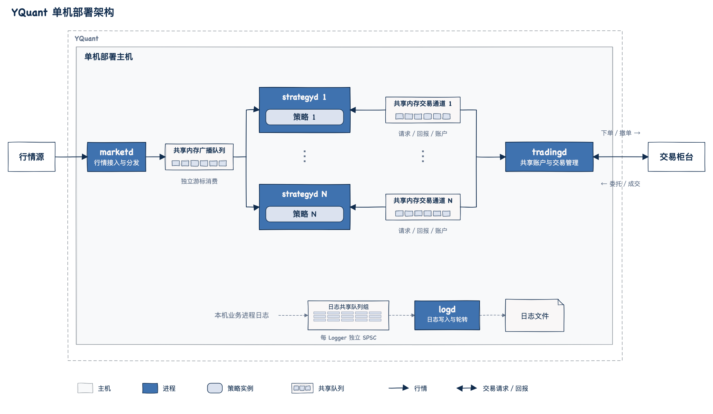
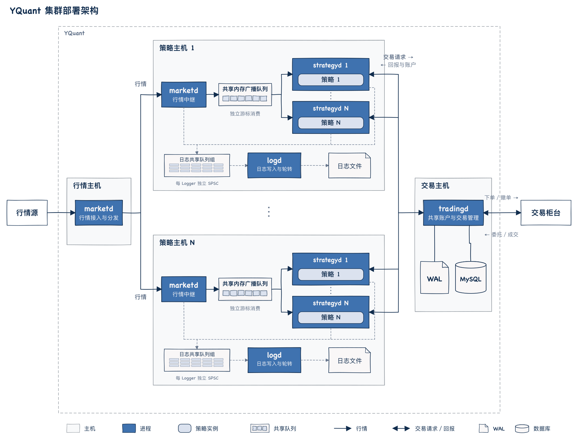

# YQuant 项目介绍

YQuant 是一个支持多策略运行的低延迟量化交易系统，使用 C++ 开发。

为支持多个策略稳定、高效地同时运行，系统提供以下能力：

- **策略隔离**：每个策略在独立进程中执行，可在部署时绑定独立的 CPU 核心，减少策略之间的调度干扰和故障传播，提升延迟稳定性与运行可靠性。
- **集群扩展**：策略可分布到集群中的多台机器上，共享行情与交易服务，通过增加节点扩展策略运行规模。
- **高效通信**：提供独立的行情、交易进程服务。单机进程间通过共享内存与无锁数据结构实现高吞吐、低延迟通信；跨机进程间目前使用 TCP，后续将采用基于 UDP 的协议与 Kernel Bypass 技术进一步降低通信延迟。

## 系统架构

### 进程类型及功能

系统由行情、策略、交易和日志四类进程组成。策略通过独立进程运行，行情、交易与日志服务供多个策略复用。

| 进程 | 功能 |
| --- | --- |
| `yquant-marketd` | 接入行情并转换为统一的行情数据格式，支持共享内存分发、跨机转发和行情录制；通过配置承担行情接入或本机中继的角色。 |
| `yquant-strategyd` | 加载一个策略动态库，管理策略生命周期，串行驱动行情、交易回报及定时回调；维护策略状态、行情快照和本策略订单缓存。 |
| `yquant-tradingd` | 管理一个共享账户和一个柜台会话，处理交易请求与订单归属，向所属策略发送回报和共享账户快照；支持本地模拟账户及 SimNow 模拟柜台账户。 |
| `yquant-logd` | 接收同机业务进程通过共享内存 SPSC 队列发送的日志，批量写入、轮转并同步日志文件，支持消费多个独立日志通道。 |

### 单机部署拓扑

一个 `marketd`、多个 `strategyd`、一个 `tradingd` 和一个 `logd` 部署在同一台主机上，行情分发与策略到交易服务的通信均通过本机共享内存完成。

| 组件 | 在单机部署中的作用 |
| --- | --- |
| 行情源 | 系统外部的行情数据接口，例如交易所行情接口、券商行情 API 或第三方行情数据服务。 |
| `marketd` | 接入行情，将标准化后的行情数据写入本机共享内存广播队列。 |
| 共享内存广播队列 | 保存一份行情流，多个策略进程以独立游标消费；发布端不等待最慢的策略。 |
| 多个 `strategyd` | 每个进程运行一个策略，独立处理行情与交易事件，并通过各自的交易通道提交请求。 |
| 共享内存交易通道 | 连接单个策略进程与 `tradingd`，传递下单、撤单、委托与成交回报及账户更新；图中每个通道合并表示请求队列和回报队列。 |
| `tradingd` | 汇总各策略的交易请求，管理共享账户和委托归属，并将柜台回报分别交付给订单所属策略。 |
| WAL | 保存交易日志，配合本地检查点恢复交易状态。 |
| MySQL | 保存交易历史与查询数据。 |
| 日志共享队列组 | 汇总表示各 Logger 独立的共享内存 SPSC 队列，由业务进程非阻塞写入，交给 `logd` 消费。 |
| `logd` | 消费本机日志队列，将日志写入文件并管理轮转。 |
| 日志文件 | 保存本机业务进程的诊断日志。 |
| 交易柜台 | 接收网关发送的交易请求，返回委托状态与成交结果。 |

单机部署复用同一组行情、交易与日志服务，增加策略时启动新的策略进程及对应交易和日志通道。策略的行情消费进度相互独立，策略状态保留在各自进程内。图中将本机业务进程的日志汇总为一个入口，连接日志队列组、`logd` 和日志文件。

图例与绘图规范见[架构图制作与维护](architecture-diagrams.md)。

### 多机部署拓扑

行情接入、策略执行和交易服务分别部署在不同主机上，策略进程可分布到多台策略主机。

行情主机上的 `marketd` 集中接入外部行情，跨机转发到各策略主机。每台策略主机新增一个中继 `marketd`，将接收的行情写入本机共享内存广播队列，供本机策略消费。

策略进程通过 TCP 连接独立交易主机上的 `tradingd`，提交交易请求并接收回报。WAL 和 MySQL 随交易服务部署在交易主机上。

日志服务在各自主机内汇集和落盘，集群图仅在策略主机中展开日志队列组、`logd` 和日志文件，行情与交易主机省略同类图元。

扩展策略运行规模时，可以增加策略主机，复用已有行情接入和交易服务。各策略主机独立维护本机行情广播队列，承载分配到该主机的策略进程。

## 技术设计

### 单写多读的共享内存行情广播

实现固定槽位的共享内存环形缓冲区，由单个发布者写入，多个策略进程独立读取。每条行情只向共享区发布一次，各读者通过私有游标顺序消费，避免发布端为每个策略分别复制和排队。

共享载荷使用固定宽度的原子单元，通过 seqlock 标记验证读取期间是否发生覆盖，成功读取后交付本地一致副本。协议同时校验布局版本、原子 ABI 和发布代次，处理不同映射地址及发布者重启。

读者落后导致槽位被覆盖时，组件显式报告缺口，策略宿主停止后续行情交付并进入收尾。发布端继续推进，其他策略保持独立消费。

详细设计见[共享内存行情广播组件](design/shared-memory-broadcast.md)。

### 单线程事件循环与有界调度

每个策略进程在主线程串行处理行情、交易回报和策略定时事件，更新内部状态后再调用策略回调。策略无需为回调之间的并发访问加锁，下单、撤单和设置定时器也不会在当前调用栈中触发事件回调。

事件循环按固定预算推进：每轮最多处理 64 个已登记交易请求；行情、交易回报和策略定时事件按持久轮转位置，共享每批最多 64 次处理额度。重复或过期事件、立即重新设置的定时事件同样占用额度，避免单个持续就绪的来源阻塞其他来源或停止检查。定时器在没有新行情时也能驱动过期撤单与失败重试。

策略停止时，宿主关闭新请求、停止行情并清除定时器。共享模式通过网关停止协议撤销本客户端委托并处理回报，正常退出须等待网关确认及本地回调排空；停止一个策略不影响其他策略的委托。

详细设计见[策略进程与动态策略加载](design/strategyd.md)、[策略定时事件](design/strategy-timer.md)和[共享交易网关](design/tradingd.md)。

### 关键路径的内存与 I/O 控制

行情字典、订阅、快照及交易账本采用固定容量存储，在初始化时准备资源，运行中复用订单、请求和回报空间。网关在通信通道初始化时预分配有界缓冲，运行期交易处理不动态扩容；跨机 TCP 通道使用非阻塞收发并启用 `TCP_NODELAY`，每轮请求、柜台回报及自动撤单均受固定预算约束。共享内存发现、健康检查等维护工作放在控制周期执行。

实现变长消息 SPSC 队列，为单生产者与单消费者提供直接借用队列存储的读写接口。日志支持通过共享内存 SPSC 队列交由独立 `logd` 写盘，行情录制通过预分配队列交由后台线程写盘，前台不等待磁盘完成。日志队列满时丢弃诊断日志并计数；行情录制队列满时报告错误并终止管线，避免静默丢失需要完整保存的数据。

详细设计见[SPSC 队列](design/spsc-queue.md)、[日志组件](design/logging.md)和[行情回放与录制](design/market-data-replay.md)。

### 多策略共享账户与订单归属

共享网关对所有客户端使用同一份账户视图。本地模拟模式由网关串行执行检查与预占，避免多个策略重复使用同一份资金或持仓；SimNow 模式使用柜台查询的资金、持仓和冻结口径，资源检查由柜台完成。客户端本地下单成功只表示请求入队，拒绝通过异步委托回报通知策略。

网关将客户端身份及本地订单号映射到全局订单号，客户端只能操作本会话订单，委托与成交回报只发给所属策略。每条订单更新携带同一提交点的完整账户视图，客户端一起提交订单、成交和账户缓存后再调用策略，保证回调查询与当前事件一致。共享账户快照包含其他策略的交易，策略自身持仓须按自身成交归属维护。

交易账本校验回报序号、成交标识、累计数量与状态转换，重复回报不重复入账。客户端断线后，网关保留订单归属并撤销其活动委托，只有确认撤单、拒单或成交后才更新预占，断开连接本身不释放资金与持仓。客户端遇到网关丢失或代次变化时停止，不自动重发结果不确定的请求。

网关支持本地模拟柜台和通过 CTP 交易桥接入的 SimNow 模拟柜台。SimNow 的 `CFFEX/TF2612` 单合约接入已完成个人账户上的报撤单、双向开平及独立账户核对，见[SimNow 模拟柜台接入](design/simnow-trading.md#柜台验收)。

本地现金模拟账户通过 mmap WAL 和检查点持久化与恢复交易状态，并可由后台线程将交易历史与查询投影异步归档至 MySQL；期货模式尚不支持网关日志恢复。详细设计见[交易模块设计](design/trading.md)、[共享交易网关](design/tradingd.md)、[交易网关持久化与恢复](design/tradingd-persistence.md)和[交易历史 MySQL 存储](design/tradingd-mysql.md)。

## 验证与工程实现

项目采用 CMake 管理构建，以 Linux x86_64 为生产目标平台，支持 macOS 本机构建与调试。项目代码及依赖关闭 C++ 异常，通过显式状态返回错误，并配置 Debug、Release、ASan/UBSan 和 TSan 构建方案。

仓库中的验证覆盖以下关键场景：

- **多进程运行**：一个行情进程向两个策略进程广播、TCP 行情中继，以及一个交易网关与多个策略进程共享账户成交。
- **并发协议与故障处理**：多读者消费、并发覆盖、一致性校验、覆盖缺口、发布者重启和慢 TCP 客户端隔离。
- **共享交易一致性**：多客户端资金与可卖持仓争用、相同本地订单号的归属隔离、账户修订一致性，以及断线撤单与预占释放。
- **策略与模拟交易闭环**：股票有底仓双边报价、期货开平仓与保证金账本、行情驱动撮合、定时撤单与重试，以及停止时的撤单排空。期货示例回放 744 条真实历史报价，模拟成交并输出账户结果。
- **CTP 接入与柜台协议**：真实期货行情采集、录制与同源回放，使用受控 SDK 的协议与故障进程测试，以及 SimNow 模拟柜台上的报撤单、双向开平和独立账户核对。
- **关键路径内存活动**：在初始化和建连完成后，对行情读取与派发、交易请求与账本更新、网关收发和日志写入等路径统计 C++ 分配和释放调用，检查首次使用及持续运行时的内存行为。
- **历史数据完整性**：使用包含 367,171 条快照的真实历史 CSV，经过独立进程录制并再次回放，逐条比较报价内容。

低延迟能力目前体现为上述架构与关键路径实现。端到端延迟的 P99、P99.9 及多策略扩展时的 CPU 开销，尚待在固定硬件和负载条件下建立基准。

构建与运行方式见[项目 README](../README.md)，组件契约见各设计文档。
